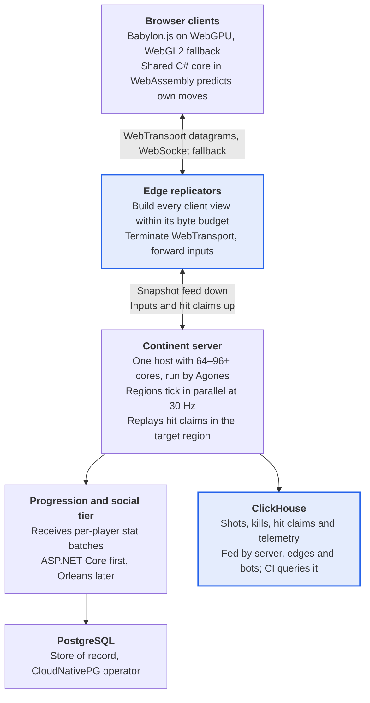
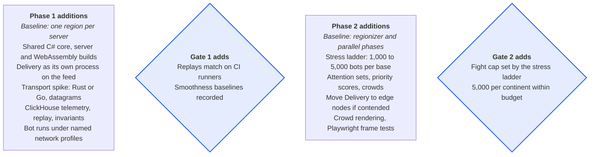

# PS2-Style MMOFPS — Architecture Recommendations

Oct 1, 2026 · @Nicholas Bonilla

## Overview

Keep the baseline architecture, raise the continent target to 5,000 players, and move per-client replication onto a new edge tier. This spec amends the PS2-Style MMOFPS Server Architecture Spec of Sep 30, 2026, and each section names the baseline section it changes.

Two principles drive every change:

- **Distribute replication, not simulation.** One host still simulates a whole continent; edge servers build and send each client's view.
- **Cost per player must not grow with fight size.** Every per-client cost is capped, so totals grow linearly and can spread across machines.

The spec adds three components: an edge replication tier, a shared simulation core run by server and client, and a ClickHouse telemetry store that powers automated tests. It closes three of the baseline's open questions, partly answers a fourth and records four new decisions. It also keeps a path to 100k-player fights without building it.

## Goals and non-goals

The continent target rises from 2,000 to 5,000 players, and the largest single fight is capped by measurement, not assumed. Changes to the baseline's goals:

- Up to 5,000 concurrent players per continent, spread across several fights.
- A maximum fight size set by the stress ladder in Testing and validation. 5,000 players in one fight is a research target.
- Per-client cost that stays flat as fights grow.
- Identical prediction code on client and server, so corrections stay small.
- Smoothness and collision correctness asserted automatically in CI.
- A preserved path to multi-host continents and 100k-player fights.

Non-goals, unchanged or added:

- Splitting one fight across machines at 5,000 players. One fight's simulation fits on one host (see the capacity model).
- GPU compute in the authoritative simulation.
- Splitting the simulation into services by function.
- Building for 100k-player fights now. Only the path is preserved.

## Reference points and capacity model

The largest shooter fight on record is about 1,300 players, so the fight cap must come from measurement, not precedent. Larger counts come from EVE at reduced game speed or from tech demos.

| Reference | Players | What was counted |
| --- | --- | --- |
| [EVE Online, Fury at FWST-8](https://www.eveonline.com/news/view/two-guinness-world-records-titles-broken) (Oct 2020) | 6,557 | Peak concurrent participants, a Guinness record; 8,825 took part over 14 hours |
| [EVE Online, Battle for 6VDT-H](https://www.eveonline.com/news/view/battle-for-6vdt-h) (Jul 2013) | 4,070 | Peak pilots in one system; game time ran at 1/10 speed for most of the battle |
| [Improbable Morpheus](https://improbable.io/blog/an-improbable-story-accelerating-into-the-metaverse-and-what-comes-next) (2021 tests) | 4,000+ | Live players in a public test; the vendor claims 10,000+ in one space |
| [PlanetSide 2](https://en.wikipedia.org/wiki/PlanetSide_2) (2020) | 1,283 | One battle, unofficial; a 2022 continent peaked at 1,530 before a server crash |
| [Star Citizen server meshing](https://starcitizen.tools/Server_meshing) (Dec 2024) | 500 | Players per shard at launch, spread across many servers |

### Capacity at 5,000 players

These estimates scale the baseline's figure of 11–33 ms of work per 1,000 players per tick. Bandwidth uses the per-client budget in Assumptions and constraints. The Phase 1 sweep replaces every row with measurements.

| Work | Estimate | Runs on |
| --- | --- | --- |
| Simulating one 5,000-player fight | 55–165 ms per tick single-threaded; about 7–20 ms on \~12 cores with parallel phases | Continent host |
| Fight hot state, pose history included | Tens of MB, resident in CPU cache | Continent host |
| View building, encoding and QUIC | 5–10 cores | Edge tier |
| Downstream bandwidth | About 2.3 Gbit/s, roughly 1 TB per hour | Edge tier |
| Hit validation | A small fraction of the cost of sweeping every projectile | Region that owns the target |

## Assumptions and constraints

These rows replace the matching rows in the baseline; rows not listed are unchanged.

| Area | Baseline | Revised |
| --- | --- | --- |
| Continent size | Up to 2,000 concurrent players | Up to 5,000, spread across several fights |
| Largest fight | Open question | Capped at the highest step the stress ladder passes |
| Host | One continent per host, at least 16 physical cores | One continent per dedicated single-socket host with 64–96+ cores |
| Client | TypeScript in the browser | TypeScript and Babylon.js on WebGPU with a WebGL2 fallback; shared C# core in WebAssembly |
| Transport | WebSocket or WebTransport, open | WebTransport datagrams with a WebSocket fallback |
| Hit detection | Open | Client-claimed hits, replayed by the server |
| Per-client budget | A per-tick byte budget | About 58 KB/s to start, from the baseline's dense-fight table; tuned in tests |
| Event storage | None | ClickHouse |
| Licensing | MIT or Apache 2.0 only | Permissive licenses (MIT, Apache 2.0, BSD) for code we ship; AGPL tools such as Grafana may run unmodified as separate services |

## Edge replication tier

Add an edge tier that builds and sends each client's view, so the continent host only simulates. This amends the baseline's Architecture overview; its Delivery workers move off the continent host.

<!-- Diagram converted from Claude Docs widget "data path · clients, edge tier, continent server, data stores" -->

**Edges carry the per-client work; the continent host only simulates**
Data path at 5,000 players. Highlighted boxes are new in this spec.

Clients talk only to edges, and the continent server sees only a snapshot feed going out and inputs and hit claims coming in.

The edge tier:

- Subscribes to the continent server's per-tick snapshot feed and keeps a read-only replica.
- Builds each client's view within its byte budget, as Replication policy describes.
- Terminates WebTransport and WebSocket connections, and forwards inputs and hit claims to the continent server.
- Absorbs connection churn, rate limiting and DDoS traffic, so the continent host is never exposed.

The snapshot feed carries more than entity rows. Each tick also includes that tick's damage events, fire events, squad membership changes and portal states, which edges need for attention sets and crowd summaries.

Phase 1 runs Delivery as a separate process on the continent host, behind the same feed interface. It moves to its own nodes when profiling shows contention for cores or cache. The feed is a direct link with no broker in between.

The transport component is written in Rust or Go, and game logic stays in C#. [Kestrel's WebTransport documentation](https://github.com/dotnet/aspnetcore/blob/c5e66c255c0254a9be191ee53031cec6b79def48/docs/WebTransport.md) describes draft-02 support without datagrams, and no later datagram support was found. A .NET-only path would mean building WebTransport on a lower-level QUIC library, at a much higher cost.

Star Citizen and EVE split the same way. Star Citizen's Replicant nodes run network code only (see Precedents under the scaling path), and [EVE's proxy nodes](https://www.eveonline.com/ja/news/view/tranquility-tech-iv) handle session management in front of its simulation nodes.

## Shared simulation core

Movement, character collision and weapon timing live in one C# library that the server, the browser and a future console client all run. This amends the baseline's Combat netcode section, where clients predict their own movement.

Two copies of prediction code drift apart, and players see the drift as rubber-banding. One library removes that class of bug and carries over unchanged to a Unity console client.

The library contains:

- The player movement step, from input to new state.
- Character collision against static world data: heightfield terrain and static meshes.
- Weapon timing: fire rate, spread and recoil.
- The input, command and collision-data formats.

It builds for three targets:

- **Server:** .NET, inside the continent process.
- **Browser:** .NET's WebAssembly target, called once per frame with batched inputs.
- **Console, later:** Unity, which runs C#.

Vehicle physics must use the same engine on both sides. The default is [BepuPhysics2](https://awesome.ecosyste.ms/projects/9879) (Apache 2.0, pure C#) inside the shared core. Its README notes that good performance needs a compiler that handles `System.Numerics` vector types, so WebAssembly speed is the risk.

If Bepu is too slow in the browser, run Jolt on both sides instead. Build it with its [CROSS\_PLATFORM\_DETERMINISTIC option](https://raw.githubusercontent.com/jrouwe/JoltPhysics/master/Build/CMakeLists.txt), which is off by default and turns off fused multiply-add.

Determinism rules for the core:

- The clock and the random seed are injected; no wall-clock reads.
- Effects apply in a fixed order.
- Gameplay code never iterates over unordered collections.

WebAssembly speed and download size are measured in Phase 1.

## Hit detection

Clients claim hits; the server replays each claim against the target's pose history before applying damage. This closes the baseline's open question on hit detection and amends its Combat netcode section.

A single server-side rewind cannot work here. Tiered replication delivers each target at a different rate, so one rewind time cannot reconstruct what a shooter saw. Each claim therefore carries the time at which the client rendered that target.

1. The client fires, detects a hit locally and shows a provisional hit marker.
2. The claim carries shot origin, direction, weapon, input sequence number, target ID and the target's render time.
3. The edge forwards the claim to the region that owns the target, through the entity queue.
4. That region replays the shot against the target's pose history at the claimed time, within tolerances. It checks line of fire against static geometry, fire rate, ammo, spread and range.
5. An accepted claim applies damage in the Apply phase, and confirmation returns to the shooter as in the baseline.

Rules:

- **Rewind cap.** Claims older than the cap are rejected. Set it from measured player pings; Hunt: Showdown uses a hard cap of 800 ms.
- **Staleness-scaled tolerance.** A claim against an entity the client receives only occasionally gets a tolerance widened by how stale that entity was. Aim targets sit in the attention set, so most claims stay tight.
- **Sent-entity check.** Edges know what they sent each client, so they reject claims against entities that client never received.
- **Spread seeds** come from a fixed rule (match salt, player ID, shot counter), so the server can recompute every shot's spread. A seed chosen by the client would let it pick favorable spread.
- **Heavy projectiles** such as tank shells, rockets and artillery stay server-simulated, matching the baseline's deferred class.
- **Every claim is logged** to ClickHouse, accepted or rejected, for statistical cheat detection. Rejections alone never trigger a ban, following Hunt's policy.

[Hunt: Showdown](https://www.huntshowdown.com/news/the-state-of-hit-registration-in-hunt) publicly describes the same model: the server checks claimed shots against stored world history, matched to the shooter's delay, with tolerances for desync. Validation runs only on claimed hits, so it costs a small fraction of sweeping every projectile.

## Replication policy

Each client receives a small, fixed-size attention set at full rate and everything else at lower rates or as crowd summaries. This amends the baseline's Interest management and network LOD section and keeps its cell grid, tiers and byte budget.

- **Attention set.** The entities the player is aiming at, those damaging them, squadmates and the nearest threats, all at full tick rate. Its size is fixed, so it does not grow with the fight. At 16–32 entities of about 10 bytes each, it costs roughly 5–10 KB/s. Members stay for a minimum hold time, so entities do not flicker in and out as the player's aim moves.
- **Priority scoring.** Every other candidate gains priority each tick from distance, threat, aim and squad. The highest are sent until the byte budget is spent, and sent entities reset to zero. This replaces hard tier caps; tier rates remain as ceilings.
- **Staleness limit.** No visible entity goes longer than the limit without an update. At the limit it is either sent or folded into its cell's crowd summary, so starved entities never sit frozen on screen.
- **State changes.** A change in how an entity looks, such as a weapon swap or a cloak, raises its priority so the change arrives promptly.
- **Crowd summaries.** Infantry beyond mid range, which the baseline did not send at all, arrive as per-cell summaries: count, faction, centroid, heading and firing intensity. Aircraft, vehicles and structures stay individual at every range and compete on priority, because pilots and tank crews need them. Each cell's summary is the same for every viewer, so it is encoded once per tick. Summaries never cross a closed portal.
- **Fire events.** Shots travel as events with a seed, derived by the rule in Hit detection, and clients draw tracers locally. Events get their own slice of each packet and repeat in the next few packets, since datagrams can be lost. Shots outside the attention set fold into the cell summary's firing intensity, which also drives distant battle audio. Only heavy projectiles replicate as entities.
- **Encoding.** Positions are quantized relative to the cell origin, infantry send yaw and pitch only, and every update is a delta against the last acknowledged state.
- **Remote prediction.** Entities with infrequent updates move by local prediction between updates, so they neither freeze nor pop.
- **Per-client state.** Delivery keeps a priority score and a last-acknowledged state for every candidate entity of every client. Assuming 1,000–2,000 candidates per client, that is roughly tens of KB per client and a few hundred MB at 5,000 clients. Candidate sets still refresh only on cell crossings, but scores update every tick, roughly 150–300 million updates a second. An edge restart forces a full resync for its clients.

The attention-set size, hold time and staleness limit are set in Phase 2 load tests. The baseline's first degradation step, tightening Delivery caps, becomes shrinking per-client budgets or tier ceilings for that region's viewers. It no longer touches the simulation tick.

The basis is [Donnybrook](https://microsoft.com/en-us/research/?p=153679) (SIGCOMM 2008). It cut bandwidth by estimating what players pay attention to and sending less important updates less often, and its simulations enabled battles of up to 900 players.

## Transport

WebTransport datagrams carry state and inputs, and WebSocket is the fallback. This closes the baseline's open question on browser transport.

[WebTransport became Baseline in March 2026](https://www.utsubo.com/blog/frontier-web-apis-2026-production-ready) when Safari 26.4 shipped it; Chrome has had it since version 97 and Firefox since 114. One API gives reliable streams and unreliable datagrams over QUIC.

- **Datagrams:** snapshots, inputs and fire events.
- **Reliable streams:** gameplay events that must arrive, such as deaths, captures and hit confirmations.
- **WebSocket fallback:** networks that block UDP, which includes many corporate networks, and any session without datagram support. Detect support at runtime rather than by browser version.
- **Server side:** the edge tier terminates QUIC over HTTP/3 itself, so no HTTP/2-only proxy sits in front of it.
- **Local development:** short-lived self-signed certificates, pinned through WebTransport's `serverCertificateHashes` option.

## Host and cluster placement

Each continent runs on a dedicated single-socket host with 64–96+ cores, and its tick threads own their cores. This amends the baseline's Orchestration section; Agones stays.

- **Exclusive cores.** Continent pods use Guaranteed QoS with whole-CPU requests, and the kubelet runs the static CPU manager policy.
- **Memory locality.** The topology manager keeps a pod on one NUMA node. One fight's phase workers sit on as few CPU chiplets as possible, so they share an L3 cache.
- **Quiet tick cores.** Garbage-collection threads and network-card interrupts stay off tick cores.
- **Edge nodes.** High-bandwidth NICs, host networking for UDP, and batched sends (UDP GSO).
- **Bandwidth.** Prefer bare-metal hosts with bundled bandwidth; at the volumes in the capacity model, cloud egress pricing becomes a major cost.
- **Local development.** kind or k3d with Agones. Full-scale tests need rented machines: a continent host, edge nodes and bot hosts.

## Client rendering

The browser client uses Babylon.js on WebGPU with a WebGL2 fallback, and draws soldiers as baked-animation instances. This is a new decision; the baseline named only TypeScript in the browser.

Babylon.js is TypeScript-native and Apache 2.0, with WebGPU and WebGL2 backends and built-in inspector tooling. [WebGPU reached Baseline in January 2026](https://www.utsubo.com/blog/frontier-web-apis-2026-production-ready), but Linux Firefox and older iPhones still need WebGL2. In-app browsers inside social apps often fail WebGPU even on capable hardware, so they are WebGL2 targets too.

Rendering rules:

- **Characters** use baked vertex animation on thin instances. Per-character skeletons animated on the CPU are not used for crowds.
- **Distance** lowers the animation update rate and swaps in LOD meshes, then impostors. Crowd summaries render as impostors.
- **Budgets** cap particles, decals and audio voices per frame; large fights use aggregated battle audio.
- **Shaders** compile and pipelines warm during loading, since a cold WebGPU compile can exceed 200 ms.
- **Network decoding** and interpolation run in a Worker. Sharing memory with it needs COOP and COEP headers.

Alternatives:

- **three.js:** lower-level, so more of the engine is ours to build.
- **Godot:** rejected. [Its C# projects still cannot export to the web, and its web export targets WebGL2](https://app.cinevva.com/guides/godot-vs-unity-web-games).
- **Unity 6.6:** worth a spike if consoles move up. [WebGPU became a fully supported, opt-in backend for Unity web builds in August 2026](https://app.cinevva.com/guides/godot-vs-unity-web-games), with a WebGL2 fallback. Unity would run the shared C# core natively and remove the later console rewrite. The costs are a proprietary license (Pro is $2,310 per seat per year; Personal is free under $200K revenue) and larger builds, about 10.7 MB for an empty 3D project.

## Persistence, data and observability

PostgreSQL stays the store of record, ClickHouse is added for events, and no NoSQL database is adopted. This amends the baseline's Persistence and social tier section.

Write volume does not justify NoSQL. Even 20,000 players per world flushing stats every 30 seconds is about 700 writes per second, well within one PostgreSQL node. [EVE Online](https://www.eveonline.com/ja/news/view/tranquility-tech-iv) built its single-shard universe on one Microsoft SQL Server database, and upgraded that database's hardware and SQL Server version in 2021.

- **ClickHouse** (Apache 2.0) stores shots, kills, hit claims, telemetry and test metrics. Analytics and automated tests query it instead of PostgreSQL.
- **Cache, only if needed:** Valkey. [Redis 8's open-source license option is AGPLv3, while Valkey is BSD 3-Clause](https://redis.io/blog/what-is-valkey/).
- **Operations:** PostgreSQL runs under the CloudNativePG operator on Kubernetes.
- **Progression tier:** ASP.NET Core over PostgreSQL first, and Orleans when load requires it. The baseline's day-one alternative becomes the plan.
- **Observability:** OpenTelemetry and Prometheus. Grafana is AGPLv3, so it runs unmodified as a separate service and is never vendored.

## Testing and validation

Every run is replayable and every tick emits metrics, so smoothness and collision correctness become CI assertions. This amends the baseline's Validation plan; its simulator and load tests stay.

### Replay and invariants

- **Deterministic replay.** Each tick is a function of state, inputs, an injected clock and a seeded random generator, with effects applied in a fixed order. It emits a state hash. Recorded bot sessions become golden replays, and CI fails when a hash diverges.
- **Pinned vector width.** Replay tests fix the SIMD vector width, because .NET's `Vector<T>` size follows the hardware and can change floating-point results.
- **Invariant monitors** run every tick in test builds: no capsule inside static geometry beyond a tolerance, nobody under terrain, speeds under each class's maximum, the four regionizer rules, one owner per entity, and timers monotonic through merges and splits.
- **Reference comparisons.** Optimized collision and hit queries are checked against a brute-force version on random scenes. The server and WebAssembly builds of the shared core must agree on identical inputs.

### Network-impaired bot runs

Headless bots run the real client netcode, including prediction and interpolation, and log data every frame. Impairment comes from tc netem locally and Chaos Mesh in Kubernetes, using named profiles. These values are starting points.

| Profile | Round trip | Jitter | Loss |
| --- | --- | --- | --- |
| LAN | 1 ms | 0 ms | 0% |
| Typical | 80 ms | 10 ms | 0.5% |
| Cross-region | 160 ms | 25 ms | 1% |
| Poor | 250 ms | 50 ms | 3% |

### Metrics and pass rules

Rules marked "from baseline" are set from Phase 1 measurements; after that, CI fails on regressions.

| Metric | Definition | Pass rule |
| --- | --- | --- |
| Correction distance | Gap between predicted and authoritative position for the same input number | p99 per profile, from baseline |
| Visible snaps | Corrections above a visible threshold, set per entity class | Per player-minute per profile, from baseline |
| Interpolation underruns | Frames where an attention-set entity had no newer snapshot | Rate per profile, from baseline |
| Remote position error | Rendered position versus the server's at the same timestamp | p99 per profile and priority class, from baseline |
| Update staleness | Time since a visible entity's last update, per priority class | Maximum within the staleness limit |
| Summary pops | Visible jumps when a crowd summary turns into individual entities | Per player-minute per profile, from baseline |
| Claim rejections | Rejected hit claims from honest bots | Near zero |
| Confirmation latency | Time from hit claim to confirmation | p95 per profile, from baseline |
| Tick time | Per region | p99 within 33 ms at 30 Hz |
| GC pauses | Per process | p99 within the tick's spare time |
| Client bandwidth | Bytes per client per second | p95 within the budget |

Everything goes to ClickHouse, so each test is an SQL query with a threshold. Failing runs keep their seed and inputs for replay.

### Client, concurrency and scale

- **Client performance.** Playwright drives Chrome with WebGPU on a GPU runner and asserts frame time with 1,000 replicated bots on screen.
- **Concurrency.** The regionizer has a seeded single-threaded scheduling mode for merge and split tests. Systematic tools such as Microsoft Coyote are optional; check their maintenance first.
- **Stress ladder.** 1,000, 2,000, 3,000, then 5,000 bots on one base. A step passes if the region holds 30 Hz or degrades cleanly to 20 Hz, and the highest passing step sets the fight cap.

Rare's GDC 2019 talk, [Automated Testing of Gameplay Features in 'Sea of Thieves'](https://gdcvault.com/play/1026366/Automated-Testing-of-Gameplay-Features), is a working model: the game was built with automated gameplay tests from the start.

## GPU compute policy

No GPU compute runs in the authoritative simulation; GPU work belongs on the client. This records a new decision.

At 5,000 players:

- The fight's hot state already fits in CPU cache, and the CPU estimate in the capacity model fits the tick budget.
- Gameplay logic is branchy and depends on order, which GPUs handle poorly.
- Every tick would pay a round trip between CPU and GPU.
- GPU nodes add cost and a device plugin to the cluster, locally and in production.

Hot loops stay in struct-of-arrays layout so a kernel can move later. The first server candidate is batched line-of-sight checks for server-side anti-wallhack culling, and CPU ray tracing with Embree (Apache 2.0) is tried before any GPU.

At million-player scale, uniform batched work becomes worth a GPU: world-collision sweeps, spatial hashing, building crowd tiles and hit-claim raycasts. [FLAME GPU 2](https://eprints.whiterose.ac.uk/199416/)'s peer-reviewed benchmarks include a model with millions of agents and one with up to 16M, and its authors stress minimizing data movement. In .NET the route is ILGPU, or CUDA and Vulkan kernels called through interop.

On the client, WebGPU compute handles skinning, culling and particles.

## Scaling path to 100k and 1M players

Beyond one host, scale out identical simulation shards and edge servers; never split the simulation by function. This extends the baseline's "Kept open for later: multi-server continents" section, whose invariants become the backbone.

### The rule

Cost per player must stay constant as a fight grows, and local density is a design budget rather than a server problem. CIG reached the same conclusion: [it expected about 100 players to see each other at reasonable frame rates](https://star-citizen.wiki/Comm-Link:18397/en), and said larger shards need mechanics that stop everyone gathering in one spot. The client is the limit, because it runs on one machine while the backend scales out.

If no player should have more than about 2,000 others within 200 m, 100k players need about 6 km² of continuously contested ground. 1M players need about 63 km², a whole 64 km² PlanetSide 2 continent packed edge to edge.

### What breaks, and the upgrade

| Component | Breaks when | Upgrade |
| --- | --- | --- |
| Region merge rule | One fight outgrows one host, somewhere in the tens of thousands (unproven) | Soft seams: neighbors see each other through read-only copies, cross-seam effects arrive one tick later, and hit claims are validated at the target's owner. Seams follow low-traffic lines, with hysteresis. |
| One host per continent | The same point | Identical simulation shards plus a partition coordinator that splits and merges areas onto pre-started servers. Shards tick independently, with no cluster-wide barrier. |
| Per-client view building | Fights get dense | Fixed attention sets plus shared detail tiles, each encoded once per tick. Clients attach to edges by map location. |
| Outbound bandwidth | It grows linearly with players | Many edge nodes, points of presence in several regions, batched sends and DDoS protection. |
| Geography | Players join from everywhere, at 1M | Edges near players smooth jitter and loss but cannot beat the speed of light. Accept the rewind-cap disadvantage or run regional fights. |
| Failures | Dozens of hosts make crashes routine | Entity state lives in a replication layer that outlives shards. |
| Progression and social tier | Login storms, presence and chat fan-out at 1M | Admission queues, hierarchical presence, scoped chat, and PostgreSQL split by player ID. |
| Agones | One session spans many servers | A pre-started fleet of shard servers; our coordinator assigns areas. |
| Testing | A million real clients is unaffordable | In-process input generators, recorded snapshot feeds, a deterministic whole-cluster simulation with injected failures, and real clients at a few percent of scale. |
| Client | It survives if per-client cost stays constant | GPU-drawn crowds, plus aggregated audio, minimap and kill feed. |

### Sizing

| Measure | 100k players | 1M players |
| --- | --- | --- |
| Simulation cores | 50–150 | 500–1,500, plus seam overhead |
| Outbound bandwidth | About 46 Gbit/s, roughly 21 TB per hour | About 464 Gbit/s, roughly 210 TB per hour |
| Stat writes | About 3,300 per second | About 33,000 per second |

These scale the 5,000-player capacity model. Bandwidth stays near 0.2 GB per player-hour at the current budget, so cost grows linearly with players.

### Precedents

- [Star Citizen's replication design](https://star-citizen.wiki/Comm-Link:18397/en) keeps game logic out of its Replicant nodes, which run only network code. A crashed Replicant is replaced from persisted entity state while clients stay connected, briefly frozen. CIG expected the extra hop to cost under a millisecond inside one data center.
- [CCP once planned EVE proxy nodes spread worldwide with dedicated backhaul](https://www.eveonline.com/ja/news/view/tranquility-tech-iv), then put its datacenter behind Cloudflare instead.

### Decomposition

The cluster has three process types: simulation shard, edge and partition coordinator, beside the existing progression and social services. Splitting the simulation by function would put network round trips inside a 33 ms tick. No message broker sits in the tick path; shards talk to neighbors directly, and brokers carry telemetry. Orleans stays in the progression and social tier and never simulates entities.

Also not on the path: deterministic lockstep, because every client would need every player's inputs; peer-to-peer authority, because browser clients are easy to tamper with; and EVE-style time dilation, which suits EVE's pace but not an FPS.

### Requirements now

- Keep the baseline's multi-server invariants: one authority per entity, stable IDs, sessions independent of workers, cross-region writes only through messages, and one continent-wide time base.
- Ship Delivery as a separate process with fixed-size attention sets from Phase 1.
- Treat local density as a design budget, enforced by map layout, spawns and objectives.
- Defer GPUs and any functional split of the simulation.

## Risks and mitigations

These risks are new or changed; the baseline's table still applies.

| Risk | Impact | Mitigation |
| --- | --- | --- |
| The edge hop adds latency | Inputs reach the simulation slightly later | Edges share the continent host's data center; every bot run measures input-to-tick latency |
| The shared core is too slow or too large in WebAssembly | Prediction cost and load time grow | Measure in Phase 1; fall back to Jolt on both sides for vehicles |
| Datagrams are unavailable on some networks | State falls back to TCP, with head-of-line blocking | Detect at runtime; test the WebSocket path in CI |
| Clients fabricate hit claims | Cheaters land impossible hits | Server replay against pose history, a rewind cap and statistical detection |
| The transport adds a second language | More to build, review and hire for | Keep the Rust or Go component small; all game logic stays in C# |
| Replays diverge across hardware | CI becomes flaky | Pin the vector width and run replay tests on fixed runner hardware |
| Bandwidth cost grows with players | Hosting cost per fight rises | Bare metal with bundled bandwidth; enforce the per-client budget |
| A fight exceeds the cap | The region overruns its tick budget | Spawn throttling, spread objectives and Instant Action steering, from the baseline |
| Babylon.js leaves no console path | A second client later | Keep all simulation in the shared C# core; revisit Unity 6.6 if consoles move up |

## Roadmap additions

Phase 1 gains the shared core, a separate Delivery process and the test harness; Phase 2 gains the stress ladder and the new replication policy. This amends the baseline's roadmap.

<!-- Diagram converted from Claude Docs widget "roadmap additions · 2 phases, 2 gates" -->

**Phase 1 proves determinism and smoothness; Phase 2 sets the fight cap**
Additions to the baseline roadmap; phases are not to scale

Each gate adds these criteria to the baseline's gate for that phase; the baseline's other phases and gates stand unchanged.

## Decisions and open questions

Seven questions are decided, one is partly decided, and nine remain open. Statuses are dropdowns, so update them as answers land.

| Question | Status | Answer or next step |
| --- | --- | --- |
| Browser transport | Decided | WebTransport datagrams with a WebSocket fallback |
| Hit detection | Decided | Client-claimed hits replayed by the server; heavy projectiles stay server-simulated |
| Orleans or ASP.NET Core first | Decided | ASP.NET Core first, Orleans when load requires it |
| Client rendering engine | Decided | Babylon.js on WebGPU; revisit Unity 6.6 if consoles move up |
| NoSQL | Decided | No; PostgreSQL plus ClickHouse |
| GPU compute | Decided | Not in the authoritative simulation |
| Simulation decomposition | Decided | No functional split; identical shards once one host is outgrown |
| Anti-cheat for a browser client | Partly decided | Server replay, rewind cap and statistical detection; client integrity still open |
| Section size and claim radius per class | Open | Set by the regionizer simulator |
| Largest fight size | Open | Set by the stress ladder |
| Tick rate | Open | 30 Hz stays the starting target; not changed here |
| Designed boundaries and openable portals | Open | Not addressed here |
| Nakama or custom grains | Open | Not addressed here |
| Transport component language | Open | Rust or Go, picked by a Phase 1 spike that tests datagrams on Chrome, Firefox and Safari 26.4+ |
| Shared core in WebAssembly | Open | Measure speed and download size in Phase 1 |
| Rewind cap | Open | Set from measured player pings |
| Smoothness thresholds | Open | Set per network profile from Phase 1 baselines |

## Glossary and sources

### Glossary additions

| Term | Meaning |
| --- | --- |
| Attention set | Fixed-size set of entities a client receives at full rate |
| Crowd summary | Per-cell aggregate (count, faction, centroid, heading, firing intensity) sent instead of far infantry |
| Edge replicator | Server that builds and sends client views from the snapshot feed and terminates client connections; never authoritative |
| Fire event | A shot sent as an event with a seed; clients draw the tracer |
| Firing intensity | Per-cell measure of shots fired, carried in crowd summaries for distant effects and audio |
| Hit claim | A client's report of a hit, carrying the target's render time |
| Partition coordinator | Service that assigns map areas to simulation shards (future) |
| Priority score | Per-client value that decides which other entities are sent each tick |
| Rewind cap | Oldest claim age the server will validate |
| Shared simulation core | C# library of movement, character collision and weapon timing, run by server and clients |
| Snapshot feed | Per-tick stream of compact snapshot deltas and that tick's events, from the continent server to edge replicators |
| Soft seam | A shard boundary inside a fight, crossed by read-only copies and one-tick messages (future) |
| Staleness limit | Longest a visible entity may go without an update before it is sent or folded into a crowd summary |
| Stress ladder | Bot-load steps on one base that set the fight cap |

### Sources

- [EVE Online: Two Guinness World Records Titles Broken](https://www.eveonline.com/news/view/two-guinness-world-records-titles-broken) (Oct 2020)
- [EVE Online: Battle for 6VDT-H, summary and numbers](https://www.eveonline.com/news/view/battle-for-6vdt-h) (Jul 2013)
- [EVE Online: Tranquility Tech IV](https://www.eveonline.com/ja/news/view/tranquility-tech-iv) (Mar 2023)
- [Improbable: An Improbable story, accelerating into the metaverse](https://improbable.io/blog/an-improbable-story-accelerating-into-the-metaverse-and-what-comes-next) (Apr 2022)
- [Wikipedia: PlanetSide 2](https://en.wikipedia.org/wiki/PlanetSide_2)
- [Star Citizen Wiki: Server meshing](https://starcitizen.tools/Server_meshing)
- [Star Citizen Wiki: Server Meshing and Persistent Streaming Q&A, Comm-Link 18397](https://star-citizen.wiki/Comm-Link:18397/en) (Nov 2021)
- [ASP.NET Core docs: Using WebTransport in Kestrel](https://github.com/dotnet/aspnetcore/blob/c5e66c255c0254a9be191ee53031cec6b79def48/docs/WebTransport.md)
- [Utsubo: Frontier Web APIs in 2026](https://www.utsubo.com/blog/frontier-web-apis-2026-production-ready) (Apr 2026)
- [Cinevva: Godot vs Unity for Web Games (2026)](https://app.cinevva.com/guides/godot-vs-unity-web-games) (updated Sep 2026)
- [Hunt: Showdown: The State of Hit Registration in Hunt](https://www.huntshowdown.com/news/the-state-of-hit-registration-in-hunt) (Feb 2019)
- [Microsoft Research: Donnybrook, Enabling Large-Scale, High-Speed, Peer-to-Peer Games](https://microsoft.com/en-us/research/?p=153679) (SIGCOMM 2008)
- [Jolt Physics: build options, CMakeLists.txt](https://raw.githubusercontent.com/jrouwe/JoltPhysics/master/Build/CMakeLists.txt)
- [Ecosyste.ms: bepuphysics2](https://awesome.ecosyste.ms/projects/9879)
- [Redis: What is Valkey?](https://redis.io/blog/what-is-valkey/) (Mar 2026)
- [White Rose Research Online: FLAME GPU 2](https://eprints.whiterose.ac.uk/199416/) (2023)
- [GDC Vault: Automated Testing of Gameplay Features in 'Sea of Thieves'](https://gdcvault.com/play/1026366/Automated-Testing-of-Gameplay-Features) (GDC 2019)
