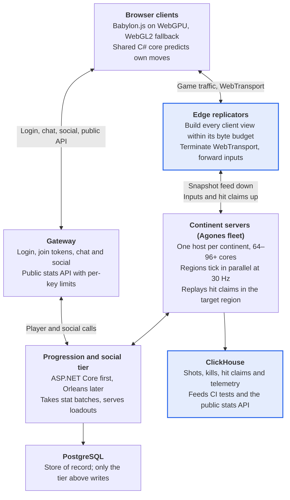
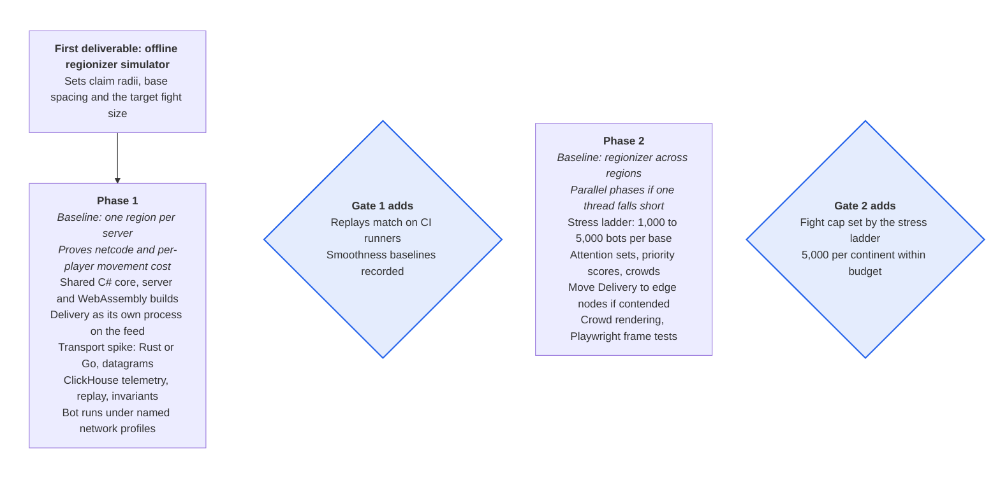

# PS2-Style MMOFPS — Server Architecture Spec v2

Oct 2, 2026 · @Nicholas Bonilla

> **About this copy.** Imported from Claude Docs on 2026-10-29; the repository is now its only home.
> The project constitution (`.specify/memory/constitution.md`) governs and carries this spec's binding
> rules. Where the constitution changes or relaxes a rule of this spec, its Governance > Source
> reconciliations section lists each case; additions and clarifications are not listed. The Roadmap
> section's instruction to copy Phases 3 and 4 from the Sep 30 version is resolved by the phase specs
> in `docs/roadmap/`, and a proposed change in those specs that is recorded yes takes precedence over
> this text on its point (constitution, Governance > Roadmap decisions). Earlier versions are in
> `history/`.

## Overview

Each continent runs as one server process that splits itself into regions around active fights and ticks those regions in parallel. Edge servers build and send each player's view. Progression and social data live in a tier over PostgreSQL, and Agones runs the continent servers as a fleet.

The target is PlanetSide 2-style play at up to 5,000 concurrent players per continent, across several base fights at once. Combat mixes infantry, ground vehicles and aircraft, and weapons fire projectiles with travel time.

Two principles shape the design:

- **Distribute replication, not simulation.** One host simulates a whole continent; edge servers do the per-client work of building and sending views.
- **Cost per player must not grow with fight size.** Every per-client cost is capped, so totals grow linearly and can spread across machines.

This version merges the Sep 30 spec with the Oct 1 recommendations and their later corrections into one document.

## Goals and non-goals

The design uses every core of one host per continent, keeps fights free of fixed server seams, and caps the largest fight by measurement.

Goals:

- Use every core of a continent's host, with no locks in gameplay code.
- Keep fights free of fixed server seams; region boundaries move with the players.
- Isolate load, so an overloaded fight slows only itself.
- Support up to 5,000 concurrent players per continent, spread across several fights.
- Set the maximum fight size with the stress ladder. 5,000 players in one fight is a research target.
- Keep per-client cost flat as fights grow.
- Run identical prediction code on client and server, so corrections stay small.
- Assert smoothness and collision correctness automatically in CI.
- Keep progression, outfits, friends and chat global across continents.
- Depend only on permissively licensed code; GPL and AGPL projects are reference reading.
- Preserve a path to multi-host continents and 100k-player fights.

Non-goals:

- Simulating one continent across several machines, until profiling shows one host can't carry it.
- Splitting one fight across machines. Parallel phases raise a single fight's ceiling on one host, and load tests measure it.
- GPU compute in the authoritative simulation.
- Splitting the simulation into services by function.
- Console clients, which need a native client and are deferred.

## Assumptions and constraints

The server is C# on .NET in Linux containers, one process per continent, and the first client is a TypeScript browser app.

| Area | Assumption |
| --- | --- |
| Server | C# on .NET, one process per continent, Linux containers |
| Client | TypeScript and Babylon.js in the browser, WebGPU with a WebGL2 fallback; shared C# simulation core in WebAssembly; a native console client later |
| Continent size | Up to 5,000 concurrent players across several fights |
| Largest fight | Capped at the highest step the stress ladder passes |
| Host | One continent per dedicated single-socket host with 64–96+ cores; Folia's FAQ recommends at least 16 physical cores for its model |
| Tick rate | 30 Hz per region as the starting target |
| Weapons | Projectiles with travel time; clients claim small-arms hits and the server replays them; heavy projectiles are server-simulated |
| Transport | WebTransport datagrams with a WebSocket fallback |
| Per-client budget | Set by the bandwidth table in Delivery, then tuned in tests |
| Data | PostgreSQL as the store of record; ClickHouse for events and telemetry |

Dependencies use permissive licenses (MIT, Apache 2.0 or BSD): Orleans is MIT and Agones is Apache 2.0. Folia (GPL-3.0) and AzerothCore (GPL-2.0) are design references only, and the regionizer is written from Folia's published docs, never its source. AGPL tools such as Grafana may run unmodified as separate services but are never vendored.

## Architecture overview

Seven components make up the system, counting the client, and only the continent servers run the real-time simulation. Players hold two connections: game traffic goes to an edge replicator, and everything else goes through the gateway.

<!-- Diagram converted from Claude Docs widget "system architecture · 7 components" -->

**Game traffic goes through edges; everything else through the gateway**
Whole system at 5,000 players per continent. Highlighted boxes are new since Sep 30.

Only the progression tier writes to PostgreSQL. Continent servers write events to ClickHouse, which tests and the public stats API read.

## Continent server: regionized simulation

A continent server cuts its map into square sections and groups them into regions that tick in parallel. The design follows Folia's overview and region logic docs, reimplemented in C#.

### Sections and regions

The map is a grid of fixed square sections, sized as a power of two. Regions own sections, not entities, so regionizer work happens only when a section gains or loses activity. Folia groups chunks the same way to cut regionizer operations.

Each region owns a private data object: its entities, spatial index, projectiles, base capture state, timers and pose history. Only work scheduled by that region's tick may touch it, so gameplay code needs no locks.

### Invariants

The regionizer keeps four rules, adapted from Folia's:

1. Every live section belongs to exactly one region.
2. Every section within an entity's claim radius, without crossing a closed portal, belongs to that entity's region.
3. A ticking region never grows. New activity beside it forms a transient region that merges in when the tick ends.
4. A region is always transient, ready, ticking or dead.

Rule 2 replaces Folia's single merge radius with a per-class claim radius and adds portals.

### Merge and split

- **Merge:** regions whose claims touch must merge. If one is ticking, the merge waits until its tick ends.
- **Split:** at tick end, after pending merges, a region holding separate islands splits into independent regions.
- **Damping:** a split is considered only once a region has enough sections and enough dead ones, like Folia's recalculation thresholds. This limits merge and split churn.
- **Callbacks:** region data merges by concatenating entities and timers, and splits by partitioning them by position.

### Designed boundaries

Level designers place portals, such as doors, elevators, tunnel mouths and airlocks, between groups of sections. Claims don't pass through a closed portal, so regions on either side never merge however close they are. Opening a portal connects the two sides, which can trigger a merge when the current tick ends.

Each boundary declares what may cross while it is closed: entity transfers, door and objective events, and deferred projectiles. Visibility doesn't cross a closed portal either, so a sealed underground fight stays independent of the surface above it.

### Scheduling

A fixed pool of tick threads runs the regions. Each region schedules its own next tick, and the pool starts the earliest one first, as Folia's scheduler does. A region that overruns its budget delays only itself, and it can drop to 20 Hz rather than stall.

Tick counters are per region. On a merge, the absorbed region's timers get an offset so relative deadlines survive; on a split, each child inherits the parent's counter. Respawn, capture and cooldown timers stay correct through both.

### Parallel phases inside a region

A region too busy for one thread spreads its tick across the pool in phases, so one fight can use many cores. Each phase gives every entity exactly one writer, and workers read the previous tick's state.

1. **Movement:** each worker integrates its own slice of players and vehicles.
2. **Shots:** each worker validates its slice of hit claims and sweeps its slice of heavy projectiles.
3. **Effects:** damage, heals and kill credit go into per-target queues.
4. **Apply:** the worker that owns each target applies that target's queue.
5. **Gameplay:** captures, timers and objectives run once, on one thread.

Phases switch on only above a region-size threshold set by load tests, because coordination costs more than it saves in small regions.

### Global region and area state

One global region per continent ticks on its own schedule and never merges or splits. It owns state tied to no place: lattice links, base ownership, continent lock and alerts, population caps and faction balance. Regions read a copy taken at the start of each tick and change it only through the global queue.

State tied to a designed area, such as its doors, objectives, hazards and timers, has a single owner: an area actor scoped like the global region. Regions read a copy taken at the start of each tick and change it only through the area's queue.

### Cross-region work

Three queues carry work between regions, mirroring Folia's utilities:

- **Entity queue:** runs a task on whichever region owns an entity, following it through merges and moves.
- **Location queue:** runs a task on the next tick of the region that owns a location, creating that region if needed.
- **Global queue:** changes global-region state.

### Deploys and teleports

Every spawn, login, redeploy and Instant Action jump uses Folia's two-step teleport. The current region removes the entity and sets its new position, then the location queue adds it on the destination region's next tick. Instant Action picks its destination from population stats that regions publish each tick.

### Multi-server invariants

Running one continent across several servers is deferred until profiling shows one host can't carry a continent. These invariants keep that path open, and the scaling path below uses them:

- One authority per entity at any instant.
- Stable entity IDs.
- Player sessions independent of the worker simulating them.
- Writes across regions only through messages.
- One continent-wide time base.

The Simulation Domains sub-spec is the starting point for that work. Its designed boundaries and area state are adopted above; its dynamic domains are dropped, because region splitting already covers them.

## Shooter adaptations

Folia's model assumes short-range interactions, so every interaction here is classed by how fast it must land. Only instant interactions set region boundaries.

| Class | Examples | Resolved by | Added delay |
| --- | --- | --- | --- |
| Instant | Melee, close-range hits, heals, repairs, revives, collisions, capture points | The owning region, inside its tick | None |
| Deferred | Heavy projectiles that leave the firing region, artillery | The region that owns the impact point, via the location queue | Up to 1 tick, hidden in flight time |
| Read-only | Far visibility, targeting, spotting, minimap | Any region, from the last published snapshots | 1 tick stale |

### Claim radius per entity class

Each entity claims the sections within its own instant-interaction radius. Infantry, ground vehicles and aircraft get separate radii, set from the simulator results. An aircraft whose guns fire projectiles claims only a small bubble, so it cannot bridge the fights it flies between.

Map design backs this up: base spacing and terrain keep neighboring fights farther apart than the largest claim radius.

### Snapshots

At the end of every tick, each region publishes an immutable snapshot of its entities and the sections it owns. Each entry holds ID, class, faction, position, velocity and visible state. Readers use the latest complete snapshot, so reads never block the writer.

Snapshots are the only way a region sees another region's entities, which departs from Folia's ban on cross-region reads. They also feed the edge tier described in Delivery.

### Cross-region messages

Anything that changes another region's entity, such as damage, travels as a message on the entity queue. The owner applies it at the start of its next tick. Messages from one sender arrive in order; there is no ordering across senders.

### Projectiles

- **Small arms:** clients claim hits, and the region that owns the target replays each claim (see Hit detection). Shots replicate as fire events, not entities.
- **Heavy projectiles in flight** claim no sections. Otherwise one tank shell arcing between two fights would fuse their regions.
- **Over empty space,** the firing region keeps simulating a heavy projectile across unowned sections, where only terrain can be hit.
- **Entering another region,** a heavy projectile is handed over on the location queue. The new owner tests it against pose history at its true timestamp, so the hop adds delay but no positional error.

At 30 Hz a hop costs at most 33 ms, about 17 m of flight for a 500 m/s round.

### Bridging

The main threat to parallelism is an entity within claim reach of two fights, which fuses them into one region. Per-class claim radii and base spacing are the first defense. The largest region's share of players is tracked as a production metric.

## Delivery: edge tier and replication policy

Edge servers build and send each client's view from the continent server's snapshots, so the continent host only simulates. Each client gets a fixed-size attention set at full rate and everything else by priority within a byte budget.

### Edge replicators

The edge tier:

- Subscribes to the continent server's per-tick snapshot feed and keeps a read-only replica.
- Builds each client's view within its byte budget, as the replication policy below describes.
- Terminates WebTransport and WebSocket connections, and forwards inputs and hit claims to the continent server.
- Absorbs connection churn, rate limiting and DDoS traffic, so the continent host is never exposed.

The snapshot feed carries more than entity rows. Each tick also includes that tick's damage events, fire events, squad membership changes and portal states, which edges need for attention sets and crowd summaries. The feed is a direct link with no broker in between.

Phase 1 runs Delivery as a separate process on the continent host, behind the same feed interface. It moves to its own nodes when profiling shows contention for cores or cache.

The transport component is written in Rust or Go, and game logic stays in C#. [Kestrel's WebTransport documentation](https://github.com/dotnet/aspnetcore/blob/c5e66c255c0254a9be191ee53031cec6b79def48/docs/WebTransport.md) describes draft-02 support without datagrams, and no later datagram support was found. A .NET-only path would mean building WebTransport on a lower-level QUIC library, at a much higher cost.

Star Citizen and EVE split the same way. [Star Citizen's Replicant nodes](https://star-citizen.wiki/Comm-Link:18397/en) run network code only, and [EVE's proxy nodes](https://www.eveonline.com/ja/news/view/tranquility-tech-iv) handle session management in front of its simulation nodes.

### Cell grid and tiers

Each region indexes its entities in a grid of cells smaller than a section, and each snapshot includes that index. As in AzerothCore's map grid, each cell keeps a separate list of far-visible objects: aircraft, vehicles and base structures. Long-range queries never scan infantry.

A client's candidate set is recomputed when the player crosses a cell boundary, not every tick. Each cell keeps a list of the views watching it, so candidates update when other entities enter or leave.

| Tier | Contents | Source | Rate ceiling |
| --- | --- | --- | --- |
| Attention set | Aim target, attackers, squadmates and nearest threats; fixed size | Snapshot feed and damage events | Every tick |
| Near | Everything inside the class's near range | Snapshot cell index | Every tick |
| Mid | Infantry and vehicles past near range | Snapshot cell index | 10 Hz to start |
| Far | Far-visible objects individually; infantry as crowd summaries | Snapshots of all regions | 2 Hz to start |

Tiers set how often an entity may be sent; priority scoring decides whether it is. Ranges, rates and limits per class are tuned in testing.

### Replication policy

- **Attention set.** The entities the player is aiming at, those damaging them, squadmates and the nearest threats, all at full tick rate. Its size is fixed, so it does not grow with the fight. At 16–32 entities of about 10 bytes each, it costs roughly 5–10 KB/s. Members stay for a minimum hold time, so entities do not flicker in and out as the player's aim moves.
- **Priority scoring.** Every other candidate gains priority each tick from distance, threat, aim and squad. The highest are sent until the byte budget is spent, and sent entities reset to zero. Tier rates remain as ceilings.
- **Staleness limit.** No visible entity goes longer than the limit without an update. At the limit it is either sent or folded into its cell's crowd summary, so starved entities never sit frozen on screen.
- **State changes.** A change in how an entity looks, such as a weapon swap or a cloak, raises its priority so the change arrives promptly.
- **Crowd summaries.** Infantry beyond mid range arrive as per-cell summaries: count, faction, centroid, heading and firing intensity. Aircraft, vehicles and structures stay individual at every range and compete on priority, because pilots and tank crews need them. Each cell's summary is the same for every viewer, so it is encoded once per tick. Summaries never cross a closed portal.
- **Fire events.** Shots travel as events with a seed, derived by the rule in Hit detection, and clients draw tracers locally. Events get their own slice of each packet and repeat in the next few packets, since datagrams can be lost. Shots outside the attention set fold into the cell summary's firing intensity, which also drives distant battle audio. Only heavy projectiles replicate as entities.
- **Encoding.** Positions are quantized relative to the cell origin, infantry send yaw and pitch only, and every update is a delta against the last acknowledged state.
- **Remote prediction.** Entities with infrequent updates move by local prediction between updates, so they neither freeze nor pop.
- **Per-client state.** Delivery keeps a priority score and a last-acknowledged state for every candidate entity of every client. Assuming 1,000–2,000 candidates per client, that is roughly tens of KB per client and a few hundred MB at 5,000 clients. Candidate sets refresh only on cell crossings, but scores update every tick, roughly 150–300 million updates a second. An edge restart forces a full resync for its clients.

The attention-set size, hold time and staleness limit are set in Phase 2 load tests. The basis is [Donnybrook](https://microsoft.com/en-us/research/?p=153679) (SIGCOMM 2008). It cut bandwidth by estimating what players pay attention to and sending less important updates less often, and its simulations enabled battles of up to 900 players.

### Bandwidth budget

Each client gets a per-tick byte budget: the attention set is served first, then priority scoring spends the rest. Updates are delta-encoded against the client's last acknowledged state, and when budgets must shrink, far updates go first.

| Policy at 1,000 players | Per client | Server egress |
| --- | --- | --- |
| Every entity at 30 Hz | \~240 KB/s | \~1.9 Gbit/s |
| 100, 300 and 600 entities at 30, 10 and 2 Hz | \~58 KB/s | \~0.46 Gbit/s |

Both rows assume about 8 bytes per entity update. The second row sets the starting per-client budget, which priority scoring now spends instead of fixed caps; real figures come from load tests.

## Combat netcode and hit detection

The server is authoritative for all combat. Clients predict only their own movement and weapon effects, using the same code the server runs.

### Prediction and lag compensation

- **Prediction:** the client applies its own inputs at once and reconciles when server state arrives.
- **Lag compensation:** each region keeps a pose history per entity, long enough to cover the rewind cap. Hit claims are replayed against targets at the claimed render time.
- **History through merges:** pose history is region data, so it moves with its entities through merges and splits.
- **Heavy projectiles** are simulated on the server with travel time. A projectile handed to another region keeps its true timestamp.
- **Hit confirmation:** the region that applies damage sends the result back to the shooter's region on the entity queue.
- **Tick rate:** 30 Hz per region to start. An overloaded region falls behind alone.

### Shared simulation core

Movement, character collision and weapon timing live in one C# library that the server, the browser and a future console client all run. Two copies of prediction code drift apart, and players see the drift as rubber-banding.

The library contains:

- The player movement step, from input to new state.
- Character collision against static world data: heightfield terrain and static meshes.
- Weapon timing: fire rate, spread and recoil.
- The input, command and collision-data formats.

It builds for the server (.NET, inside the continent process), the browser (.NET's WebAssembly target, called once per frame with batched inputs) and, later, Unity for consoles.

Vehicle physics must use the same engine on both sides. The default is [BepuPhysics2](https://awesome.ecosyste.ms/projects/9879) (Apache 2.0, pure C#) inside the shared core. Its README notes that good performance needs a compiler that handles `System.Numerics` vector types, so WebAssembly speed is the risk.

If Bepu is too slow in the browser, run Jolt on both sides instead. Build it with its [CROSS\_PLATFORM\_DETERMINISTIC option](https://raw.githubusercontent.com/jrouwe/JoltPhysics/master/Build/CMakeLists.txt), which is off by default and turns off fused multiply-add.

Determinism rules for the core:

- The clock and the random seed are injected; no wall-clock reads.
- Effects apply in a fixed order.
- Gameplay code never iterates over unordered collections.

### Hit detection

Clients claim hits, and the region that owns the target replays each claim against its pose history before applying damage. Tiered replication delivers each target at a different rate, so one server rewind time cannot reconstruct what a shooter saw.

1. The client fires, detects a hit locally and shows a provisional hit marker.
2. The claim carries shot origin, direction, weapon, input sequence number, target ID and the target's render time.
3. The edge forwards the claim to the region that owns the target, through the entity queue.
4. That region replays the shot against the target's pose history at the claimed time, within tolerances. It checks line of fire against static geometry, fire rate, ammo, spread and range.
5. An accepted claim applies damage in the Apply phase, and confirmation returns to the shooter.

Rules:

- **Rewind cap.** Claims older than the cap are rejected. Set it from measured player pings; Hunt: Showdown uses a hard cap of 800 ms.
- **Staleness-scaled tolerance.** A claim against an entity the client receives only occasionally gets a tolerance widened by how stale that entity was. Aim targets sit in the attention set, so most claims stay tight.
- **Sent-entity check.** Edges know what they sent each client, so they reject claims against entities that client never received.
- **Spread seeds** come from a fixed rule (match salt, player ID, shot counter), so the server can recompute every shot's spread. A seed chosen by the client would let it pick favorable spread.
- **Heavy projectiles** such as tank shells, rockets and artillery stay server-simulated, in the deferred class.
- **Every claim is logged** to ClickHouse, accepted or rejected, for statistical cheat detection. Rejections alone never trigger a ban, following Hunt's policy.

[Hunt: Showdown](https://www.huntshowdown.com/news/the-state-of-hit-registration-in-hunt) publicly describes the same model: the server checks claimed shots against stored world history, matched to the shooter's delay, with tolerances for desync. Validation runs only on claimed hits, so it costs a small fraction of sweeping every projectile.

### Transport

WebTransport datagrams carry state and inputs, and WebSocket is the fallback. [WebTransport became Baseline in March 2026](https://www.utsubo.com/blog/frontier-web-apis-2026-production-ready) when Safari 26.4 shipped it; Chrome has had it since version 97 and Firefox since 114.

- **Datagrams:** snapshots, inputs and fire events.
- **Reliable streams:** gameplay events that must arrive, such as deaths, captures and hit confirmations.
- **WebSocket fallback:** networks that block UDP, which includes many corporate networks, and any session without datagram support. Detect support at runtime rather than by browser version.
- **Server side:** the edge tier terminates QUIC over HTTP/3 itself, so no HTTP/2-only proxy sits in front of it.
- **Local development:** short-lived self-signed certificates, pinned through WebTransport's `serverCertificateHashes` option.

## Client

The browser client uses Babylon.js on WebGPU with a WebGL2 fallback, and draws soldiers as baked-animation instances. Babylon.js is TypeScript-native and Apache 2.0, with WebGPU and WebGL2 backends and built-in inspector tooling.

[WebGPU reached Baseline in January 2026](https://www.utsubo.com/blog/frontier-web-apis-2026-production-ready), but Linux Firefox and older iPhones still need WebGL2. In-app browsers inside social apps often fail WebGPU even on capable hardware, so they are WebGL2 targets too.

Rendering rules:

- **Characters** use baked vertex animation on thin instances. Per-character skeletons animated on the CPU are not used for crowds.
- **Distance** lowers the animation update rate and swaps in LOD meshes, then impostors. Crowd summaries render as impostors.
- **Budgets** cap particles, decals and audio voices per frame; large fights use aggregated battle audio.
- **Shaders** compile and pipelines warm during loading, since a cold WebGPU compile can exceed 200 ms.
- **Network decoding** and interpolation run in a Worker. Sharing memory with it needs COOP and COEP headers.

A console client is deferred. When it comes, it is a native Unity client that runs the shared C# core unchanged. Alternatives to Babylon.js, including a Unity web client, are listed in Alternatives considered.

## Persistence and social tier

Live player and social state sits in a progression tier backed by PostgreSQL, the source of truth, while ClickHouse holds events. The tier starts as one ASP.NET Core service and moves to Orleans grains when write volume or cross-continent traffic requires it.

### Grain catalog

| Grain | Key | Owns | Stored |
| --- | --- | --- | --- |
| Player | Character ID | Profile, loadouts, progression counters, presence | Own schema; stats batched |
| Outfit | Outfit ID | Roster, ranks, outfit stats | Own schema |
| Squad | Squad ID | Members, leader, waypoints | Memory only |
| Chat channel | Channel ID | Members, message fan-out | Memory only |
| Continent | Continent instance ID | Population, faction split, edge endpoints, heartbeat | Memory only |
| World | World ID | Continent directory, open and locked continents, alerts | Own schema |

Before Orleans, the same owners exist as classes in the ASP.NET Core service, one owner per player and per outfit, so the later move to grains is mechanical.

### Storage

- Queryable data (characters, outfits, rosters, stats and the currency ledger) lives in our own PostgreSQL schema, read and written through EF Core or Dapper.
- Opaque grain state can use Orleans' ADO.NET provider for PostgreSQL. It stores each grain's state as one serialized payload, binary by default with JSON recommended, so nothing we query goes there.
- Orleans system tables for cluster membership and reminders live in the same PostgreSQL instance.
- PostgreSQL runs under the CloudNativePG operator on Kubernetes.

### Write policy

| Data | Policy |
| --- | --- |
| Currency and purchases | Written immediately, as append-only ledger rows |
| Loadouts and settings | Written on change |
| XP and stats | Batched per player on a fixed interval, at logout and on continent transfer |
| Squads, chat, presence | Never persisted |

A crash loses at most one batch interval of stats. Currency is never held only in memory.

### Concurrency

The owners (grains, or their day-one classes) are the only writers of live data, and admin tools change it through them, never with direct SQL. Rows carry a concurrency token (xmin in PostgreSQL), so a stale save fails instead of overwriting. Leaderboards read PostgreSQL and lag live state by up to one batch interval; analytics read ClickHouse.

### Cross-player transfers

Orleans transactions span grains, but they need a transactional state store. The documented store is Azure Table, and regular grain storage is meant for development only. So trades run as one PostgreSQL transaction, driven by a short-lived trade grain.

The trade grain locks the items in both player grains, commits the SQL transaction, then tells both grains to apply it.

### Events, cache and observability

- **No NoSQL database.** Even 20,000 players per world flushing stats every 30 seconds is about 700 writes per second, within one PostgreSQL node. [EVE Online](https://www.eveonline.com/ja/news/view/tranquility-tech-iv) built its single-shard universe on one Microsoft SQL Server database, and upgraded that database's hardware and SQL Server version in 2021.
- **ClickHouse** (Apache 2.0) stores shots, kills, hit claims, telemetry and test metrics. Analytics, automated tests and the public stats API query it.
- **Cache, only if needed:** Valkey. [Redis 8's open-source license option is AGPLv3, while Valkey is BSD 3-Clause](https://redis.io/blog/what-is-valkey/).
- **Observability:** OpenTelemetry and Prometheus. Grafana is AGPLv3, so it runs unmodified as a separate service.

### Nakama option

Nakama is Apache 2.0, written in Go, and runs on PostgreSQL or another Postgres-compatible database. It brings friends, groups, chat and leaderboards ready-made, at the cost of a second runtime to operate. Whether it replaces custom social grains is an open question.

## Gateway and public API

The gateway carries all non-game traffic, and the public stats API runs as its own ASP.NET Core service behind it. No API management product is adopted at launch.

### Gateway

- **Duties:** TLS, routing, token validation, per-player rate limits and WebSockets for chat.
- **Day one:** the ASP.NET Core service itself, using built-in authentication, rate-limiting and output-caching middleware.
- **Several services:** YARP, Microsoft's reverse-proxy toolkit built on ASP.NET Core, routes between them.
- **Ingress and certificates:** the cluster's Gateway API controller, such as Envoy Gateway.
- **DDoS protection** comes before any API management. [EVE has used Cloudflare as its datacenter's front door since 2020](https://www.eveonline.com/ja/news/view/tranquility-tech-iv).

### Public stats API

- **API keys.** Self-serve signup issues keys, stored hashed in PostgreSQL and checked by an ASP.NET Core authentication handler.
- **Per-key rate limits.** The built-in limiter is partitioned by key. It counts per process, so shared counts move to Valkey once several replicas run.
- **Caching.** GET responses are cached at a CDN for 30 seconds to a few minutes, so most traffic never reaches our servers.
- **Read isolation.** Queries hit ClickHouse aggregates or a PostgreSQL read replica, never the primary or the game servers. Every query has a hard timeout.
- **Live event stream.** Kills and captures stream over WebSocket from a separate service fed by the event pipeline, never from game servers.
- **Docs and versioning.** ASP.NET Core generates the OpenAPI documents, and paths are versioned, such as `/v1/`.
- **Usage analytics.** Every request is logged with its key into ClickHouse.

### Gateway products

- **Azure API Management:** not adopted. It is a paid Azure service built for HTTP APIs, which conflicts with local-first hosting.
- **Kong Gateway:** not adopted. [Kong staff confirm that Gateway 3.10 and later need a license](https://discuss.konghq.com/t/kic-helm-charts-dont-upgrade-gateway-above-version-3-9/13895).
- **Envoy Gateway:** the upgrade path once several public services need shared policies. [Its release notes cover API key authentication with keys in Kubernetes Secrets, global rate limits and external authorization](https://gateway.envoyproxy.io/news/releases/v1.8/). Self-serve keys go through external authorization to our own key service.

## Orchestration and hosting

Each continent server runs as an Agones GameServer in a Fleet on Kubernetes, one per dedicated single-socket host with 64–96+ cores. Agones (Apache 2.0) handles server lifecycle, health checks, connection details and fleet autoscaling tied to cluster autoscaling.

- **Placement:** one continent per dedicated node. No other workloads share it, so tick budgets stay predictable.
- **Exclusive cores:** continent pods use Guaranteed QoS with whole-CPU requests, and the kubelet runs the static CPU manager policy.
- **Memory locality:** the topology manager keeps a pod on one NUMA node. One fight's phase workers sit on as few CPU chiplets as possible, so they share an L3 cache.
- **Quiet tick cores:** garbage-collection threads and network-card interrupts stay off tick cores.
- **Edge nodes:** high-bandwidth NICs, host networking for UDP, and batched sends (UDP GSO).
- **Opening a continent:** the World grain requests an allocation from the fleet. The allocated server loads the map, registers with its Continent grain, and edges attach to its snapshot feed.
- **Locking a continent:** the server stops accepting deploys, moves players out through the normal teleport path, flushes progression batches, then shuts down.
- **Failure:** the global region checkpoints base ownership to the World grain. A replacement server restores the map from it, and lost stats are bounded by the batch interval.
- **Everything else:** edges, the gateway, the public API and the progression tier run as ordinary Kubernetes Deployments, outside Agones.
- **Bandwidth:** prefer bare-metal hosts with bundled bandwidth. At the volumes in the capacity model, cloud egress pricing becomes a major cost.
- **Local development:** kind or k3d with Agones. Full-scale tests need rented machines: a continent host, edge nodes and bot hosts.

## Key data flows

Five flows cross component boundaries; everything else stays inside one component.

### Login and first deploy

1. The client signs in through the gateway, which activates the Player grain.
2. The gateway asks the World grain for open continents.
3. The player picks a spawn. The gateway returns an edge endpoint for that continent and a one-time join token.
4. The client connects to the edge over WebTransport. The edge checks the token, and the continent server fetches the loadout from the Player grain.
5. The server adds the player at the spawn point through the location queue, and the edge starts sending that player's view.

### Instant Action

1. The client asks for Instant Action through its edge.
2. The current region picks a destination fight from the population stats in the latest snapshots.
3. The current region removes the player, and the location queue adds them to the destination region on its next tick.

### Progression events

1. Regions record XP and stat changes in region-local buffers during each tick.
2. A per-continent batcher aggregates them per player.
3. On each batch interval, at logout and on transfer, the batcher sends each Player grain one update.
4. The Player grain applies it in memory and persists it under the write policy.

Each tick's shots, kills and hit claims also flow to ClickHouse.

### Chat and presence

1. The continent server sends its Continent grain a heartbeat with population and the player list.
2. The Continent grain updates each Player grain's presence.
3. Chat travels from the client to the gateway to a Chat channel grain, which fans it out to members' gateway connections.

### Continent lock

1. The global region detects the lock condition and tells the World grain.
2. The World grain opens the next continent through an Agones allocation.
3. The locking server drains its players to open continents and shuts down.

## Capacity, performance and degradation

The binding limit is the largest single fight, because one fight is one region and cannot be split across regions. The largest shooter fight on record is about 1,300 players, so the fight cap must come from measurement, not precedent.

### Reference points

| Reference | Players | What was counted |
| --- | --- | --- |
| [EVE Online, Fury at FWST-8](https://www.eveonline.com/news/view/two-guinness-world-records-titles-broken) (Oct 2020) | 6,557 | Peak concurrent participants, a Guinness record; 8,825 took part over 14 hours |
| [EVE Online, Battle for 6VDT-H](https://www.eveonline.com/news/view/battle-for-6vdt-h) (Jul 2013) | 4,070 | Peak pilots in one system; game time ran at 1/10 speed for most of the battle |
| [Improbable Morpheus](https://improbable.io/blog/an-improbable-story-accelerating-into-the-metaverse-and-what-comes-next) (2021 tests) | 4,000+ | Live players in a public test; the vendor claims 10,000+ in one space |
| [PlanetSide 2](https://en.wikipedia.org/wiki/PlanetSide_2) continent | 2,000 | Population cap on a 64 km² continent |
| PlanetSide 2 (2020) | 1,283 | One battle, unofficial; a 2022 continent peaked at 1,530 before a server crash |
| PlanetSide 2 (2022) | 1,241 | Highest stable continent count |
| [Star Citizen server meshing](https://starcitizen.tools/Server_meshing) (Dec 2024) | 500 | Players per shard at launch, spread across many servers |
| Folia pre-release test server | About 330 | Peak players, per Folia's FAQ |

Game design spreads players, whatever the cap turns out to be: base capacity limits, several live objectives per lane, and Instant Action steering.

### Estimates

By estimate, a single 1,000-player fight spends between a third of a 30 Hz tick (33 ms) and all of it, before parallel phases. Per-player movement cost is the biggest unknown, so the Phase 1 sweep measures it first.

| Work per tick, 1,000 players | Lean | Heavy |
| --- | --- | --- |
| Movement and collision at 5–20 µs per player | 5 ms | 20 ms |
| Projectiles: about 400 in flight at 3–5 µs per sweep, plus spawns and hits | 2 ms | 3 ms |
| Vehicles: 100 at 20–50 µs | 2 ms | 5 ms |
| Captures, heals, revives, damage | 2 ms | 5 ms |
| Total, against a 33 ms budget | 11 ms | 33 ms |

With client-claimed hits, the projectile row shrinks to heavy projectiles and claim replays. Scaled to 5,000 players:

| Work at 5,000 players | Estimate | Runs on |
| --- | --- | --- |
| Simulating one 5,000-player fight | 55–165 ms per tick single-threaded; about 7–20 ms on \~12 cores with parallel phases | Continent host |
| Fight hot state, pose history included | Tens of MB, resident in CPU cache | Continent host |
| View building, encoding and QUIC | 5–10 cores | Edge tier |
| Downstream bandwidth | About 2.3 Gbit/s, roughly 1 TB per hour | Edge tier |
| Hit validation | A small fraction of the cost of sweeping every projectile | Region that owns the target |

These are estimates, not measurements; the Phase 1 sweep replaces every row.

### Threads and efficiency

- Networking, serialization and GC get reserved cores first. Following Folia's rule of thumb, total allocated threads stay under 80% of the host's cores, and the remainder become tick threads.
- Entities are stored as structs of arrays per region.
- Gameplay code makes no per-tick allocations; buffers and messages are pooled.
- Visibility and hit tests run as tight loops over contiguous data.
- GC pause time is tracked against the tick budget.

### GPU compute

No GPU compute runs in the authoritative simulation; GPU work belongs on the client. At 5,000 players:

- The fight's hot state already fits in CPU cache, and the CPU estimate above fits the tick budget.
- Gameplay logic is branchy and depends on order, which GPUs handle poorly.
- Every tick would pay a round trip between CPU and GPU.
- GPU nodes add cost and a device plugin to the cluster, locally and in production.

Hot loops stay in struct-of-arrays layout so a kernel can move later. The first server candidate is batched line-of-sight checks for server-side anti-wallhack culling, and CPU ray tracing with Embree (Apache 2.0) is tried before any GPU.

At million-player scale, uniform batched work becomes worth a GPU: world-collision sweeps, spatial hashing, building crowd tiles and hit-claim raycasts. [FLAME GPU 2](https://eprints.whiterose.ac.uk/199416/)'s peer-reviewed benchmarks include a model with millions of agents and one with up to 16M, and its authors stress minimizing data movement. In .NET the route is ILGPU, or CUDA and Vulkan kernels called through interop.

### Degradation order

When a region still overruns, it degrades in this order, and correctness always comes before tick rate:

1. Shrink per-client budgets or tier ceilings for that region's viewers. This happens on the edges and never touches the simulation tick.
2. Drop that region from 30 Hz to 20 Hz.
3. Inside sealed designed areas only, slow game time with a time scale over the continent-wide time base.

Time dilation stays inside sealed areas. Across an open boundary, players would see the other side in slow motion, and crossing projectiles would need two clocks.

### Metrics

Every continent server reports per-region tick time, region count, the largest region's share of players, merge and split rate, cross-region message volume and snapshot size. Edges report bytes per client per tick, update staleness per priority class and CPU per client.

## Testing and validation

Every run is replayable and every tick emits metrics, so smoothness and collision correctness become CI assertions. The first deliverable is an offline regionizer simulator, whose results set the claim radii, base spacing and target fight size.

### Simulator

1. Lay out bases along lanes on a continent-sized map.
2. Place simulated players in several fights, plus aircraft and stragglers moving between them.
3. Run the regionizer every tick across a range of claim radii.
4. Plot region count and the largest region's share of players against claim radius.
5. Read the claim-radius budget and minimum base spacing off the point where region count collapses.

Each map's portal graph is validated in the simulator too.

### Load tests

- **Tick-time curve:** bots on one continent server measure per-region tick time against players in the region.
- **Stress ladder:** 1,000, 2,000, 3,000, then 5,000 bots on one base. A step passes if the region holds 30 Hz or degrades cleanly to 20 Hz, and the highest passing step sets the fight cap.
- **Door tests** open and close portals mid-fight to check that merges and splits stay correct.
- **Soak test** drives repeated merges and splits to check timer correctness and churn.

### Replay and invariants

- **Deterministic replay.** Each tick is a function of state, inputs, an injected clock and a seeded random generator, with effects applied in a fixed order. It emits a state hash. Recorded bot sessions become golden replays, and CI fails when a hash diverges.
- **Pinned vector width.** Replay tests fix the SIMD vector width, because .NET's `Vector<T>` size follows the hardware and can change floating-point results.
- **Invariant monitors** run every tick in test builds: no capsule inside static geometry beyond a tolerance, nobody under terrain, speeds under each class's maximum, the four regionizer rules, one owner per entity, and timers monotonic through merges and splits.
- **Reference comparisons.** Optimized collision and hit queries are checked against a brute-force version on random scenes. The server and WebAssembly builds of the shared core must agree on identical inputs.

### Network-impaired bot runs

Headless bots run the real client netcode, including prediction and interpolation, and log data every frame. Impairment comes from tc netem locally and Chaos Mesh in Kubernetes, using named profiles. These values are starting points.

| Profile | Round trip | Jitter | Loss |
| --- | --- | --- | --- |
| LAN | 1 ms | 0 ms | 0% |
| Typical | 80 ms | 10 ms | 0.5% |
| Cross-region | 160 ms | 25 ms | 1% |
| Poor | 250 ms | 50 ms | 3% |

### Metrics and pass rules

Rules marked "from baseline" are set from Phase 1 measurements; after that, CI fails on regressions.

| Metric | Definition | Pass rule |
| --- | --- | --- |
| Correction distance | Gap between predicted and authoritative position for the same input number | p99 per profile, from baseline |
| Visible snaps | Corrections above a visible threshold, set per entity class | Per player-minute per profile, from baseline |
| Interpolation underruns | Frames where an attention-set entity had no newer snapshot | Rate per profile, from baseline |
| Remote position error | Rendered position versus the server's at the same timestamp | p99 per profile and priority class, from baseline |
| Update staleness | Time since a visible entity's last update, per priority class | Maximum within the staleness limit |
| Summary pops | Visible jumps when a crowd summary turns into individual entities | Per player-minute per profile, from baseline |
| Claim rejections | Rejected hit claims from honest bots | Near zero |
| Confirmation latency | Time from hit claim to confirmation | p95 per profile, from baseline |
| Tick time | Per region | p99 within 33 ms at 30 Hz |
| GC pauses | Per process | p99 within the tick's spare time |
| Client bandwidth | Bytes per client per second | p95 within the budget |

Everything goes to ClickHouse, so each test is an SQL query with a threshold. Failing runs keep their seed and inputs for replay.

### Client and concurrency

- **Client performance.** Playwright drives Chrome with WebGPU on a GPU runner and asserts frame time with 1,000 replicated bots on screen.
- **Concurrency.** The regionizer has a seeded single-threaded scheduling mode for merge and split tests. Systematic tools such as Microsoft Coyote are optional; check their maintenance first.

Rare's GDC 2019 talk, [Automated Testing of Gameplay Features in 'Sea of Thieves'](https://gdcvault.com/play/1026366/Automated-Testing-of-Gameplay-Features), is a working model: the game was built with automated gameplay tests from the start.

## Scaling path to 100k and 1M players

Beyond one host, scale out identical simulation shards and edge servers; never split the simulation by function. The multi-server invariants in Continent server become the backbone.

### The rule

Cost per player must stay constant as a fight grows, and local density is a design budget rather than a server problem. CIG reached the same conclusion: [it expected about 100 players to see each other at reasonable frame rates](https://star-citizen.wiki/Comm-Link:18397/en), and said larger shards need mechanics that stop everyone gathering in one spot. The client is the limit, because it runs on one machine while the backend scales out.

If no player should have more than about 2,000 others within 200 m, 100k players need about 6 km² of continuously contested ground. 1M players need about 63 km², a whole PlanetSide 2 continent packed edge to edge.

### What breaks, and the upgrade

| Component | Breaks when | Upgrade |
| --- | --- | --- |
| Region merge rule | One fight outgrows one host, somewhere in the tens of thousands (unproven) | Soft seams: neighbors see each other through read-only copies, cross-seam effects arrive one tick later, and hit claims are validated at the target's owner. Seams follow low-traffic lines, with hysteresis. |
| One host per continent | The same point | Identical simulation shards plus a partition coordinator that splits and merges areas onto pre-started servers. Shards tick independently, with no cluster-wide barrier. |
| Per-client view building | Fights get dense | Fixed attention sets plus shared detail tiles, each encoded once per tick. Clients attach to edges by map location. |
| Outbound bandwidth | It grows linearly with players | Many edge nodes, points of presence in several regions, batched sends and DDoS protection. |
| Geography | Players join from everywhere, at 1M | Edges near players smooth jitter and loss but cannot beat the speed of light. Accept the rewind-cap disadvantage or run regional fights. |
| Failures | Dozens of hosts make crashes routine | Entity state lives in a replication layer that outlives shards. |
| Progression and social tier | Login storms, presence and chat fan-out at 1M | Admission queues, hierarchical presence, scoped chat, and PostgreSQL split by player ID. |
| Agones | One session spans many servers | A pre-started fleet of shard servers; our coordinator assigns areas. |
| Testing | A million real clients is unaffordable | In-process input generators, recorded snapshot feeds, a deterministic whole-cluster simulation with injected failures, and real clients at a few percent of scale. |
| Client | It survives if per-client cost stays constant | GPU-drawn crowds, plus aggregated audio, minimap and kill feed. |

### Sizing

| Measure | 100k players | 1M players |
| --- | --- | --- |
| Simulation cores | 50–150 | 500–1,500, plus seam overhead |
| Outbound bandwidth | About 46 Gbit/s, roughly 21 TB per hour | About 464 Gbit/s, roughly 210 TB per hour |
| Stat writes | About 3,300 per second | About 33,000 per second |

These scale the 5,000-player estimates. Bandwidth stays near 0.2 GB per player-hour at the current budget, so cost grows linearly with players.

### Precedents

- [Star Citizen's replication design](https://star-citizen.wiki/Comm-Link:18397/en) replaces a crashed Replicant from persisted entity state while clients stay connected, briefly frozen. CIG expected the extra hop to cost under a millisecond inside one data center.
- [CCP once planned EVE proxy nodes spread worldwide with dedicated backhaul](https://www.eveonline.com/ja/news/view/tranquility-tech-iv), then put its datacenter behind Cloudflare instead.

### Decomposition

The cluster has three process types: simulation shard, edge and partition coordinator, beside the progression, social and gateway services. Splitting the simulation by function would put network round trips inside a 33 ms tick. No message broker sits in the tick path; shards talk to neighbors directly, and brokers carry telemetry.

Orleans stays in the progression and social tier and never simulates entities. Also not on the path: deterministic lockstep, because every client would need every player's inputs; peer-to-peer authority, because browser clients are easy to tamper with; and EVE-style time dilation, which suits EVE's pace but not an FPS.

### Requirements now

- Keep the multi-server invariants intact.
- Ship Delivery as a separate process with fixed-size attention sets from Phase 1.
- Treat local density as a design budget, enforced by map layout, spawns and objectives.
- Defer GPUs and any functional split of the simulation.

## Risks and mitigations

The largest risk is density: one big fight is one region, and only parallel phases spread it across cores.

| Risk | Impact | Mitigation |
| --- | --- | --- |
| One fight outgrows a region's tick budget | That fight's tick rate drops | Parallel phases, the stress ladder's fight cap, client-claimed hits, and designs that spread players |
| Bridging entities fuse separate fights | Parallelism collapses into one region | Per-class claim radii, base spacing, terrain; alert on the largest region's share |
| Merge and split churn | Wasted work, timer jitter | Split thresholds and a minimum region lifetime before a split |
| Snapshots are one tick old | An entity that appeared this tick can be missed by cross-region reads | Keep cross-region interactions deferred; resolve hits at true timestamps |
| GPL code leaks into the server | License obligations on our code | Implement from Folia's docs only; record design sources; never copy source |
| .NET GC pauses | Tick overruns | Allocation-free gameplay code, GC threads off tick cores, GC pause time tracked |
| Datagrams unavailable on some networks | State falls back to TCP, with head-of-line blocking | Runtime detection; the WebSocket path is tested in CI |
| Continent server crash | Players dropped; up to one batch of stats lost | Checkpointed base ownership, fast replacement through Agones, currency written immediately |
| Orleans overhead too early | Slower iteration | Start with ASP.NET Core over PostgreSQL; move to grains when load requires |
| Browser client can't render a big fight | Frame rate collapses | Baked-animation instancing, LODs and impostors, crowd summaries, frame-time tests |
| Clients fabricate hit claims | Cheaters land impossible hits | Server replay against pose history, rewind cap, sent-entity check, seed rule, statistical detection |
| A map's portal graph misses an opening | Areas meant to stay separate merge | Validate each map's portal graph in the simulator |
| The edge hop adds latency | Inputs reach the simulation slightly later | Edges share the continent host's data center; every bot run measures input-to-tick latency |
| The shared core is too slow or too large in WebAssembly | Prediction cost and load time grow | Measure in Phase 1; fall back to Jolt on both sides for vehicles |
| The transport adds a second language | More to build, review and hire for | Keep the Rust or Go component small; all game logic stays in C# |
| Replays diverge across hardware | CI becomes flaky | Pin the vector width and run replay tests on fixed runner hardware |
| Priority starvation | Entities freeze or pop on screen | Staleness limit, remote prediction, staleness metrics per priority class |
| Public API load reaches game systems | Gameplay slows | CDN caching, per-key limits, reads only from ClickHouse or replicas |
| Bandwidth cost grows with players | Hosting cost per fight rises | Bare metal with bundled bandwidth; enforce the per-client budget |
| Babylon.js leaves no console path | A second client later | Keep all simulation in the shared C# core; revisit Unity 6.6 if consoles move up |

## Roadmap

The offline regionizer simulator comes first. Phase 1 proves netcode and smoothness on one region per server, and Phase 2 adds the regionizer and sets the fight cap.

<!-- Diagram converted from Claude Docs widget "roadmap · first deliverable, Phases 1–2, 2 gates" -->

**Phase 1 proves netcode and smoothness; Phase 2 sets the fight cap**
Phases 3 and 4 and their gates carry over unchanged from the Sep 30 roadmap.

Parallel phases join Phase 2 if the Phase 1 sweep shows one thread can't hold the target fight size. The Sep 30 roadmap diagram didn't come through in the source text, so copy its Phases 3 and 4 and their gates over from that version.

## Alternatives considered

Every option that promised spatial sharding out of the box is discontinued, experimental, unverified or tied to another engine. The other rows record the client, gateway and database choices.

| Option | Area | What it offered | Why not chosen |
| --- | --- | --- | --- |
| SpatialOS | Spatial sharding | Managed interest management and load balancing | Improbable moved to metaverse and blockchain work (MSquared, Somnia) |
| AWS SimSpace Weaver | Spatial sharding | Spatial simulations split across EC2 instances | Support ended May 20, 2026 |
| SpacetimeDB | Spatial sharding | Built-in query subscriptions, C# modules, TypeScript client | Each database runs single-threaded and sharding is manual; cross-database calls are only planned for October 31, 2026 |
| Unreal MultiServer Replication | Spatial sharding | A proxy fanning clients out to several servers | Experimental plumbing; requires an Unreal client and server |
| coherence | Spatial sharding | Multiple simulators with authority handover | Unity-only SDK |
| OpenSimulator | Spatial sharding | C#, BSD license, regions on separate servers | Fixed square regions put server borders through fights and vehicle routes |
| MultiPaper | Spatial sharding | One world shared across servers by chunk ownership | Its team's newer project, ShreddedPaper, multithreads a single server instead |
| KBEngine | Spatial sharding | BigWorld-style cells with dynamic load balancing | Cross-process space sharing unconfirmed; docs mostly in Chinese |
| [Godot](https://app.cinevva.com/guides/godot-vs-unity-web-games) | Client engine | MIT engine with C# support | C# projects cannot export to the web, and its web export targets WebGL2 |
| [Unity 6.6](https://app.cinevva.com/guides/godot-vs-unity-web-games) | Client engine | One C# client for web and consoles; WebGPU fully supported in web builds since August 2026 | Proprietary license (Pro is $2,310 per seat per year; Personal is free under $200K revenue) and larger builds, about 10.7 MB for an empty 3D project; revisit if consoles move up |
| three.js | Client engine | Lower-level WebGPU renderer | More of the engine is ours to build |
| Azure API Management | Gateway | Managed API gateway with keys, quotas and a portal | Paid Azure service built for HTTP APIs; conflicts with local-first hosting |
| [Kong Gateway](https://discuss.konghq.com/t/kic-helm-charts-dont-upgrade-gateway-above-version-3-9/13895) | Gateway | Plugin-based API gateway | Version 3.10 and later need a license |
| A NoSQL store | Database | Horizontal write scaling | Write volume fits one PostgreSQL node |

## Decisions and open questions

Nine questions are decided, one is partly decided, and ten remain open. Statuses are dropdowns, so update them as answers land.

| Question | Status | Answer or next step |
| --- | --- | --- |
| Browser transport | Decided | WebTransport datagrams with a WebSocket fallback |
| Hit detection | Decided | Client-claimed hits replayed by the server; heavy projectiles stay server-simulated |
| Orleans or ASP.NET Core first | Decided | ASP.NET Core first, Orleans when load requires it |
| Client rendering engine | Decided | Babylon.js on WebGPU; revisit Unity 6.6 if consoles move up |
| NoSQL | Decided | No; PostgreSQL plus ClickHouse |
| GPU compute | Decided | Not in the authoritative simulation |
| Simulation decomposition | Decided | No functional split; identical shards once one host is outgrown |
| API gateway product | Decided | None at launch; YARP between services, Envoy Gateway when shared policies are needed |
| Public stats API | Decided | Its own ASP.NET Core service with keys, per-key limits, CDN caching and isolated reads |
| Anti-cheat for a browser client | Partly decided | Server replay, rewind cap, sent-entity check, seed rule and statistical detection; client integrity still open |
| Section size and claim radius per class | Open | Set by the regionizer simulator |
| Largest fight size | Open | Set by the stress ladder |
| Tick rate | Open | 30 Hz stays the starting target |
| Designed boundaries and openable portals | Open | Which bases get them, and which portals players can open |
| Nakama or custom grains | Open | For friends, groups and chat |
| Transport component language | Open | Rust or Go, picked by a Phase 1 spike that tests datagrams on Chrome, Firefox and Safari 26.4+ |
| Shared core in WebAssembly | Open | Measure speed and download size in Phase 1 |
| Rewind cap | Open | Set from measured player pings |
| Smoothness thresholds | Open | Set per network profile from Phase 1 baselines |
| Attention-set size, hold time and staleness limit | Open | Set in Phase 2 load tests |

## Glossary and sources

### Glossary

| Term | Meaning |
| --- | --- |
| Area actor | Single owner of a designed area's state, scoped like the global region |
| Attention set | Fixed-size set of entities a client receives at full rate |
| Claim radius | Distance around an entity whose sections must share its region |
| Crowd summary | Per-cell aggregate (count, faction, centroid, heading, firing intensity) sent instead of far infantry |
| Delivery | Building and sending each client's view from snapshots, run on edge replicators; never authoritative |
| Edge replicator | Server that runs Delivery for its clients and terminates their connections |
| Entity queue | Delivers a task to whichever region owns an entity |
| Far-visible object | An entity kept on a separate list for long-range visibility: aircraft, vehicles and structures |
| Fire event | A shot sent as an event with a seed; clients draw the tracer |
| Firing intensity | Per-cell measure of shots fired, carried in crowd summaries for distant effects and audio |
| Fleet | An Agones set of identical game servers |
| Global region | Continent-wide state tied to no place; never merges or splits |
| Grain | An Orleans virtual actor, addressed by ID |
| Hit claim | A client's report of a hit, carrying the target's render time |
| Location queue | Delivers a task to the region owning a location, on its next tick |
| Parallel phase | One step of a busy region's tick, run across threads with one writer per entity |
| Partition coordinator | Service that assigns map areas to simulation shards (future) |
| Portal | A designed opening between groups of sections; claims and visibility don't cross it while closed |
| Priority score | Per-client value that decides which other entities are sent each tick |
| Region | A set of sections with private data, ticked with one writer per entity |
| Rewind cap | Oldest claim age the server will validate |
| Section | Fixed square map tile; the unit regions own |
| Shared simulation core | C# library of movement, character collision and weapon timing, run by server and clients |
| Snapshot | Immutable end-of-tick copy of a region's entities and sections |
| Snapshot feed | Per-tick stream of compact snapshot deltas and that tick's events, from the continent server to edge replicators |
| Soft seam | A shard boundary inside a fight, crossed by read-only copies and one-tick messages (future) |
| Staleness limit | Longest a visible entity may go without an update before it is sent or folded into a crowd summary |
| Stress ladder | Bot-load steps on one base that set the fight cap |

### Sources

Pages consulted for this version:

- [EVE Online: Two Guinness World Records Titles Broken](https://www.eveonline.com/news/view/two-guinness-world-records-titles-broken) (Oct 2020)
- [EVE Online: Battle for 6VDT-H, summary and numbers](https://www.eveonline.com/news/view/battle-for-6vdt-h) (Jul 2013)
- [EVE Online: Tranquility Tech IV](https://www.eveonline.com/ja/news/view/tranquility-tech-iv) (Mar 2023)
- [Improbable: An Improbable story, accelerating into the metaverse](https://improbable.io/blog/an-improbable-story-accelerating-into-the-metaverse-and-what-comes-next) (Apr 2022)
- [Wikipedia: PlanetSide 2](https://en.wikipedia.org/wiki/PlanetSide_2)
- [Star Citizen Wiki: Server meshing](https://starcitizen.tools/Server_meshing)
- [Star Citizen Wiki: Server Meshing and Persistent Streaming Q&A, Comm-Link 18397](https://star-citizen.wiki/Comm-Link:18397/en) (Nov 2021)
- [ASP.NET Core docs: Using WebTransport in Kestrel](https://github.com/dotnet/aspnetcore/blob/c5e66c255c0254a9be191ee53031cec6b79def48/docs/WebTransport.md)
- [Utsubo: Frontier Web APIs in 2026](https://www.utsubo.com/blog/frontier-web-apis-2026-production-ready) (Apr 2026)
- [Cinevva: Godot vs Unity for Web Games (2026)](https://app.cinevva.com/guides/godot-vs-unity-web-games) (updated Sep 2026)
- [Hunt: Showdown: The State of Hit Registration in Hunt](https://www.huntshowdown.com/news/the-state-of-hit-registration-in-hunt) (Feb 2019)
- [Microsoft Research: Donnybrook, Enabling Large-Scale, High-Speed, Peer-to-Peer Games](https://microsoft.com/en-us/research/?p=153679) (SIGCOMM 2008)
- [Jolt Physics: build options, CMakeLists.txt](https://raw.githubusercontent.com/jrouwe/JoltPhysics/master/Build/CMakeLists.txt)
- [Ecosyste.ms: bepuphysics2](https://awesome.ecosyste.ms/projects/9879)
- [Redis: What is Valkey?](https://redis.io/blog/what-is-valkey/) (Mar 2026)
- [White Rose Research Online: FLAME GPU 2](https://eprints.whiterose.ac.uk/199416/) (2023)
- [GDC Vault: Automated Testing of Gameplay Features in 'Sea of Thieves'](https://gdcvault.com/play/1026366/Automated-Testing-of-Gameplay-Features) (GDC 2019)
- [Kong Nation: KIC Helm charts don't upgrade Gateway above version 3.9](https://discuss.konghq.com/t/kic-helm-charts-dont-upgrade-gateway-above-version-3-9/13895) (Mar 2026)
- [Envoy Gateway: Announcing Envoy Gateway v1.8](https://gateway.envoyproxy.io/news/releases/v1.8/) (May 2026)

Carried over from the Sep 30 spec, with links as listed there:

- Folia: overview, region logic, FAQ, license
- AzerothCore: README and license, MapGrid reference
- Orleans: project page, ADO.NET persistence, transactions
- Agones on GitHub
- Nakama overview, Game Developer
- SpacetimeDB scaling plan, RuntimeWire
- Improbable, Wikipedia
- AWS SimSpace Weaver documentation
- Unreal MultiServer Replication, Epic knowledge base
- coherence features
- OpenSimulator README
