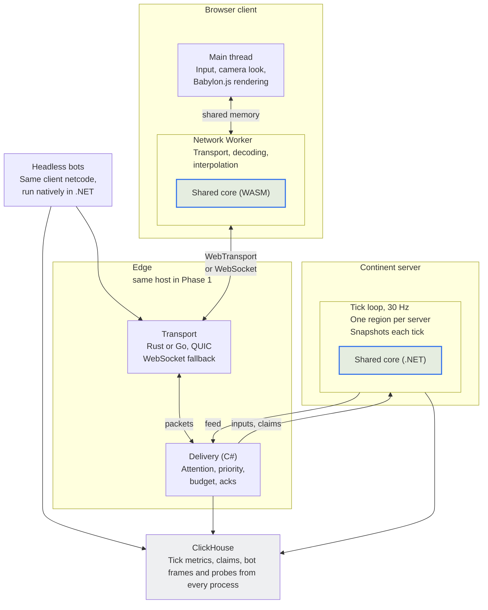
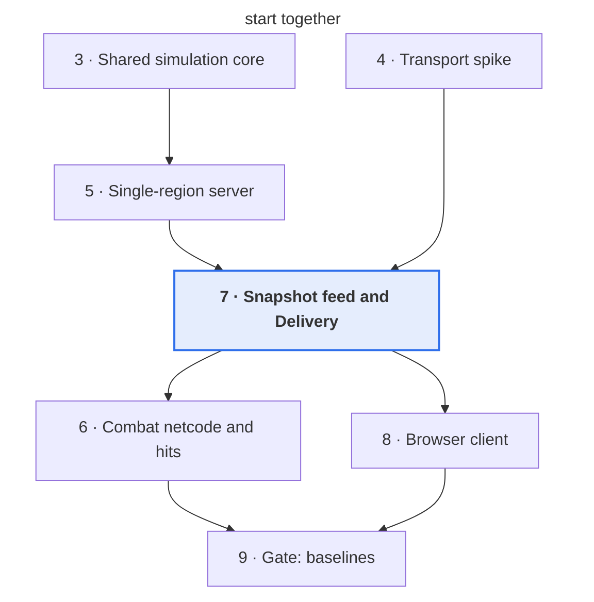

# Phase 1 Spec — Netcode and Smoothness on One Region

Oct 2, 2026 · @Nicholas Bonilla

Phase 1 proves that netcode and smoothness hold up on one region per server, before the regionizer exists. It builds the shared core, the edge transport, the single-region server, combat netcode, Delivery and the browser client, then measures them at gate 9. The gate records the baselines every later regression test compares against, and decides whether parallel phases join Phase 2.

Phase 1 starts once Pre-Phase 1 exits. By then the harness, network profiles and replay checks exist, and the decision memo has set the target fight size the tick-time sweep measures first.

## Exit criteria

Gate 9 passes when all of these hold:

- [ ] The transport language is chosen, datagrams are measured on Chrome, Firefox and Safari 26.4+, and the WebSocket fallback works end to end.
- [ ] The vehicle physics engine is chosen, and the server and WebAssembly builds of the shared core produce identical state hashes on the agreement suite.
- [ ] The tick-time sweep has measured per-player movement cost and tick time from 100 players up to the target fight size, on the target host class.
- [ ] Smoothness baselines exist for every network profile, and every “from baseline” rule has switched to regression mode.
- [ ] Honest bots' hit claims are rejected under 0.1% of the time (proposed) in every profile.
- [ ] Client bandwidth p95 stays within the starting budget of about 58 KB/s, and edge CPU per client is measured.
- [ ] Input-to-tick latency through the edge hop is measured in every bot run.
- [ ] Frame time with 1,000 replicated bots on screen is measured on both the WebGPU and WebGL2 paths.
- [ ] Golden replays of recorded bot sessions pass in CI.
- [ ] The decision on parallel phases for Phase 2 is recorded with the measurements behind it.

## At a glance

<!-- Diagram converted from Claude Docs widget "Phase 1 runtime · client, edge, server and what crosses between them" -->
**The same shared core runs at both ends; Delivery does the per-client work**\
Phase 1 runtime; telemetry from every process lands in ClickHouse

The continent host only simulates and publishes one feed; everything per client happens in Delivery and in the client's Worker. Bots enter through the same transport as browsers, which is what makes their measurements count.

## Sub-spec 3: Shared simulation core

One C# library steps movement, character collision, weapon timing and projectile flight the same way on the server, in bots and in the browser. If the builds disagree by a single bit, prediction drifts, and players see the drift as rubber-banding.

### Contents

- **Movement step.** A pure function from state and input to new state, at the fixed 30 Hz step. The client predicts at that same step and renders between steps.
- **Character collision.** Capsule sweeps against heightfield terrain and static meshes, from the same collision data files on every build.
- **Weapon timing.** Fire rate, spread from v2's seed rule, recoil, and ammo and heat counters.
- **Projectile flight.** Ballistic paths for small arms and heavy projectiles. This adds to v2's list, because client hit detection and server replay must trace identical paths.
- **Formats.** Input commands, collision data, and the recorded streams of the agreement suite.

### Determinism rules

The core keeps v2's rules: an injected clock and seed, effects in a fixed order, and no iteration over unordered collections. Cross-build agreement adds four more:

- Scalar float or explicit Vector128 math only. Vector\<T> changes width between x64 and WebAssembly, so its results can differ.
- The core ships its own sin, cos, atan2 and similar functions, because platform math libraries differ in the last bit. [Rapier's determinism guide](https://rapier.rs/docs/user_guides/c/determinism) states the same rule for its own math.
- No fused multiply-add, explicit or contracted by a compiler; Rapier's guide likewise requires contraction off.
- The timestep is a constant, never a measured frame time.

The agreement suite runs recorded input streams through the server and WebAssembly builds, and per-step state hashes must match bit for bit. It runs in CI on every change to the core, and a Roslyn analyzer on the core assembly enforces the rules. Server-only code outside the core may still use wide SIMD.

### Builds

| Target | Build | Measured in Phase 1 |
| --- | --- | --- |
| Server and bots | .NET 10 LTS on Linux x64, in process | Cost per movement step and per vehicle step |
| Browser | .NET WebAssembly build in a Web Worker, called once per frame with batched inputs | Download size, startup time and step cost, interpreter against AOT |
| Consoles (later) | Unity, same source | Nothing in Phase 1 |

.NET's WebAssembly runtime [can run inside a Web Worker](https://learn.microsoft.com/en-us/aspnet/core/client-side/dotnet-on-webworkers), with a sample for .NET 10 and later; sub-spec 8 relies on this.

### Vehicle physics

v2 defaults to BepuPhysics2 with Jolt as the fallback. Phase 1 decides with an agreement-and-cost test, and adds Rapier as a third candidate because it ships deterministic builds.

| Engine | License and language | Cross-build determinism | Integration |
| --- | --- | --- | --- |
| BepuPhysics2 | Apache 2.0, C# | Same machine and build only; cross-platform determinism is a [roadmap item](https://raw.githubusercontent.com/bepu/bepuphysics2/master/Documentation/roadmap.md) | Inside the core; WebAssembly speed is the risk |
| Jolt | MIT, C++ | With CROSS\_PLATFORM\_DETERMINISTIC, which we build ourselves | P/Invoke on the server; Emscripten build in the browser |
| Rapier | Apache 2.0, Rust | With its enhanced-determinism feature; its parallel solver gives the same results at any thread count | C API through P/Invoke on the server; WebAssembly build in the browser |

The same vehicle scenarios run on both builds: terrain driving, ramps and vehicle-to-vehicle collisions. An engine qualifies only if the hashes match, and Bepu gets its best chance with the server pinned to 128-bit vectors. Among qualifiers, browser step cost decides first, then download size. Rapier is tested only if it fits the same scenario harness cheaply. If Bepu misses bit-exact agreement but its vehicle corrections stay small under the network profiles, keeping Bepu with non-exact vehicles is a valid outcome.

## Sub-spec 4: Transport spike

A time-boxed spike picks Rust or Go for the edge's transport component by running the same tests on both. Browser behavior varies more than the libraries do, so the test matrix is most of the spike's value, and it stays on as CI tests afterwards.

### Candidates

| Language | Library | Status | Integration with C# Delivery |
| --- | --- | --- | --- |
| Rust | [wtransport](https://docs.rs/wtransport/), on quinn | 0.7.2 (Aug 2026), MIT or Apache 2.0, datagrams supported | In process: a native library called through P/Invoke, sharing buffers |
| Go | [webtransport-go](https://github.com/quic-go/webtransport-go/releases), on quic-go | 0.13.0 (Aug 2026), MIT, draft-16 with flow control; sends the SETTINGS Safari 26.4 requires since 0.11.0 | Sidecar process over a Unix socket or shared-memory ring, since a Go library would put a second garbage-collected runtime inside the .NET process |

### Browser behaviors to design around

These come from a [public compatibility survey](https://echo.semantic-ui.com/compat) tested against a live echo server; the spike re-verifies each one.

| Behavior | Design response |
| --- | --- |
| Safari's `ready` never settles unless the server advertises WT\_MAX\_SESSIONS, and refuses sessions without initial credits once it exceeds 1 | The server advertises all four settings; the client has a connect timeout |
| Safari's errors carry empty messages | Connection diagnostics live server-side |
| Safari never releases flow-control credit on stream FIN or RESET, deadlocking at 16 MB or 7,600 streams | Reliable events ride a small fixed set of long-lived streams, split by kind; the soak test pushes a Safari session past 16 MB |
| Safari silently falls back to HTTP/2 over TCP, where streams work but datagrams vanish | The client checks `reliability` after connecting and switches to the WebSocket path |
| Chrome and Firefox have no fallback, so UDP-blocked networks just fail | The WebSocket fallback is required, not optional |
| The datagram writer is `createWritable()` in Safari and `datagrams.writable` in Chrome; Firefox has both | Feature-detect the writer |
| Chrome fixes `maxDatagramSize` at 1,024 bytes | Client datagrams stay at or under 1,024 bytes |
| No custom headers on the CONNECT request | The join token travels in the first message |
| Browsers still send the legacy `webtransport` protocol token | The server accepts it |
| Certificate pinning needs the leaf certificate's SHA-256, at most 14 days' validity, ECDSA P-256 and the literal string "sha-256"; Safari ignores user-installed root CAs | Local tooling mints certificates to exactly those rules |
| Safari's floor is iOS or macOS 26.4, set by the OS rather than the browser | Support is detected at runtime, never by version |

### Test matrix

Each test runs on Chrome, Firefox, and Safari on macOS and iOS, under every network profile plus a UDP-blocked path.

1. Connect: time to `ready`, every failure mode, and fallback detection.
2. Datagrams at 30 Hz both ways at the starting budget: loss, reordering and latency against the raw UDP probe.
3. Reliable events at game rate: ordering and head-of-line delay under loss.
4. Soak: a 2-hour session per browser (proposed), including the 16 MB Safari case.
5. Load: 1,000 synthetic clients on one edge process, measuring CPU per client at the budget with and without UDP GSO.
6. WebSocket fallback: the same framing over binary WebSocket messages.

Server datagrams start under about 1,100 bytes to fit QUIC's minimum packet size with headroom. QUIC never fragments, so the spike measures loss against datagram size, and path MTU discovery can raise the cap later.

### Decision rule

The language that passes every browser test with the fewest workarounds wins. Ties break on CPU per client, then integration cost with Delivery, then each library's release cadence.

## Sub-spec 5: Single-region continent server

The server runs one region at a fixed 30 Hz on a pinned tick thread. It is shaped so Phase 2's regionizer slots in without rewriting gameplay code.

Phase 1 content is deliberately small: one test map with one base, heightfield terrain and static meshes; one infantry class; one ground vehicle; one small arm and one heavy weapon.

### Tick loop

1. Drain the inputs and hit claims that Delivery forwarded for this tick.
2. Step every player through the shared core's movement step with its input for this tick.
3. Step vehicles and heavy projectiles.
4. Validate hit claims against pose history, then apply damage, heals and kill credit in a fixed order.
5. Run gameplay: captures, timers and objectives.
6. Record pose history, publish the snapshot and the tick's events, and emit metrics.

Each step times itself, so the sweep at gate 9 can split tick cost by system.

### Inputs and time

- One time base: game time, as the constitution's Scheduling and time defines it. The region's game-time clock advances by exactly one tick interval per tick, never by a measured duration, and timer deadlines, projectile timestamps and pose history use game time, not tick counts. This is the one continent-wide time base v2's multi-server invariants require.
- Clients run ahead of the server by their one-way latency plus a small buffer, so each input arrives just before the tick that consumes it.
- The server keeps an input buffer per player that adapts to that client's measured jitter, starting at 1–2 ticks, and reports its depth back. Each buffered tick adds 33 ms before an action lands, so the buffer stays as shallow as jitter allows. Clients adjust their lead by running their simulation clock slightly fast or slow.
- Each input datagram repeats the last 4 inputs, so a short burst of loss costs nothing. Redundancy costs only a few KB/s upstream, so it errs on the generous side.
- A missing input is replaced by the previous one and flagged; a late input for a tick already simulated is dropped, and client reconciliation repairs the view.
- Inputs carry the player's aim for that tick, which hit validation reuses.

### Data layout

- Entities live in structs of arrays per class (infantry, vehicle, heavy projectile), with stable IDs built from a slot index and a generation counter.
- The single region owns one region data object: entities, spatial index, projectiles, capture state, timers and pose history. It is the same object the regionizer later merges and splits.
- Effects on another entity already travel as the message types Phase 2's entity queue will carry, applied at a fixed point in the tick. Phase 2 then changes routing, not semantics.
- Gameplay code makes no per-tick allocations; buffers and messages come from pools, and entity arrays are sized for the full population at startup.

### Pose history

A ring buffer per entity covers the rewind cap: Hunt's 800 ms cap from v2 is 24 ticks at 30 Hz, so the ring holds 32 (proposed). Each entry stores position, orientation, stance and an animation pose key, enough to rebuild hitboxes deterministically. At 5,000 entities and about 48 bytes per entry, that is roughly 7.7 MB.

### Snapshots, threads and replay

- At tick end, an immutable snapshot of entity rows and the cell index goes into a ring of the last 4 snapshots (proposed), so readers never block the writer.
- A feed writer on its own core diffs consecutive snapshots and sends the delta plus the tick's events to Delivery.
- The tick thread is pinned to a dedicated core; the input reader, feed writer, telemetry writer and GC threads stay off it. Server GC starts with a capped heap count and GC threads kept off tick cores, confirmed against the gate's pause rule.
- Every tick's inputs, claims and injected clock go to the replay log, so a recorded bot session replays to identical state hashes.

## Sub-spec 6: Combat netcode and hit detection

Clients predict only their own movement and weapons, render everyone else slightly in the past, and claim their own small-arms hits. The server checks every claim against what that client could actually have seen.

### Own player: prediction and reconciliation

- The client applies each input at once through the shared core, and keeps the inputs and predicted states of the last second.
- When an authoritative state arrives with the last input it consumed, the client rewinds to it, replays the unacknowledged inputs and compares.
- Small differences are smoothed on screen over about 100 ms, scaled by the size of the error, while the simulation takes the corrected state; large ones snap. Hit claims and aim always use the corrected simulation position, never the smoothed one. Every correction's distance is logged for the gate.

### Other entities: interpolation and remote prediction

- Entities updated every tick render at server time minus an interpolation delay of two ticks plus a jitter allowance, adapted per client and capped, since a longer delay shows enemies further in the past and deepens rewinds.
- Entities updated less often move by remote prediction from their last position and velocity, blending toward each new update, so they neither freeze nor pop.
- Every rendered entity knows the server time it represents. That time becomes the render time in a hit claim.

### Hit-claim flow

1. The client fires. The shared core computes spread from v2's seed rule (match salt, player ID, shot counter) and flies the projectile against entities as rendered each frame.
2. On a local hit, the client shows a provisional marker and sends a claim: origin, direction, weapon, input sequence number, shot counter, target ID, hit location and the target's render time at impact.
3. The edge confirms that the target was in this client's individually sent view at the claimed render time, and attaches how stale the client's copy was at that time. Claims against entities withheld, culled or folded into a crowd summary are rejected at the edge.
4. The server replays the shot: it rebuilds the trajectory from the shooter's input at that sequence number plus the seeded spread, then checks it against the target's pose history at the claimed render time.
5. An accepted claim applies damage in the fixed effect order. The result returns on the hit-confirmation stream, confirming the provisional marker or removing it.

### Validation rules

| Check | Rule |
| --- | --- |
| Age | Render time older than the rewind cap is rejected |
| Origin | Within tolerance of the shooter's server position for that input |
| Direction | Within tolerance of the aim in the shooter's input plus the seeded spread |
| Flight time | Impact time consistent with the weapon's ballistics over that distance |
| Target pose | Impact point inside the target's hitboxes at render time, with tolerance widened by the edge's staleness figure, capped at the staleness limit |
| Line of fire | Trajectory clear of static geometry and of blocking entities (vehicles, vessel hulls, deployed structures and shields), checked against their pose history at the claimed time |
| Weapon state | Fire rate, ammo and heat agree with server-side counters |

Every claim goes to ClickHouse with its result and a reason code, and rejections alone never trigger a ban, as v2 requires. Tolerances start generous, backed by statistical detection in ClickHouse, and tighten per weapon class from honest-bot distributions while honest bots stay under the 0.1% rejection bar. The claimed hit location is always verified, never trusted.

### Heavy projectiles

Heavy projectiles stay server-simulated with travel time, from the tick that consumes the fire input, and so do homing, area-effect and persistent effects. Clients claim hits only for single-target, non-homing projectiles whose flight the shared core fully determines. The shooter and nearby clients draw a cosmetic projectile at once from the fire event's seed, so the authoritative one replaces it without a visible jump in the common case.

## Sub-spec 7: Snapshot feed and Delivery

Delivery turns the server's per-tick snapshot deltas into each client's view within a fixed byte budget, so the continent host only simulates. In Phase 1 it runs as a separate process on the continent host, behind the same feed interface it will later use from its own nodes.

### Feed

- One frame per tick: tick number, changed entity rows (ID, class, faction, quantized position, velocity, visible state), removed IDs, cell index changes, and the tick's damage, fire, squad and portal events.
- Between processes on one host, frames travel over a Unix socket with the same framing as TCP, so the feed can move onto the network unchanged, with no broker in between. The feed is small, about 100 KB per tick or 3 MB/s at 5,000 changed entities, so a shared-memory ring gets built only if profiling shows feed I/O costing the tick host.
- The return path carries inputs and annotated hit claims from Delivery to the server, batched per tick.
- Feed frames are recorded, so Delivery can be load-tested from a recorded feed without a live server.

### View building

For each client, every tick:

1. **Candidates** come from the cell index and refresh only when the player crosses a cell boundary. Aircraft, vehicles and structures come from each cell's far-visible list.
2. **Attention set**: aim target, attackers from damage events, squadmates and nearest threats. It is fixed at 16–32 entities, holds members for a minimum time, and is sent every tick.
3. **Priority** grows each tick for every other candidate by distance, threat, aim and squad, capped by its tier's rate. A visible state change, such as a weapon swap, adds a boost.
4. **Fill**: the attention set first, then the highest priorities until the byte budget is spent. Sent entities reset to zero.
5. **Staleness**: a visible entity at the staleness limit is sent, or folded into its cell's crowd summary.
6. **Crowd summaries** carry infantry beyond mid range, encoded once per cell per tick and shared by every viewer of that cell.
7. **Fire events** get their own slice of each packet and repeat in the next few packets.

### Packets and acknowledgments

- Each tick's update splits into datagrams under the size cap from the transport spike. Each datagram holds whole entities and decodes on its own, so one loss never spoils another.
- Every datagram carries a sequence number and its tick. Clients acknowledge on their input datagrams with the latest sequence number plus a bitmask of the 32 before it.
- Deltas are encoded against the last state the client acknowledged for that entity, never the last state sent, so loss never breaks decoding.
- Positions are quantized relative to the cell origin, and infantry orientation is yaw and pitch only.
- WebSocket clients get the same packets as binary messages. When a TCP send queue backs up, Delivery drops unsent older ticks instead of queueing them.

### Budget and per-client state

The starting budget from v2's bandwidth table is about 58 KB/s per client, roughly 1,900 bytes per tick at 30 Hz, so usually two datagrams. Per-client state is a priority score and a last-acknowledged state for each candidate. v2 estimates tens of KB per client and 150–300 million score updates a second at 5,000 clients; Phase 1 measures CPU and memory per client against that.

Delivery itself is C#, and hands encoded packets to the transport component sub-spec 4 picks. An edge restart forces a full resync for its clients.

## Sub-spec 8: Browser client

The client keeps netcode off the render thread. A Worker runs transport, decoding, interpolation and prediction, and the main thread reads transforms and draws.

### Threads

| Thread | Runs |
| --- | --- |
| Main | Input capture, camera look, Babylon.js rendering, UI and audio |
| Network Worker | WebTransport or WebSocket, packet decoding, acknowledgments, interpolation buffers, and the shared core for prediction and hit claims |

Data crosses through SharedArrayBuffer rings: inputs from main to the Worker, render transforms back. Sharing memory needs cross-origin isolation, so the page and its assets are served with COOP and COEP headers. Those headers block cross-origin assets that don't opt in and break popup-based sign-in, so sign-in later uses redirects. Camera look applies on the main thread straight from raw input, and the Worker uses the same values for prediction. If sub-spec 3's download size or startup time is unacceptable, the fallback is a TypeScript decoder generated from the same schema, with bots running it in Node.

### Rendering

- Babylon.js runs on WebGPU, with WebGL2 chosen by capability detection at startup. Linux Firefox, older iPhones and in-app browsers land on WebGL2.
- Crowds use baked vertex animation on thin instances. Baked animations can't blend two animations or interpolate between frames, [as a Babylon.js team member notes](https://forum.babylonjs.com/t/baked-texture-animations-to-reduce-cpu-usage-with-many-concurrent-animations/43244/3). So the nearest characters use regular skeletal animation with blending, capped by a tunable that starts at the attention-set size, and switch with hysteresis and a crossfade. Phase 1 first re-checks that limitation against current Babylon.js.
- Distance first lowers the animation update rate, then swaps in LOD meshes, then impostors. Crowd summaries render as impostors.
- Per-frame budgets cap particles, decals and audio voices. Battle audio in big fights is aggregated from each cell's firing intensity.
- Shaders compile and pipelines warm during loading, since a cold WebGPU compile can exceed 200 ms.

### Debug overlay

An overlay shows round trip, loss, input buffer depth, corrections, staleness per tier and bytes per second. These are the numbers bots log, so people and bots see the same figures.

### Measured in Phase 1

- Frame time with 1,000 replicated bots on screen, on WebGPU and WebGL2, driven by Playwright on a GPU runner to catch regressions. Absolute targets come from a reference laptop with integrated graphics, with a minimum spec below it.
- Worker time per frame at the starting budget, and the shared core's step cost in the browser.
- Download size and time to first frame.

## Sub-spec 9: Phase 1 gate — baselines

Gate 9 measures everything Phase 1 built, records the baselines every later regression rule compares against, and records five decisions. Phase 2 doesn't start while a rule is red without an explanation and an owner.

### Tick-time sweep

- Bots fill one region at 100, 250, 500, 1,000, 1,500 and 2,000 players, then step up to the decision memo's target fight size if that is larger.
- The sweep runs twice: infantry-only, to isolate per-player movement cost, then mixed with 10–20% vehicles. Each step holds 10 minutes of fight-like play: moving, shooting and captures.
- Each step records tick cost per system, with movement first as v2 asks, plus GC pauses, snapshot size and feed size per tick.
- Runs use the target host class, because a single tick thread's speed depends on the CPU model.
- The resulting curve replaces v2's estimate of 11–33 ms per tick at 1,000 players.

### Smoothness baselines

Every metric in v2's metrics table is recorded per network profile, plus input-to-tick latency and edge CPU per client. Bots run the real client netcode at 500 players per run (proposed), over 5 seeds per profile (proposed). Baselines are p50, p95 and p99 across those runs, committed through review, and every “from baseline” rule then switches to regression mode.

### Decisions recorded

| Decision | Rule |
| --- | --- |
| Parallel phases join Phase 2 | Yes if single-thread tick p99 at the target fight size exceeds 33 ms, or leaves under 25% headroom (proposed) |
| Vehicle physics engine | Sub-spec 3's agreement-and-cost test |
| WebAssembly build mode | Interpreter or AOT, by step cost against download size |
| Transport language | Made in sub-spec 4; the gate confirms it under load |
| Rewind cap | 800 ms is a ceiling only; the real value comes from the player ping distribution, possibly per region |

## Interfaces

Nine messages cross sub-spec boundaries. Their formats live in the shared core, and every packet starts with a protocol version, so client, edge and server can't drift apart.

| Message | Path | Channel | Contents | Owner |
| --- | --- | --- | --- | --- |
| Join | Client → edge | First message | Join token (a development token in Phase 1) | 4 |
| Input command | Client → edge → server | Datagram, repeating the last 4 inputs | Sequence number, client tick, buttons, aim, acknowledgment field | 3, 5 |
| Hit claim | Client → edge | Datagram, repeated until confirmed; deduplicated by shot counter | Origin, direction, weapon, input sequence, shot counter, target, hit location, render time | 6 |
| Annotated claim | Edge → server | Feed return path | The claim, plus the sent-entity result and staleness | 7 |
| Feed frame | Server → Delivery | Shared-memory ring, or TCP | Tick, entity deltas, cell index changes, events | 5, 7 |
| View packet | Delivery → client | Datagram, or WebSocket message | Sequence number, tick, entity deltas, crowd summaries, fire events | 7 |
| Reliable event | Server → client | A small fixed set of long-lived streams, split by kind | Deaths, captures, hit confirmations | 6, 7 |
| Hit confirmation | Server → shooter | Reliable event | Shot counter, accepted or rejected, reason, damage | 6 |
| Buffer report | Server → client | Inside view packets | Input buffer depth, for the client's lead adjustment | 5 |

## Build order

<!-- Diagram converted from Claude Docs widget "build order · sub-specs 3–9 and their direct prerequisites" -->
**Feed and Delivery is the hinge: combat netcode and the client both wait on it**\
Arrows point from a prerequisite to the work it unblocks

Sub-spec numbers follow the breakdown, but the build runs 7 before 6, as the breakdown's ordering note suggested. Arrows show direct prerequisites only; earlier ones are implied, so 3 also feeds 6 and 8 through 5 and 7.

## Proposed changes to the v2 spec

Seven changes, each with the case for and against and a recommendation. The spec's body already follows every recommendation. Agents decide each change under the constitution's Governance, Roadmap decisions, before the first feature of any sub-spec it affects is specified; the Decision column records it.

| Change | For | Against | Recommendation | Affects | Decision |
| --- | --- | --- | --- | --- | --- |
| Projectile flight joins the shared core | Client detection and server replay trace one path, so honest hits pass and tolerances stay tight | More code under the determinism rules (drag needs a custom exp); ballistics changes need a synchronized client and server release | Adopt; separate models would force loose tolerances | 3, 6 | Partly (constitution 1.0.0: only projectiles whose flight the shared core fully determines may be client-claimed; reconciliation 22) |
| The core uses scalar or Vector128 math and its own sin, cos and similar | Bit-exact agreement across builds, a clean pass-or-fail suite, portable replays | Core code loses AVX2 width; custom trig is slower and easy to get subtly wrong; prediction doesn't strictly need bit-exactness | Adopt for code that runs on both sides, enforced by a Roslyn analyzer; server-only code may still use wide SIMD | 3 | Pending |
| Rapier joins Bepu and Jolt as a vehicle-physics candidate | Deterministic cross-platform builds, a C API, results independent of thread count, Apache 2.0 | Another native language; interop on server and browser; slower deterministic build; evaluation time | Include only if it fits the scenario harness cheaply; non-exact Bepu vehicles are a valid outcome if corrections stay small | 3 | Partly (constitution 1.0.0: Rapier is tested only if it fits the scenario harness cheaply; keeping non-exact Bepu needs the MINOR amendment that settles open decision 7; reconciliation 21) |
| Hit claims add the shot counter and hit location, and the edge stamps staleness | Spread can be recomputed and repeats deduplicated; hitboxes checked directly; only the edge knows what it sent | The edge keeps send-time history and joins the anti-cheat path; hit location is a cheat vector if ever trusted | Adopt, and always verify the hit location | 6, 7 | Pending |
| Reliable events ride a small fixed set of long-lived streams, split by kind (revised from one stream per direction) | Avoids Safari's many-streams flow-control bug while confining head-of-line delay to one kind of event | Slightly more to manage than one stream; unproven that long-lived streams escape the bug's 16 MB ceiling | Adopt, and confirm with the Safari soak test | 4, 7 | Pending |
| The nearest characters use skeletal animation; baked animation covers the rest | Blended aiming and transitions where players look; crowds stay cheap | Two animation pipelines; a visible switch without hysteresis and a crossfade; skinning cost on weak WebGL2 machines; the limitation's source dates from 2023 | Adopt with a tunable cap, after re-checking the limitation in current Babylon.js | 8 | Pending |
| Client netcode lives in the shared core and runs in a Worker | Bots run the exact client netcode natively; one decoder; the render thread stays smooth | Bigger download and startup; a younger .NET-in-Worker path; COOP and COEP block assets that don't opt in and break popup sign-in; harder debugging | Adopt if sub-spec 3's size and startup numbers are acceptable; otherwise a generated TypeScript decoder, with bots in Node | 3, 8 | Pending |

## Open questions

Ten questions are open and one is partly decided, each with its trade-off and a recommendation. The spec's body follows the recommendations. Agents answer each remaining question under the constitution's Governance, Roadmap decisions, before the first feature of any sub-spec it affects is specified, and record the answer in its Status cell.

| Question | Status | Trade-off | Recommendation |
| --- | --- | --- | --- |
| Reference client hardware for frame-time tests | Open | A low reference keeps the game playable for most browser players but caps crowds and visuals; CI GPUs don't represent players | An integrated-GPU laptop as the reference with a minimum spec below it; CI catches regressions only |
| Server datagram size cap | Open | Smaller is safer on small-MTU paths but adds packets and overhead; QUIC never fragments, so oversized datagrams are lost | Start at about 1,100 bytes, measure loss against size in the spike, and let path MTU discovery raise it later |
| Feed transport between processes | Open | A shared-memory ring is fastest but host-only and complex; a socket is one code path with backpressure; the feed is only about 3 MB/s | A Unix socket with TCP framing; build the ring only if profiling shows feed I/O costing the tick host |
| Input redundancy and buffer target | Open | Redundancy costs a few KB/s; each buffered tick adds 33 ms but cuts missing inputs | Generous redundancy, and a buffer that adapts per client to measured jitter |
| Interpolation delay | Open | Longer is smoother but shows enemies further in the past and deepens rewinds | Adaptive per client, starting at two ticks (67 ms) plus jitter, with a ceiling |
| Correction smoothing | Open | Longer hides corrections but shows the wrong position for longer | About 100 ms scaled by error size, with large errors snapping; claims always use the corrected position |
| Claim tolerances | Open | Generous avoids false rejections but gives cheaters slack | Generous tolerances backed by statistical detection, tightened per weapon class from honest-bot data |
| Rewind cap | Partly decided (constitution 1.0.0: the cap comes from measured player pings, open decision 8) | Higher helps high-ping players but means more shots after reaching cover and a bigger manipulation window | 800 ms as a ceiling only; the real value from the player ping distribution, possibly per region |
| Attention-set size, hold time and staleness limit | Open | A bigger set, longer hold or shorter staleness limit each cost budget or responsiveness | Start mid-range in v2's 16–32; Phase 2 load tests tune all three |
| Vehicle share and bot behavior in the sweep | Open | More vehicles add realism but muddy the per-player movement cost v2 wants first | Two sweeps: infantry-only, then 10–20% vehicles |
| GC mode | Open | Server GC gives throughput and control at more memory; workstation GC is lighter with less control | Server GC with a capped heap count and GC threads off tick cores, confirmed by pause measurements |

## Sources

- PS2-Style MMOFPS Server Architecture Spec v2 (Oct 2, 2026), the sub-spec breakdown PS2-Style MMOFPS — Sub-spec Breakdown and the Pre-Phase 1 spec Pre-Phase 1 Spec — Regionizer Simulator and Test Harness
- [Rapier: Determinism](https://rapier.rs/docs/user_guides/c/determinism), C user guide 0.36
- [BepuPhysics2 roadmap](https://raw.githubusercontent.com/bepu/bepuphysics2/master/Documentation/roadmap.md)
- [.NET on Web Workers](https://learn.microsoft.com/en-us/aspnet/core/client-side/dotnet-on-webworkers), Microsoft Learn
- [WebTransport compatibility survey](https://echo.semantic-ui.com/compat), WebTransport Echo (2026)
- [webtransport-go releases](https://github.com/quic-go/webtransport-go/releases)
- [wtransport documentation](https://docs.rs/wtransport/), version 0.7.2
- [Babylon.js forum: baked texture animation limits](https://forum.babylonjs.com/t/baked-texture-animations-to-reduce-cpu-usage-with-many-concurrent-animations/43244/3) (Aug 2023)
