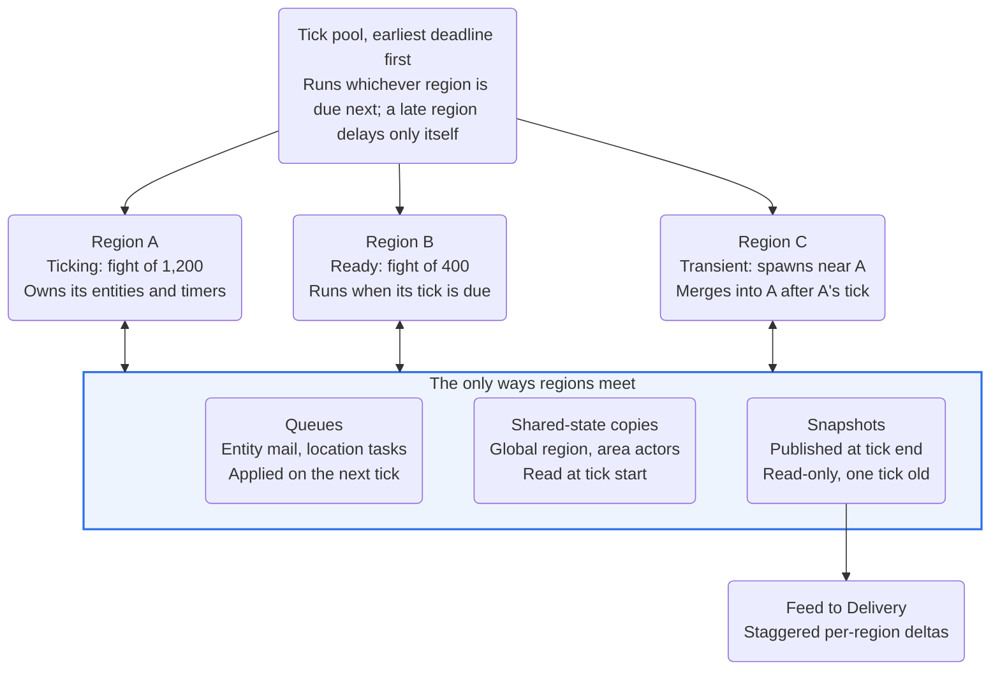
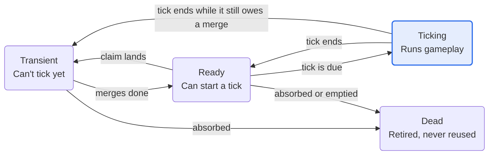

# Phase 2 Spec — Regionizer and Fight Cap

Oct 2, 2026 · @Nicholas Bonilla

Phase 2 turns the single-region server into a regionized one. The regionizer core from Pre-Phase 1 runs inside the continent server, so separate fights tick in parallel on a shared thread pool. Parallel phases join only if gate 9 found that one thread can't hold the target fight, and the phase ends with the stress ladder, whose highest passing step becomes the fight cap.

Phase 2 starts from three inputs: the decision memo's claim radii, section size, damping thresholds and target fight size; Phase 1's server, Delivery and baselines; and gate 9's verdict on parallel phases. Every Phase 1 regression rule keeps running, so regionizing can't quietly cost smoothness.

## Exit criteria

Gate 12 passes when all of these hold:

- [ ] Invariant monitors report zero violations in the real server across the door tests and a 24-hour soak.
- [ ] An overloaded fight slows only its own region: while one region degrades, every other region's tick p99 stays within 33 ms.
- [ ] The stress ladder has run, and its highest passing step is recorded as the fight cap.
- [ ] The continent scenario, 5,000 players across several fights, holds 30 Hz in every region below the fight cap.
- [ ] Replays reproduce identical state hashes with many regions, and at 1 and N workers if parallel phases were built.
- [ ] Attention-set size, hold time and staleness limit are set from load tests, and every Phase 1 regression rule still passes.
- [ ] The server's region statistics match the simulator's prediction for the same scripted scenario, or the simulator has been recalibrated.
- [ ] The degradation order holds: edge budgets shrink before any region drops to 20 Hz.
- [ ] The regionizer's serialized cost at 5,000 entities is measured against its budget.

## At a glance

<!-- Diagram converted from Claude Docs widget "Phase 2 server · regions, the pool, and the three ways regions meet" -->
**Regions tick on their own and meet only through queues, copies and snapshots**\
Phase 2 continent server; region sizes are examples



No region ever reads or writes another region's live data. Writes cross as queued messages, shared state arrives as copies, and reads of other regions use their last published snapshot.

## Sub-spec 10: Regionizer in the continent server

Phase 1's single region becomes many. Each region owns a private data object, ticks on its own schedule, and touches other regions only through queues and snapshots.

### Ownership

- The regionizer core from Pre-Phase 1 owns section ownership, and the server never edits it directly.
- Each region's data object holds its entities, spatial index, projectiles, capture state, timers and pose history, as v2 lists. Only work scheduled by the region's own tick may touch it, so gameplay code stays lock-free.
- An entity belongs to the region that owns its section. Its claim radius covers one tick of movement, so it can't leave its region's sections mid-tick; ownership changes only at tick ends, through merges, splits and teleports.

### Claims

- Claims are recomputed in one batch at each region's tick end, not as entities cross sections mid-tick. Pre-Phase 1's claim-radius floor already includes a tick of movement, so rule 2 holds at every tick boundary and the regionizer is never called during a tick.
- Claim radius per class, section size, anchoring mode and merge gap come from the decision memo.
- Anything that can outrun its class's speed ceiling for even one tick, such as a boost or a launch pad, either raises that class's radius or moves by teleport.

### Merge and split at tick end

A region's tick end follows [Folia's order](https://docs.papermc.io/folia/reference/region-logic/): process pending merges; if the region still owes a merge to a ticking neighbor, turn transient; otherwise drop dead sections and split when the damping thresholds allow.

| Data | On merge | On split |
| --- | --- | --- |
| Entities and pose history | Arrays concatenate | Each entity goes to the child that owns its section |
| Spatial index | Rebuilt for the merged set | Rebuilt per child |
| Heavy projectiles | Concatenate | Divided by position |
| Capture state | Each base's state moves with its capture-zone sections | Same |
| Timers | Concatenate; absolute deadlines need no offset | Follow the entity or section they belong to |
| Mailboxes | Untouched, since they're indexed by entity ID | Untouched |

Moving the arrays is copy-sized work, about 1 MB for 5,000 entities at roughly 200 bytes each, and gate 12 measures it.

### Layers and portals

- Sections are keyed by layer and grid position, and an entity changes layer only by crossing a portal.
- Portal state belongs to area actors. Opening a portal lets claims cross it at the next tick end, which may trigger a merge; closing it retracts them, and the regions split once damping allows.
- Whatever crosses a closed portal, such as entity transfers, door and objective events and deferred projectiles, goes through the queues, never as a shared read.

### Timers

Gameplay timers use absolute deadlines on the continent time base, as the Pre-Phase 1 spec recommends. A region fires each timer at its first tick at or after the deadline, so merges, splits and 20 Hz drops never stretch one.

### Region lifecycle

<!-- Diagram converted from Claude Docs widget "region lifecycle · four states and their transitions" -->
**Only a ready region can tick, and every merge or split waits for a tick to end**\
Region states from Folia's region logic; arrows are transitions



A new region starts ready, or transient if it appears beside a ticking region. A ticking region never grows, so anything that would make it grow waits as a transient region until its tick ends.

### Scheduler

A fixed pool of tick threads runs regions earliest-deadline-first, as [Folia's scheduler](https://docs.papermc.io/folia/reference/overview) does, so a region that falls behind delays only itself.

- **Pool size.** Cores for the input reader, feed writer, telemetry writer and GC are reserved first, and the continent server's dedicated busy threads use at most a configured share of the host's physical cores, starting at 80% and tuned by load tests (constitution, Scheduling and time; reconciliation 16). The rest become tick threads.
- **Ordering.** Each region schedules its next tick one tick length after its last start, on the continent clock. The pool starts whichever region is due earliest, which equals earliest-deadline-first because every deadline is start plus one tick. While the pool isn't saturated, every region whose tick fits in 33 ms holds 30 Hz.
- **Start and end.** Starting moves a region from ready to ticking, and fails if it turned transient meanwhile; the scheduler then skips and reschedules it. At tick end the regionizer runs claim updates, merges and splits under its lock, which is the serialized work measured separately.
- **Placement.** Folia's scheduler is neither NUMA- nor core-aware. Ours pins tick threads to the continent pod's exclusive cores, and draws a parallel region's phase workers from one L3 domain.
- **Watchdog.** A region stuck transient for 30 ticks, or any tick over 250 ms (both proposed), is logged with a state dump, which catches stalled merge-later chains.

### Overruns

When a region overruns, the v2 degradation order applies to that region alone:

1. Delivery shrinks per-client budgets and tier ceilings for that region's viewers. The simulation doesn't change.
2. The region drops to 20 Hz when its tick p95 over the last 2 s exceeds 33 ms, and returns to 30 Hz after 10 s under 60% of the budget (both proposed).
3. Inside sealed areas only, game time slows; whether Phase 2 builds this step is an open question.

### Global region and area actors

State tied to no place lives in the global region, and state tied to a designed area lives in that area's actor. Regions only ever read a copy and send changes.

| Owner | Owns | Ticks | How regions use it |
| --- | --- | --- | --- |
| Global region | Lattice links, base ownership, continent lock and alerts, population caps, faction balance | On its own schedule; never merges or splits | Read the copy taken at tick start; change through the global queue |
| Area actor | One designed area's doors and portals, objectives, hazards and timers | On its own schedule, scoped like the global region | Read the copy taken at tick start; change through the area's queue |

- Each owner publishes an immutable copy after every tick. A region takes the latest copy at its tick start and reads only that copy all tick, so two reads in one tick always agree; Folia does the same with its global game time.
- Changes are messages applied in the owner's next tick, in arrival order per sender.
- Capture progress stays in the region, because counting players on a point is instant and local. When a base flips, the region sends the flip to the global region, which owns ownership and lattice links.
- A door opens in three steps: the interaction goes to the area actor, the actor flips the portal on its next tick, and regions recompute claims at their next tick end. A visible door state reaches clients as an event in the meantime.
- The global region checkpoints base ownership to a local file until the progression tier exists, standing in for v2's World grain.

### Cross-region work

Regions never write each other's data. Every write that crosses a region boundary goes through one of the queues v2 and Folia define, and every read goes through snapshots.

| Queue | Delivers to | Implementation | Used for |
| --- | --- | --- | --- |
| Entity queue | Whichever region owns the entity, at its next tick start | A first-in-first-out mailbox per stable entity ID. The owning region drains its own entities' mailboxes, so mail follows an entity through merges, splits and teleports without any lookup | Damage and heals from other regions, inputs, hit claims, hit confirmations |
| Location queue | The region owning a location, on its next tick, created if none exists | Tasks keyed by section. Between ticks the scheduler hands each task to the owning region, or creates a ready region for an unowned section | Spawns, logins, redeploys, Instant Action, heavy-projectile handoff |
| Global and area queues | The global region or one area actor | Queues drained on each owner tick | Base flips, door interactions, population changes |

- Messages from one sender arrive in order, and there is no order across senders, as v2 states. Each tick sorts drained messages by send tick, sender ID and sequence before applying them, so replays stay deterministic whatever the thread timing.
- Inputs and hit claims from Delivery land in entity mailboxes, so the Phase 1 input path survives merges unchanged.
- **Teleports** use v2's two-step form for spawns, logins, redeploys and Instant Action. The current region removes the entity and sets its new position, then the location queue adds it on the destination region's next tick. The entity skips at most one tick in between, and its mailbox holds mail meanwhile.
- **Instant Action** picks its destination fight from the population stats regions publish in their snapshots.
- **Heavy projectiles** fly in their firing region across unowned sections, where only terrain can be hit. On entering another region's sections, they move on the location queue with their true timestamp, and the new owner tests them against pose history at that time. A hop costs at most one tick, about 17 m of flight at 500 m/s.
- **Hit claims** go to the target's mailbox, so the target's region validates them against its own pose history. The confirmation returns through the shooter's mailbox.
- **Reads** of other regions, such as far visibility, targeting, spotting and the minimap, use their latest published snapshots, one tick stale.

### Snapshots, Delivery and metrics

With many regions, snapshots arrive staggered rather than once per tick, and Delivery has to tolerate that.

- Each region publishes an immutable snapshot at its own tick end, stamped with continent time. The feed writer forwards each region's delta as it lands, so feed frames carry a region ID and continent time instead of one global tick.
- Delivery keys its replica by entity ID, not by region. During a merge or split an entity can appear in one region's snapshot before it leaves another's, so Delivery deletes an entity only on an explicit despawn event, never because a snapshot omits it.
- Interpolation already uses each entity's own timestamps, so staggered region ticks don't show up as jitter.
- Each region publishes its tick health, so Delivery can shrink budgets for that region's viewers first, which is degradation step 1.

| Metric | Why it matters |
| --- | --- |
| Tick time and rate per region | Overrun detection and the stress ladder |
| Region count and the largest region's share of players | Bridging, v2's production metric |
| Merge and split rate, and serialized regionizer time per tick end | Churn, and the budget from Pre-Phase 1 |
| Cross-region message volume | Storms, such as artillery barrages across regions |
| Snapshot size per region | Feed and Delivery load |
| Age of transient regions | Stalled merge-later chains |
| Ticks entities wait after a teleport | Teleports that skip more than one tick |

The Pre-Phase 1 invariant monitors run every tick in test builds of the server, so rule violations surface in the real code, not just the simulator.

## Sub-spec 11: Parallel phases (if needed)

This is built only if gate 9 found that one thread can't hold the target fight. A busy region then spreads its tick across pool workers in five phases, each giving every entity exactly one writer.

1. **Movement:** each worker integrates its slice of players and vehicles.
2. **Shots:** each worker validates its slice of hit claims and sweeps its slice of heavy projectiles.
3. **Effects:** damage, heals and kill credit go into per-target queues.
4. **Apply:** the worker that owns each target applies that target's queue.
5. **Gameplay:** captures, timers and objectives run once, on one thread.

### Rules

- **One rule for serial and parallel.** Every phase reads the previous tick's state and writes the next one, in both the single-threaded and parallel paths. Results are then identical at any worker count, so replay hashes don't depend on core count. The cost is double-buffered arrays, and player-to-player pushes seeing neighbors one tick late in every mode.
- **Sorted effects.** Workers append effects in whatever order threads happen to run, so each target's queue is sorted by source entity ID and sequence before Apply.
- **Slices.** Workers take contiguous runs of entities in cell order, so each slice is spatially compact and stays in cache. Slices are recomputed when the region's size changes.
- **Switching on.** A region goes parallel when its single-thread tick time passes a threshold, and back with hysteresis.
- **Workers.** A parallel region borrows up to a capped number of pool workers, all from one L3 domain, so smaller regions aren't starved.
- **Barriers** separate the phases, and their wait time is measured as serial overhead alongside Gameplay.

### Expected scaling

v2 estimates one 5,000-player fight at 55–165 ms per tick on one thread, and about 7–20 ms on roughly 12 cores. The serial parts (Gameplay, barriers and the regionizer's tick end) cap that speedup, per Amdahl's law, where p is the parallel fraction and N the worker count:

```latex
S(N) = \frac{1}{(1 - p) + p / N}
```

v2's estimate is about 8× on 12 workers, which needs serial work under 5% of the tick. At 10% serial, 12 workers top out near 5.7×, so gate 12 measures the serial share directly rather than trusting the estimate.

## Sub-spec 12: Phase 2 gate — load tests and fight cap

Gate 12 sets the fight cap and proves that regions isolate load. Every test runs on the target host class, with bots running the real client netcode.

### Tests

| Test | Setup | Pass rule |
| --- | --- | --- |
| Tick-time curve | Bots fill one region in steps, as at gate 9, with the regionizer running | Recorded, and compared with gate 9's curve to price the regionizer |
| Stress ladder | 1,000, 2,000, 3,000, then 5,000 bots on one base, 15 minutes per step (proposed) | A step passes if the region holds 30 Hz or degrades cleanly to 20 Hz; the highest passing step is the fight cap |
| Continent scenario | 5,000 bots across several fights, shaped like the Pre-Phase 1 Baseline scenario | Every region below the fight cap holds 30 Hz |
| Isolation | One fight pushed past the cap while the others run | Every other region's tick p99 stays within 33 ms |
| Door tests | Portals opened and closed mid-fight on the stacked-areas map | Correct merges and splits, zero invariant violations |
| Soak | 24 hours of migrating fights, door cycling and teleports | Zero violations, timers on time, no transient region outliving the watchdog |
| Determinism | Recorded multi-region sessions replayed, at 1 and N workers if parallel phases exist | Identical state hashes |

Degrading cleanly means tick p99 within 50 ms at 20 Hz, no tick over 100 ms, and Phase 1's smoothness metrics within twice their 30 Hz baselines (all proposed).

### Tuning

On the continent scenario, attention-set size (16, 24, 32), hold time (0.5, 1, 2 s) and staleness limit (0.5, 1, 2 s) are swept against bandwidth per client and Phase 1's smoothness metrics (proposed grid). The winners replace the starting values, and Phase 1's baselines are re-recorded through review.

### Simulator check

The continent scenario's script also runs through the Pre-Phase 1 simulator. Region count, the largest region's share and the merge and split rate must match the server's within 20% (proposed). Otherwise the simulator's movement models are recalibrated from server traces before anyone uses it to space bases on real maps.

### Decisions recorded

| Decision | Rule |
| --- | --- |
| Fight cap | The highest passing ladder step |
| Attention-set size, hold time, staleness limit | The tuning sweep's winners |
| Parallel-phase threshold and worker cap | From the ladder runs, if parallel phases exist |
| Base spacing changes | The continent scenario's largest-share metric, checked against the simulator |

## Risks

The largest Phase 2 risk is that real fights fuse more often than the simulator predicted, so the gate checks the simulator before trusting it.

| Risk | Impact | Mitigation |
| --- | --- | --- |
| Fights fuse more often than the simulator predicted | Parallelism collapses into one large region | The simulator check at gate 12, the largest-share alert, and base spacing changes |
| Merge and split churn at tick ends | Serialized time eats the tick budget | Damping thresholds, a minimum region age, and serialized cost measured |
| A merge-later chain stalls | A region stays transient and stops ticking | The watchdog with state dumps, and Pre-Phase 1's interleaved-mode tests |
| Cross-region message storms | One region spends its tick draining mail | A message volume metric, and per-tick drain caps on cross-region effects only, never on inputs (proposed) |
| Thread timing leaks into results | Replays diverge and CI flakes | Sorted message application, one read and write rule, replays at 1 and N workers |
| Parallel phases scale poorly across chiplets | The fight cap stays near the single-thread number | Workers drawn from one L3 domain, and the serial share measured |
| Delivery flickers during merges | Entities vanish and pop back | Deletion only on explicit despawn events |
| Timers drift across merges or 20 Hz drops | Respawn and capture timers run long | Absolute continent-time deadlines and timer monitors |
| Teleports pile up in a spawn rush | Players wait several ticks to appear | The teleport-wait metric, and spawn throttling through the global region |

## Build order

Each step leaves the server runnable, so Phase 1's regression rules keep running throughout.

1. Split the single region's state into region data objects driven by the regionizer core: first one region, then many with fixed assignments.
2. Entity mailboxes, the location queue and the global queue, with inputs and claims routed through mailboxes.
3. The scheduler: tick pool, earliest-deadline-first ordering, ticking states, and tick-end claim updates, merges and splits.
4. The global region and area actors, with portals that open and close.
5. Two-step teleports for spawns, redeploys and Instant Action, then heavy-projectile handoff.
6. Per-region snapshots in the feed, and explicit despawns in Delivery.
7. Metrics, invariant monitors and the watchdog in the server, then the door and soak tests.
8. Sub-spec 11's parallel phases, only if gate 9 called for them.
9. Gate 12: tick-time curve, stress ladder, continent scenario, isolation test, tuning and the simulator check.

## Proposed changes to the v2 spec

Six changes, each with the case for and against and a recommendation. The spec's body follows every recommendation. Agents decide each change under the constitution's Governance, Roadmap decisions, before the first feature of any sub-spec it affects is specified; the Decision column records it.

| Change | For | Against | Recommendation | Affects | Decision |
| --- | --- | --- | --- | --- | --- |
| Claims are recomputed in one batch at each region's tick end | The regionizer is never called mid-tick, and takes its lock once per tick end | Claims lag movement by up to a tick, so anything faster than its class ceiling breaks rule 2 | Adopt; monitors catch violations, and fast movers use teleports or larger radii | 10 | Partly (constitution 1.0.0: the regionizer's serialized tick-end section MAY apply claim updates; reconciliation 18) |
| The entity queue is a mailbox per stable entity ID | Mail follows the entity through merges, splits and teleports with no lookup; per-sender order comes free | One mailbox per entity, a mail check per entity per tick, and stale mail to discard by generation | Adopt | 10 | Pending |
| Drained messages are sorted by send tick, sender and sequence before applying | Replays stay deterministic whatever the thread timing | A sort per tick per region, small at expected volumes | Adopt | 10, 11 | Yes (constitution 1.0.0) |
| Delivery deletes entities only on explicit despawn events | Staggered region snapshots can't make entities flicker during merges | The feed must carry despawns reliably; a lost one leaks an entity until resync | Adopt; the feed is reliable, and resyncs clear leaks | 7, 10 | Pending |
| Serial and parallel ticks share one read-previous, write-next rule, with effects sorted before Apply | Identical results at any worker count, so replays don't depend on core count | Double-buffered arrays and one-tick-late pushes even single-threaded, plus sorting time | Adopt, and measure the overhead at gate 12 | 11 | Partly (constitution 1.0.0: Apply runs each target's queue in a deterministic order, and a tick's result doesn't depend on how its work is scheduled across threads, so the single-threaded path follows the parallel path's read rule; Principle III lets a worker read the previous tick's state, queued work applied at the start of the tick or an earlier phase's completed output, so whether every phase reads entity state only from the previous tick is decided before sub-spec 11; reconciliation 26) |
| Gate 12 checks the simulator against the server | Keeps the simulator trustworthy for spacing bases on real maps | Needs one scenario scripted for both, and recalibration work if they diverge | Adopt | 1, 12 | Pending |

## Open questions

Nine questions are open and one is partly decided, each with its trade-off and a recommendation. The spec's body follows the recommendations. Agents answer each remaining question under the constitution's Governance, Roadmap decisions, before the first feature of any sub-spec it affects is specified, and record the answer in its Status cell.

| Question | Status | Trade-off | Recommendation |
| --- | --- | --- | --- |
| Tick pool size and reserved cores | Partly decided (constitution 1.0.0: dedicated busy threads use at most 80% of physical cores to start, tuned by load tests; reconciliation 16) | More tick threads run more regions and phases at once, but contend with networking, telemetry and GC | Start with the constitution's rule, dedicated busy threads at most 80% of physical cores, then tune from the isolation and continent tests |
| Parallel-phase threshold | Open | A fixed player count is simple but hardware-specific; measured tick time adapts but can flap | On above 60% of the tick budget and off below 40%, measured over a few seconds (proposed) |
| Workers per parallel region | Open | More workers raise the fight cap but starve other regions and cross chiplets | Cap at one L3 domain's cores, and measure scaling from 2 up to that cap |
| 20 Hz trigger and recovery | Open | Dropping fast protects others but can flap; dropping slowly lets a region stutter longer | Drop when p95 over 2 s exceeds 33 ms; recover after 10 s under 60% (proposed) |
| Global region tick rate | Open | Faster keeps ownership and caps fresher at more cost; slower is cheaper but lags | 10 Hz (proposed), since it holds slow-changing state |
| Large merges at tick end | Open | Merging two big fights at once is simplest and keeps the invariants; spreading it over ticks bounds the spike but complicates the rules | Merge at once; it moves about 1 MB, so measure before optimizing |
| Time dilation in sealed areas | Open | A third degradation step for sealed fights, but two clocks in one continent and translation at portals | Defer unless sealed-area fights hit 20 Hz in the door tests |
| Stress ladder step length and pass rule | Open | Longer steps catch slow leaks and GC drift but cost runner time | 15 minutes per step, with the clean-degradation rule in sub-spec 12 (proposed) |
| What happens at the fight cap | Open | Letting degradation absorb overflow is simple but hurts everyone in the fight; enforcing a cap needs game design | Steer Instant Action and redeploys away at the cap, and deny spawns above the cap plus a margin |
| Drain caps for cross-region effects | Open | Caps bound a storm's cost but delay effects; no caps let one barrage blow a region's budget | Cap per tick (proposed) and carry the rest over, never capping inputs or claims |

## Sources

- PS2-Style MMOFPS Server Architecture Spec v2 (Oct 2, 2026)
- Earlier specs: the breakdown PS2-Style MMOFPS — Sub-spec Breakdown, Pre-Phase 1 Pre-Phase 1 Spec — Regionizer Simulator and Test Harness and Phase 1 Phase 1 Spec — Netcode and Smoothness on One Region
- [Folia: Overview](https://docs.papermc.io/folia/reference/overview), PaperMC Docs
- [Folia: Region logic](https://docs.papermc.io/folia/reference/region-logic/), PaperMC Docs
