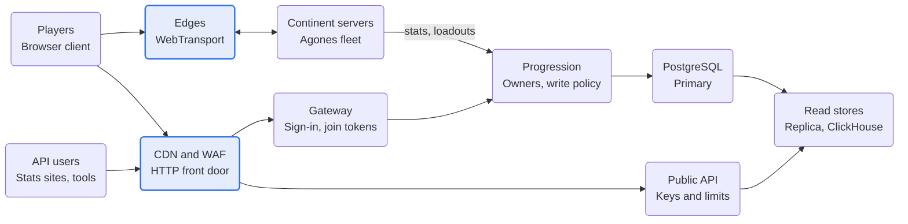

# Phase 3 Spec — Platform: Persistence, Login, Hosting and Public API

Oct 2, 2026 · @Nicholas Bonilla

Phase 3 turns the regionized server into a hosted, persistent game. Players sign in, their progress survives crashes, continents open and close on demand, and outsiders read stats without touching game systems. It builds sub-specs 13–16: the progression and social tier, the gateway and login flow, orchestration and hosting, and the public stats API.

v2 doesn't define Phase 3; it says to copy Phases 3 and 4 from the Sep 30 spec. That spec has since been recovered ([Sep 30 spec](../architecture/history/server-architecture-2026-09-30.md)) and puts ASP.NET Core and SQL in its Phase 1, but these phase specs govern (constitution, reconciliation 12). So this spec takes the breakdown's Platform stage as Phase 3 and adds a gate of its own, a hosted alpha.

## Exit criteria

The Phase 3 gate passes when all of these hold on staging:

- [ ] A player signs in, joins a continent through an edge, plays, logs out and back in, and finds their progress intact.
- [ ] Killing a continent server mid-play loses at most one batch interval of stats, never currency, and no stat batch applies twice.
- [ ] Concurrent conflicting trades never duplicate or lose items or currency.
- [ ] A continent opens through an Agones allocation, locks by draining players through the continent-transfer flow, and recovers from a crash with base ownership restored, each one timed.
- [ ] A login storm of 5,000 sign-ins in 5 minutes (proposed) completes, with the admission queue engaging past capacity.
- [ ] Continent tick p99 under Kubernetes matches gate 12's bare numbers, proving exclusive and quiet tick cores work.
- [ ] Public stats API load never reaches the PostgreSQL primary or a continent server, and every query respects its timeout.
- [ ] Join tokens are single-use and expire, and rate limits hold at the gateway and the API.
- [ ] Dashboards and alerts cover continent, edge, gateway, progression and database health.

## At a glance

<!-- Diagram converted from Claude Docs widget "Phase 3 platform · front doors, services and data stores" -->
**Two front doors: edges for game traffic, the CDN and gateway for everything else**\
Phase 3 platform; public reads never touch the primary or game servers

Players sign in and get a join token through the HTTP door, then play through an edge. Only the progression service writes the primary; public reads come from the replica and ClickHouse.

## Sub-spec 13: Progression and social tier

Live player and social state sits in one ASP.NET Core service over PostgreSQL. It is organized as owners, so the later move to Orleans grains is mechanical rather than a redesign.

### Owners

| Owner | Key | Owns | Stored |
| --- | --- | --- | --- |
| Player | Character ID | Profile, loadouts, progression counters, presence | Own schema; stats batched |
| Outfit | Outfit ID | Roster, ranks, outfit stats | Own schema |
| Squad | Squad ID | Members, leader, waypoints | Memory only |
| Chat channel | Channel ID | Members, message fan-out | Memory only |
| Continent | Continent instance ID | Population, faction split, edge endpoints, heartbeat | Memory only |
| World | World ID | Continent directory, open and locked continents, alerts | Own schema |

### One owner per ID

- Owners are the only writers of live data, and admin tools change it through them, never with direct SQL.
- Without Orleans, there is one owner per ID only while one service instance holds them. Phase 3 runs exactly one active instance, elected through a Kubernetes Lease, with a warm standby that takes over when the lease lapses.
- Concurrency tokens (PostgreSQL's xmin) stay as the safety net: if two instances ever overlap, a stale save fails instead of overwriting.

### Storage

- Queryable data, such as characters, outfits, rosters, stats and the currency ledger, lives in our own PostgreSQL schema through EF Core or Dapper.
- PostgreSQL runs under the CloudNativePG operator, with a streaming replica serving leaderboards and the public API.
- Schema changes use expand-and-contract migrations, so the service never needs downtime for them.

### Write policy

| Data | Policy |
| --- | --- |
| Currency and purchases | Written immediately as append-only ledger rows, each with an idempotency key (the purchase, provider event, trade or grant ID) under a unique constraint, which a trade's rows share once per party; a repeated key with the same request returns the original result, a repeated key with a different request is rejected, and a write that carries an older continent epoch is rejected even when its key exists |
| Loadouts and settings | Written on change |
| XP and stats | Batched per player every 30 s, at logout and on continent transfer |
| Squads, chat, presence | Never persisted |

The currency balance is the sum of ledger rows, cached on the player row behind its concurrency token. A retried purchase can't charge twice, and currency never sits only in memory.

### Idempotent stat batches

Regions record XP and stat changes in region-local buffers, and a per-continent batcher sums them per player. Each batch carries its continent instance, player and a batch sequence number; the Player owner keeps the last sequence applied per continent instance and ignores repeats. Batches can then be retried after a timeout without counting twice, and a crash loses at most one 30-second interval of stats.

At 20,000 players flushing every 30 seconds, that is about 700 writes a second, which v2 places within one PostgreSQL node.

### Trades

v2 rules out Orleans transactions, because they need a transactional state store whose documented option is Azure Table. A trade is instead one PostgreSQL transaction, driven by a short-lived trade owner:

1. The trade owner asks both Player owners to reserve the items involved.
2. It commits one SQL transaction that records the trade under its trade ID, behind a unique constraint, and moves the items and currency, guarded by the concurrency token of every row it moves; any currency it moves is written as one ledger row per party, keyed by the trade ID.
3. It tells both owners to apply the result. On a failure, both release their reservations and nothing moves; if the outcome is unknown, the trade owner first retries with the same trade ID, and the retry looks that ID up before checking any concurrency token, so a trade that already committed returns its original result whether or not it moved currency. After a commit or a failure, both owners reload the affected rows before another trade, and reservations expire.

A fuzz test runs many conflicting trades at once and checks that total items and currency never change.

### Squads, chat and presence

- Squad owners hold members, leader and waypoints in memory. Membership changes also reach Delivery in the snapshot feed, since attention sets include squadmates.
- Chat travels from the client's gateway WebSocket to a Chat channel owner, which fans it out to members' gateway connections. Channels are squad, outfit, continent and whisper (proposed).
- Chat is never persisted, so a moderation report carries the reported messages from the channel's short in-memory buffer (proposed). The gateway rate-limits chat per player.
- Each continent server heartbeats its Continent owner with population and its player list, and the Continent owner updates each Player owner's presence.
- Friends and groups wait on the Nakama question below.

## Sub-spec 14: Gateway and login flow

The gateway carries all traffic to the game backend except game traffic. Game traffic goes straight to an edge, admitted by a one-time join token that the gateway issued.

### Gateway

- It handles TLS, routing, token validation, per-player rate limits and WebSockets for chat.
- Day one, it is the ASP.NET Core service itself, using built-in authentication, rate-limiting and output-caching middleware. YARP routes between services once there are several, and the cluster's Gateway API controller, such as Envoy Gateway, handles ingress and certificates.
- DDoS protection sits in front of everything, before any API management product, as v2 requires: Cloudflare for HTTP traffic, and host network protection for edges (constitution, reconciliation 25).

### Identity and join tokens

- Sign-in uses an OpenID Connect provider with a redirect flow, since Phase 1's COOP header breaks popup sign-in. The gateway validates short-lived access tokens locally by signature, and refresh tokens renew them.
- A join token binds the player, continent instance, edge endpoint, an expiry (30 s, proposed) and a single-use nonce, signed by the gateway with an asymmetric key.
- Edges verify the signature offline and remember used nonces until they expire, so each token works once.
- The token travels in the connection's first message, because browsers can't add headers to the connect request.

### Login and first deploy

1. The client signs in through the gateway, which activates the Player owner.
2. The gateway asks the World owner for open continents.
3. The player picks a spawn, and the gateway returns that continent's edge endpoint with a join token.
4. The client connects to the edge; the edge checks the token, and the continent server fetches the loadout from the Player owner.
5. The server adds the player at the spawn point through the location queue, and the edge starts sending the player's view.

### Reconnects and admission

- A dropped player keeps their place for a grace window (15 s, proposed). The edge holds a resume token, and the avatar stays in the world until the window ends, then despawns. A reconnect inside the window resumes with a full resync.
- When a world or continent is full, the gateway queues sign-ins and deploys and shows each player's queue position. The World owner publishes capacity from population caps and the fight cap.

## Sub-spec 15: Orchestration and hosting

Each continent server runs as an Agones game server on a dedicated node, and everything else runs as ordinary Kubernetes workloads.

### Continent servers under Agones

| Step | Agones mechanism | What happens |
| --- | --- | --- |
| Start | Pod scheduled on a dedicated continent node | The server loads its map and collision data |
| Ready | SDK `Ready()` | Agones publishes the address and port, and the server waits in the fleet |
| Allocated | A GameServerAllocation from the World owner | The server registers with its Continent owner, and edges attach to its feed |
| Healthy | SDK `Health()` pings | A watchdog sends pings only while ticks progress, so a stalled tick lets the pings lapse and Agones marks the server Unhealthy |
| Shutdown | SDK `Shutdown()` after the drain | The server stops and its pod terminates |

The [Agones SDK guide](https://1-58-0.agones.dev/site/docs/guides/client-sdks/) documents these calls, and Agones ships a C# SDK.

### Node tuning

- Continent pods are Guaranteed with integer CPU requests, so the kubelet's static CPU manager [gives them exclusive CPUs](https://kubernetes.io/docs/concepts/resource-management/resource-managers/).
- Three static-policy options apply: `full-pcpus-only` stops other pods sharing a physical core, `strict-cpu-reservation` keeps all pods off reserved CPUs, and `prefer-align-cpus-by-uncorecache` aligns CPUs to last-level cache, matching Phase 2's one-L3 rule for phase workers.
- The topology manager's `single-numa-node` policy keeps each continent pod on one NUMA node.
- Exclusive CPUs only exclude other pods; the kubelet and container runtime can still run there. Node setup therefore keeps system daemons and NIC interrupts on the reserved CPUs, while the continent server's own GC and helper threads run on its exclusive CPUs, inside the reserved-core counts of its thread budget (constitution, Scheduling and time).
- Taints and node affinity keep everything else off continent nodes, one continent per node, except that continent's own Delivery and edge transport until they move to edge nodes (constitution, Principle I).

### Edges and other services

- Edges run as Deployments. Each continent's Delivery and edge transport start on its continent host, behind the same feed and outside the continent pod's exclusive CPUs, and move to edge nodes when profiling shows contention for cores or cache (constitution, Principles I and II). Edge nodes have high-bandwidth NICs, host networking for UDP and batched sends, and sit in the same data center as the continent hosts.
- The gateway, progression service, public API, PostgreSQL under CloudNativePG and ClickHouse run outside Agones.

### Environments

| Environment | What runs |
| --- | --- |
| Local | kind or k3d with Agones and the Pre-Phase 1 harness stack |
| CI | The same manifests, plus the fixed runner class for replays |
| Staging | Rented bare metal: one continent host, edge nodes, bot hosts and the platform services |
| Production | Bare metal with bundled bandwidth for continent hosts and edges |

Bundled bandwidth matters because v2 estimates about 2.3 Gbit/s downstream for 5,000 players, roughly 1 TB an hour.

### Continent lifecycle

Opening, locking and failover all go through the World owner and the Agones fleet, and the gate times each one.

**Opening**

1. The World owner requests an allocation from the fleet.
2. The allocated server restores base ownership from the latest checkpoint, if there is one, and registers with its Continent owner.
3. Edges attach to its feed, and the World owner lists the continent as open.

**Locking**

1. The global region detects the lock condition and tells the World owner, which opens the next continent if needed.
2. The locking server stops accepting deploys and flushes each player's stat batch, as v2's write policy requires on transfer.
3. Each player is handed to the gateway for a deploy onto an open continent, with a fresh join token.
4. Once empty, or after a timeout, the server calls `Shutdown()`.

**Failover**

1. A stalled server misses its health pings and Agones marks it Unhealthy, or its pod dies.
2. The World owner allocates a replacement from the fleet's ready servers.
3. The replacement restores base ownership from the global region's last checkpoint (every 10 s, proposed). Lost stats are bounded by the batch interval, and currency was never only in memory.
4. Clients lose their edge session and rejoin through the gateway with a fresh join token, while edges reattach to the new feed.

Failover is only quick if a ready server is waiting, so the fleet keeps at least one spare per world (proposed). That spare is an idle dedicated node, which the open questions weigh.

## Sub-spec 16: Public stats API

The public API runs as its own ASP.NET Core service behind the gateway, and no request it serves can reach the PostgreSQL primary or a game server.

### Endpoints (proposed)

| Path | Returns | Source | Freshness |
| --- | --- | --- | --- |
| `/v1/characters/{id}` | Profile, outfit, lifetime stats | PostgreSQL replica | Within one 30 s batch |
| `/v1/outfits/{id}` | Roster and outfit stats | PostgreSQL replica | Within one batch |
| `/v1/leaderboards/{stat}` | Top players by stat and period | ClickHouse aggregates | Minutes |
| `/v1/worlds/{id}/continents` | Open and locked continents, population, base ownership | A status table the World owner writes every 5 s, read from the replica | Seconds |
| `/v1/events` | Recent kills and captures, paginated | ClickHouse | Seconds |
| Live stream | Kills and captures as they happen, over WebSocket | The stream service | Near real time |

### Rules

- **Keys.** Self-serve signup issues API keys, stored hashed in PostgreSQL and checked by an ASP.NET Core authentication handler.
- **Rate limits.** The built-in limiter is partitioned by key. It counts per process, so shared counts move to Valkey once several replicas run.
- **Caching.** A CDN caches GET responses for 30 seconds to a few minutes, so most traffic never reaches our servers.
- **Isolation.** Queries hit ClickHouse aggregates or the read replica, each with a hard timeout.
- **Docs and versions.** ASP.NET Core generates the OpenAPI documents, and paths carry the version, such as `/v1/`.
- **Usage.** Every request is logged with its key into ClickHouse.

### Live stream

Game events reach ClickHouse through the ingest service, which also publishes kills and captures to Valkey pub/sub. A separate stream service fans them out over WebSocket, so the stream never touches a game server. Valkey is already planned for shared rate limits, so this adds no new component.

### Privacy

Events in ClickHouse use pseudonymous player IDs, and only PostgreSQL maps them to characters. Erasing a player deletes that mapping and their PostgreSQL rows, which leaves their events anonymous without rewriting ClickHouse history. Whether detailed per-player stats are public by default is an open question.

Envoy Gateway remains the upgrade path once several public services need shared policies, as v2 decided.

## Phase 3 gate — hosted alpha

The gate runs on staging bare metal with bots and a handful of real browser players. It checks the platform end to end; gates 9 and 12 already covered the simulation.

| Test | Setup | Pass rule |
| --- | --- | --- |
| End-to-end session | Browsers and bots sign in, deploy, play, log out and back in | Progress intact, with no manual steps |
| Crash durability | A continent server killed mid-play, repeatedly | At most one batch interval of stats lost, no currency lost, no batch applied twice |
| Trade fuzz | Thousands of conflicting trades at once | Total items and currency unchanged |
| Continent lifecycle | Open, lock with drain, and crash failover | Each completes; open and failover under 60 s with a spare ready (proposed) |
| Login storm | 5,000 sign-ins in 5 minutes (proposed) | Every sign-in completes or queues, within latency targets |
| Kubernetes overhead | Gate 12's continent scenario re-run under Agones | Tick p99 within 5% of gate 12's bare numbers (proposed) |
| API isolation | Several times the expected API load, with the CDN bypassed | Primary database and continent servers unaffected; timeouts hold |
| Security basics | Replayed and expired join tokens, rate-limit abuse, key revocation | All rejected or throttled |
| Progression failover | The active progression instance killed | The standby takes over within the lease timeout, with no lost or doubled writes |

The gate also records four decisions: Nakama or custom social owners, the triggers for moving to Orleans, the number of spare continent servers per world, and whether detailed player stats are public by default.

## Risks

Most Phase 3 risks are about data integrity rather than speed, so the gate leans on crash and race tests.

| Risk | Impact | Mitigation |
| --- | --- | --- |
| The single progression instance becomes a bottleneck or single point of failure | Logins and stat writes stall | A lease-based standby, and Orleans triggers recorded at the gate |
| Stat batches lost or counted twice | Players lose or gain progress | Idempotent batch sequences and the crash durability test |
| Trade races duplicate items or currency | Economy damage | One SQL transaction per trade, concurrency tokens, and the trade fuzz test |
| A login storm overwhelms Player owners or the database | Sign-ins time out | The admission queue, connection pooling and a staged warm-up |
| A continent crash loses base state | Fights reset | Checkpoints every 10 s and a ready spare server |
| Kubernetes adds tick jitter | Smoothness regresses | Exclusive cores, cache-aligned CPUs, and the overhead test against gate 12 |
| Join-token signing keys leak | Anyone can join any edge | Short expiry, single-use nonces and key rotation |
| DDoS against edges | Players drop | Network-level protection at the host, with only edges exposed |
| Public stats expose players unexpectedly | Privacy and legal exposure | Pseudonymous event IDs, erasure by deleting the mapping, and a default-visibility decision |
| Platform scope grows past the gate | Phase 3 slips | The public API can move to Phase 4, taking its isolation test with it |

## Build order

Persistence comes first because login, lifecycle and the API all read or write it.

1. PostgreSQL under CloudNativePG with the schema, then the progression service: owners, write policy, ledger and idempotent stat batches.
2. The continent server's stat batcher and loadout fetch, wired to the Player owner.
3. The gateway with OpenID Connect sign-in, token validation and rate limits, plus join tokens and edge validation, giving the login and first-deploy flow end to end.
4. Squads, chat and presence.
5. The Agones fleet, node tuning and edge Deployments, first on kind or k3d, then on staging bare metal.
6. The continent lifecycle: opening, locking with a drain, and failover from checkpoints.
7. Reconnects and the admission queue.
8. The public stats API: keys, limits, caching, read isolation and the live stream.
9. The Phase 3 gate on staging.

## Proposed changes to the v2 spec

Eight changes, each with the case for and against and a recommendation. The spec's body follows every recommendation. Agents decide each change under the constitution's Governance, Roadmap decisions, before the first feature of any sub-spec it affects is specified; the Decision column records it.

| Change | For | Against | Recommendation | Affects | Decision |
| --- | --- | --- | --- | --- | --- |
| Phase 3 is the breakdown's Platform stage, with a hosted-alpha gate of its own | Gives the platform a measurable finish line, like Phases 1 and 2 | The missing Sep 30 roadmap may split the work differently | Adopt now, and re-cut if that roadmap turns up | 13–16 | Yes (constitution 1.0.0; reconciliation 12) |
| One active progression instance, elected through a Kubernetes Lease, until Orleans | One owner per ID without Orleans, with failover | One instance caps write capacity, and failover waits for the lease timeout | Adopt, and record the Orleans triggers at the gate | 13 | Partly (constitution 1.0.0: one active progression instance until Orleans, with the Orleans thresholds recorded at the Phase 3 gate) |
| Stat batches carry a sequence number per continent instance and player | Retries can't count twice | The Player owner stores one extra number per continent instance | Adopt | 5, 13 | Yes (constitution 1.0.0) |
| The gateway signs join tokens, and edges verify them offline with single-use nonces | Edges admit players without a callback, and tokens can't be replayed | Key rotation, and a nonce cache on each edge | Adopt | 7, 14 | Yes (constitution 1.0.0; reconciliation 20) |
| Sign-in uses an OpenID Connect provider with a redirect flow | Standard tokens that work under Phase 1's COOP header | One more service to run or buy | Adopt; the provider is an open question | 14 | Partly (constitution 1.0.0: redirect sign-in, but our own code on ASP.NET Core Identity serves OpenID Connect, not a separate provider; reconciliation 19) |
| Dropped players keep their place for a grace window | Brief network drops don't end sessions | The avatar stays in the world, exposed, during the window | Adopt at 15 s, tuned in playtests | 7, 14 | Pending |
| The ingest service feeds the live stream through Valkey pub/sub | No game server touches the stream, and Valkey is already planned | Pub/sub is fire-and-forget, so a lagging stream service misses events | Adopt; clients backfill gaps from `/v1/events` | 16 | Pending |
| Events use pseudonymous player IDs | Erasure deletes one mapping instead of rewriting ClickHouse | Analysis joins through the mapping to see names | Adopt | 2, 16 | Yes (constitution 1.0.0) |

## Open questions

Eight questions are open and three are decided by the constitution, each with its trade-off and a recommendation. The spec's body follows the recommendations. Agents answer each remaining question under the constitution's Governance, Roadmap decisions, before the first feature of any sub-spec it affects is specified, and record the answer in its Status cell; escalation items wait for the director.

| Question | Status | Trade-off | Recommendation |
| --- | --- | --- | --- |
| Nakama or custom social owners | Open | Nakama ships friends, groups, chat and leaderboards, but adds a Go runtime and a second home for player data | Custom squads, chat and presence, which tie into gameplay; consider Nakama only for friends and groups, and only on our player IDs |
| Identity provider | Decided (constitution 1.0.0): our own code on ASP.NET Core Identity, with redirect sign-in; the identity spike chooses how it serves OpenID Connect (reconciliation 19) | Self-hosted keeps hosting local-first but adds operations; managed cuts operations but adds cost and lock-in; building our own is the most work and risk | A self-hosted OpenID Connect provider, such as Keycloak or Ory, chosen in a short spike |
| When to move to Orleans | Open | Moving early slows iteration; moving late risks an outage when one instance saturates | Move when the single instance passes 60% CPU at peak, or failover exceeds 30 s (proposed) |
| Stat batch interval | Open | Shorter loses less in a crash but writes more | 30 s, flushing at logout and on transfer |
| Reconnect grace window | Open | Longer saves more sessions but leaves avatars exposed longer | 15 s, tuned in playtests |
| Spare continent servers per world | Open (escalation item: the director decides) | A ready spare makes failover fast but idles a dedicated node | One spare per world at launch, revisited against real failure rates |
| DDoS protection | Decided (constitution 1.0.0): Cloudflare in front of the gateway and the public stats API, and provider network protection for edges (reconciliation 25); paid tiers and scrubbing (escalation item: the director decides) | Host-level network protection is cheap but coarse; scrubbing services are stronger but cost more | Hosts with built-in network protection for edges, and HTTP behind a CDN with a web application firewall |
| Hosting provider and region | Open (escalation item: the director decides) | Bare metal with bundled bandwidth is cheapest per terabyte but slower to scale; cloud is elastic, but egress pricing dominates | Bare metal for continent hosts and edges, one region first |
| Default visibility of per-player stats | Open (escalation item: the director decides) | Public by default makes the API more useful; opt-in protects privacy | Decide with legal input for launch regions; publish only aggregates until then |
| Admission queue order | Open | Strict first-come is simple but can split squads; squad-aware queuing keeps groups together at some complexity | First-come, with each squad queued as one unit |
| Edge placement | Decided (constitution 1.0.0): Delivery and edge transport start on the continent host and move to their own nodes in the same data center when profiling shows contention for cores or cache (Principles I and II) | Edges on the continent host save a hop; separate nodes isolate cores and cache | Own nodes in the same data center once profiling shows contention, as v2 says |

## Sources

- PS2-Style MMOFPS Server Architecture Spec v2 (Oct 2, 2026)
- Earlier specs: the breakdown PS2-Style MMOFPS — Sub-spec Breakdown, Pre-Phase 1 Pre-Phase 1 Spec — Regionizer Simulator and Test Harness, Phase 1 Phase 1 Spec — Netcode and Smoothness on One Region and Phase 2 Phase 2 Spec — Regionizer and Fight Cap
- [Agones Game Server Client SDKs](https://1-58-0.agones.dev/site/docs/guides/client-sdks/), Agones docs
- [Resource managers](https://kubernetes.io/docs/concepts/resource-management/resource-managers/), Kubernetes docs
