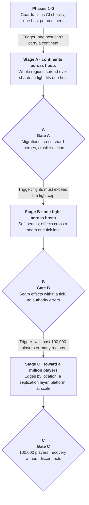
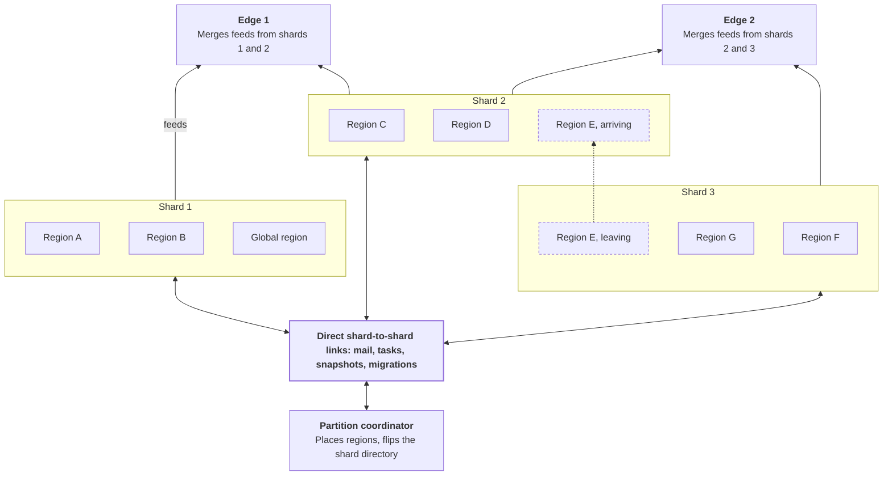

# Phase 4 Spec — Scaling Past One Host

Oct 2, 2026 · @Nicholas Bonilla

Phase 4 takes the game past one host per continent, toward v2's targets of 100,000 and then a million players. It covers sub-spec 17, the scaling path, in three stages: continents spread across hosts, then one fight spread across hosts, then the systems a million players need.

Unlike Phases 1–3, Phase 4 starts only when a trigger fires, because v2 defers multi-host work until profiling shows one host can't carry a continent. Until then only its guardrails apply, and they have applied since Phase 1.

v2 doesn't define Phase 4 either, so this spec takes the breakdown's last stage. Launch readiness, such as client anti-cheat and live operations, is Phase 5 (sub-specs 18–24), which may run before Phase 4 while both phases keep their numbers (constitution, Principle XII); a section below lists the gaps Phase 5 took over.

## At a glance

<!-- Diagram converted from Claude Docs widget "Phase 4 stages · triggers and gates" -->
**Each stage waits for its own trigger and ends at its own gate**
*Phase 4 stages; nothing starts until its trigger fires*



A stage starts only when the previous gate has passed and its own trigger has fired, so the game may never need Stage B or C. Stages A and B also need a MINOR amendment that lifts the matching Non-goal (constitution, Principle XII).

## Triggers and guardrails

Each stage starts on its own trigger, and none starts early.

| Stage | Trigger |
| --- | --- |
| A: continents across hosts | Gate 12's curves or production show one host can't carry a continent's target population across its fights |
| B: one fight across hosts | The design needs fights bigger than the fight cap, after parallel phases are exhausted |
| C: toward a million | A world or event needs well beyond 100,000 concurrent players, or players from several geographic regions in one fight |

### Guardrails from Phase 1 on

v2's multi-server invariants keep Phase 4 an extension rather than a rewrite. Each is enforced by a check, not a convention.

| Invariant | Enforced by |
| --- | --- |
| At most one authority per entity at any instant | Phase 2's monitors: no entity has more than one owning region, and an entity in a two-step teleport has none (constitution, reconciliation 6) |
| Stable entity IDs | Slot index plus generation from Phase 1, never reused while anything still refers to it |
| Player sessions independent of the worker simulating them | Sessions live on edges and in the progression tier, keyed by player, never by region or host |
| Writes across regions only through messages | Region data is reachable only through the tick's context, never statics, and an analyzer flags violations |
| One continent-wide time base | Phase 2's continent clock for every deadline and timestamp |

v2's other standing requirements also hold until a trigger fires: Delivery stays a separate process with fixed attention sets, local density stays a design budget enforced by map layout, spawns and objectives, and GPUs and any functional split of the simulation stay deferred.

## Density budget and sizing

Cost per player must stay flat as fights grow, so local density is a design budget rather than a server problem. The client renders on one machine while the backend scales out, so the client sets the limit, as v2 notes.

If no player should have more than N others within radius R, P players need this much continuously contested ground:

```latex
A = \frac{P \, \pi R^2}{N}
```

With v2's budget of 2,000 players within 200 m, each full circle covers about 0.126 km². So 100,000 players need about 6.3 km², and a million need about 63 km², a whole PlanetSide 2 continent packed edge to edge.

| Measure | 100,000 players | 1,000,000 players |
| --- | --- | --- |
| Simulation cores | 50–150 | 500–1,500, plus seam overhead |
| Outbound bandwidth | About 46 Gbit/s, roughly 21 TB per hour | About 464 Gbit/s, roughly 210 TB per hour |
| Stat writes | About 3,300 per second | About 33,000 per second |

These scale v2's 5,000-player estimates. At the starting budget of about 58 KB/s, each player costs about 0.21 GB an hour, so bandwidth grows linearly and, at a million players, becomes the dominant cost. The per-client byte budget is then a business number as much as a technical one.

## Stage A: continents across hosts

Stage A spreads one continent's regions over several hosts while keeping each region whole on one host. Phase 2's regions already meet only through queues, copies and snapshots, so this turns in-process channels into network ones without changing gameplay. A fight must still fit on one host; only the continent grows.

### Processes

- **Simulation shards** are identical continent-server processes, each hosting a set of whole regions, pre-started in an Agones fleet as v2 describes.
- **The partition coordinator** assigns regions to shards, decides migrations and owns the region-to-shard directory. It never simulates.
- **Edges** keep their role, and each subscribes to the feeds of every shard holding regions its clients can see.
- **The global region and area actors** run on one designated shard, and other shards read their copies over the network at tick start.

### Rules

- **Regions stay whole.** A region never spans hosts in Stage A; a fight that outgrows a host needs Stage B.
- **Merges co-locate first.** When regions on different shards must merge, the smaller one turns transient and the coordinator migrates it to the larger one's shard, where the normal tick-end merge runs. The larger fight keeps ticking throughout.
- **One authority during migration.** The source shard stops ticking the region and serializes it, the target loads it and acknowledges, the coordinator flips the directory, and the source drops its copy. Mail arriving mid-move is forwarded after the flip.
- **Cross-shard queues.** Entity mail and location tasks for other shards travel over direct shard-to-shard links, routed by an entity-to-shard directory each shard caches. A stale lookup is forwarded by the old shard, and per-link ordering keeps per-sender order.
- **Snapshots** cross shards for the read-only class, such as far visibility and spotting, one tick stale plus the data center's network delay.
- **Time.** Every shard ticks on the one continent time base, with host clocks kept well within a tick of each other, and cross-shard messages carry continent timestamps.
- **Delivery.** Edges merge feeds from several shards, and Phase 2's explicit-despawn rule already keeps a moving region from flickering.
- **Placement.** The coordinator balances shard load and keeps neighboring fights on one shard where it can, so likely merges need no migration.
- **Failure.** A shard crash loses only its own regions, whose players rejoin through Phase 3's failover path until Stage C adds a replication layer.

A migrating region skips only a few ticks. A 1,000-player region is about 2 MB with pose history (roughly 1.7 KB per entity), which moves across a data-center network in milliseconds.

### Stage A architecture

<!-- Diagram converted from Claude Docs widget "Stage A · shards, links, coordinator and edges" -->
**Regions stay whole on one shard; shards meet only over direct links**
*Stage A continent; region E is moving to shard 2 to merge with D*



The coordinator only places regions and flips the directory; it never simulates, so existing regions keep ticking if it goes down.

## Stage B: one fight across hosts

Stage B is the first time one region spans hosts, so it is the first stage that changes gameplay: interactions across a seam arrive a tick late. v2 places this somewhere in the tens of thousands of players per fight and calls that unproven.

- **When.** A region past the fight cap, with parallel phases exhausted, is cut into parts along seams, each part on its own shard.
- **Where.** Seams follow low-traffic lines, such as terrain features or ground between capture points, chosen from recent density. Hysteresis keeps them from moving every tick, and they avoid roads and vehicle lanes.
- **Across a seam.** Entities within one claim radius of the seam appear on the other side as read-only ghosts, refreshed every tick. An effect on a ghost becomes a message to its owner and lands a tick later.
- **Instant interactions** such as melee, heals and revives therefore take a tick across a seam. Collisions across a seam resolve against the other side's ghost from the previous tick, so two bodies can overlap for one tick.
- **Hit claims** don't change: the target's owner validates them against its own pose history.
- **Crossing a seam** hands the entity to the other side at a tick boundary, so it has one owner at every instant.
- **Vehicles** belong to one side by their center point. Vehicle physics across a seam is the most likely source of visible artifacts, which is why seams avoid vehicle lanes.
- **Ghost cost** grows with the number of entities inside the seam band, so seam placement minimizes that band's population.

Stage B makes a design trade explicit. v2 treats local density as a design budget, so capping fights through map layout and spawns is preferable where it works, and seams are for fights the design truly needs bigger than one host.

## Stage C: toward a million players

Stage C fixes what breaks once players arrive from everywhere and failures become routine. Each row comes from v2's scaling table.

| Area | What breaks | Upgrade |
| --- | --- | --- |
| View building | Dense fights make per-client views costly | Fixed attention sets plus shared detail tiles, each encoded once per tick for every viewer of an area |
| Edges | Outbound bandwidth grows linearly with players | Many edge nodes, points of presence in several regions, batched sends and DDoS protection |
| Geography | Players join from everywhere | Edges near players smooth jitter and loss but can't beat the speed of light; accept the rewind-cap disadvantage or run regional fights |
| Failures | Dozens of hosts make crashes routine | Entity state lives in a replication layer that outlives shards |
| Progression and social | Login storms, presence and chat fan-out | Admission queues, hierarchical presence, scoped chat, and PostgreSQL split by player ID |
| Orchestration | One session spans many servers | A pre-started fleet of shard servers, with areas assigned by the coordinator |
| Client | Crowds overwhelm one machine | GPU-drawn crowds, plus aggregated audio, minimap and kill feed |

- **Edges by location.** Clients attach to the edge serving their map area. Crossing into another edge's area uses a make-before-break handoff: a new session with a fresh join token opens before the old one closes.
- **Replication layer.** Star Citizen's design, as v2 describes it, replaces a crashed node from persisted entity state while clients stay connected and briefly frozen. Stage C aims for the same, so a shard crash no longer sends players through a rejoin.
- **GPU work.** At this scale, uniform batched work becomes worth a GPU: world-collision sweeps, spatial hashing, building crowd tiles and hit-claim raycasts. Hot loops are already structs of arrays, and the route in .NET is ILGPU, or CUDA and Vulkan kernels called through interop.

## Testing at scale

A million real clients is unaffordable, so v2 splits testing across four tools, each covering what the others can't.

| Tool | What it does | What it catches |
| --- | --- | --- |
| In-process input generators | Synthetic player inputs generated inside shard processes, skipping the network | Simulation cost at full scale |
| Recorded snapshot feeds | Recorded feeds replayed into edges without live shards | Edge and Delivery cost per client |
| Whole-cluster simulation | Shards, coordinator and edges in one process, on a simulated network and clock, with seeded crashes, partitions and delays | Migration, merge and seam bugs that need rare timing |
| Real clients at a few percent of scale | Bots and browsers on the real network path | End-to-end smoothness and latency |

The whole-cluster simulation is the main correctness tool. A bug that needs a crash during a migration during a merge is out of reach for load tests, but a seeded search over failure schedules finds it and replays it exactly.

The Pre-Phase 1 simulator also gains shard placement, so it can predict migrations and seam traffic for a map before any of it runs for real.

## Stage gates

Each stage ends at its own gate, and the next stage waits for both that gate and its own trigger.

### Stage A gate

- [ ] A continent's regions run across at least three shards, in the whole-cluster simulation and on real hosts.
- [ ] A region migrating under load skips at most 3 ticks (proposed), while every other region holds its tick budget.
- [ ] Cross-shard merges co-locate and complete with zero invariant violations through a soak with injected failures.
- [ ] A shard crash affects only its own regions, and the rest keep 30 Hz.
- [ ] Edges merge multi-shard feeds with every Phase 1 smoothness rule still passing.
- [ ] A continent at several times one host's population holds 30 Hz in every region below the fight cap.

### Stage B gate

- [ ] One fight above the fight cap runs across two or more shards at 30 Hz.
- [ ] Cross-seam interactions land within one tick, and one-tick overlaps are counted and judged acceptable in playtests.
- [ ] Honest bots' hit claims across seams are still rejected under 0.1% of the time.
- [ ] Seams move only within a per-minute cap (proposed), thanks to hysteresis.
- [ ] The whole-cluster simulation finds no authority violations under injected failures.

### Stage C gate

- [ ] 100,000 concurrent players in one world, a few percent real and the rest generated, stay within Phase 1's smoothness baselines.
- [ ] A shard crash recovers from the replication layer without disconnecting clients, freezing them for at most 2 s (proposed).
- [ ] Location-based edge handoffs complete without dropped sessions.
- [ ] The progression tier sustains about 3,300 stat writes a second, and a world-scale login storm queues cleanly.
- [ ] Bandwidth per player stays within budget, and cost per player-hour is reported.

## What stays off the path

The cluster has three process types, simulation shards, edges and the partition coordinator, beside the progression, social and gateway services. v2 rules the following out, and Phase 4 keeps them out.

| Option | Why not |
| --- | --- |
| Splitting the simulation by function | It would put network round trips inside a 33 ms tick |
| A message broker in the tick path | Shards talk to neighbors directly; brokers carry only telemetry |
| Orleans simulating entities | Orleans stays in the progression and social tier |
| Deterministic lockstep | Every client would need every player's inputs |
| Peer-to-peer authority | Browser clients are easy to tamper with |
| EVE-style time dilation across the world | It suits EVE's pace, not a shooter; Phase 2 limits slowed time to sealed areas |

## Launch gaps outside sub-specs 1–17

No sub-spec from 1 to 17 covers these, and a public launch needs most of them. Phase 5 turns all of them except the console client into sub-specs 18–24; the console client stays deferred, and this scaling plan stays Phase 4 (constitution, Principle XII).

| Gap | Why it matters | What already touches it |
| --- | --- | --- |
| Client integrity and anti-cheat | Server replay stops impossible hits, not wallhacks or aim assistance | v2 lists client integrity as open, and names server-side anti-wallhack culling as the first job for batched line-of-sight checks |
| Content pipeline | Maps, portal graphs, collision data and baked animations need a repeatable export path | The portal validator and the collision data formats |
| Live operations | On-call, incident response, and patches that don't drop running fights | Protocol versioning and the Agones lifecycle |
| Moderation and player safety | Reports, chat moderation, and bans built on statistical detection | Claims logged to ClickHouse, with rejections alone never banning |
| Economy | Currency sources and sinks, purchases and refunds | The currency ledger |
| World selection and faction balance | Which world a player joins and how factions stay even | The World owner and the global region's faction balance |
| Console client | Deferred by v2 | The shared core runs unchanged in Unity |
| Legal and privacy | Terms, data protection and age rules in launch regions | Pseudonymous event IDs |

## Risks

The cheapest risk to prevent is the first one: a guardrail quietly broken in Phases 1–3 turns Stage A into a rewrite.

| Risk | Impact | Mitigation |
| --- | --- | --- |
| A guardrail erodes before Phase 4 | Stage A becomes a rewrite | Every guardrail is a CI check from Phase 1 |
| Cross-shard merges need migrations mid-fight | A transient region stalls for several ticks | Placement keeps neighbors together, and the gate caps skipped ticks |
| The coordinator fails | No new placements or migrations, though existing regions keep ticking | Small coordinator state, recoverable from shards, with a lease-elected standby |
| Seams show visible artifacts | Players notice one-tick delays and overlaps | Seams avoid vehicle lanes and dense ground, and design caps are preferred |
| A network partition splits shards | Cross-shard mail stalls | Authority changes only by directory flips, tested with partitions in the whole-cluster simulation |
| Bandwidth cost grows linearly | Cost per player stays high at scale | The per-client budget treated as a business number, and bare metal with bundled bandwidth |
| Distant players are disadvantaged | Unfair cross-region fights | Regional fights, or an accepted rewind-cap disadvantage, decided per event |
| The whole-cluster simulation drifts from reality | Bugs escape to production | Real clients at a few percent of scale, with traces compared |
| The replication layer slows writes | The tick budget shrinks | Replication off the tick thread, measured at the Stage C gate |

## Proposed changes to the v2 spec

Seven changes, each with the case for and against and a recommendation. Agents decide each change under the constitution's Governance, Roadmap decisions, before the first feature of any sub-spec it affects is specified; the Decision column records it.

| Change | For | Against | Recommendation | Affects | Decision |
| --- | --- | --- | --- | --- | --- |
| Phase 4 is the scaling path, trigger-gated, in three stages | Turns v2's deferred scaling section into a plan with gates | v2 may have meant a different Phase 4, and launch readiness has no home yet | Adopt, and decide where launch readiness goes | 17 | Yes (constitution 1.0.0, Principle XII: Stages A and B also need a MINOR amendment that lifts the matching Non-goal; reconciliation 12) |
| Stage A distributes whole regions before any seams | Continents outgrow one host with no gameplay change, reusing Phase 2's queues | Fights stay capped by one host | Adopt; it is v2's identical shards plus a coordinator, without soft seams | 10, 17 | Partly (constitution 1.0.0: Stage A runs one continent across hosts, and splitting one fight waits for Stage B) |
| Cross-shard merges co-locate the smaller region first | Merges stay local, and the invariants don't change | The smaller region pauses while it moves | Adopt | 10, 17 | Pending |
| Each shard caches an entity-to-shard directory and forwards stale lookups | Mail reaches entities on other shards without a central hop | The directory updates on every migration and cross-shard teleport | Adopt | 17 | Pending |
| The guardrails are CI checks from Phase 1 | Phase 4 stays an extension, not a rewrite | Analyzer work, and some false positives early | Adopt | 3, 5, 10 | Partly (constitution 1.0.0: invariant monitors check at most one owner per entity, and CI analyzers reject clock reads and mutable static state) |
| Design caps come before soft seams | Keeps one-tick seams out of gameplay | Limits the largest possible fight | Adopt as the default; seams only where the design needs bigger fights | 17, level design | Yes (constitution 1.0.0) |
| Location-based edge handoffs are make-before-break | No dropped sessions when players cross edge areas | Two sessions briefly, and more join tokens | Adopt | 7, 14, 17 | Pending |

## Open questions

Nine questions are open and one is decided by the constitution, each with its trade-off and a recommendation. Agents answer each remaining question under the constitution's Governance, Roadmap decisions, before the first feature of any sub-spec it affects is specified, and record the answer in its Status cell.

| Question | Status | Trade-off | Recommendation |
| --- | --- | --- | --- |
| Does Phase 4 mean scale or launch? | Decided (constitution 1.0.0): scale; launch readiness is Phase 5, which may run before Phase 4 (Principle XII) | Scaling next matches the breakdown, but players need anti-cheat, operations and moderation before any 100,000-player fight | Decide now; launch readiness most likely comes first, making this plan Phase 5 |
| Stage A trigger threshold | Open | Starting early adds cross-shard complexity before it pays; starting late risks a continent hitting its host ceiling in production | Start when a continent's target population needs more than 70% of one host at peak (proposed) |
| Coordinator design | Open | One coordinator is simple and holds little state; a distributed one avoids a single point of failure but needs consensus | One coordinator with a lease-elected standby, since regions keep ticking without it |
| Migration size budget | Open | Larger migrations give placement freedom but stall bigger regions longer | Cap migrations at what moves within 3 ticks; to merge two big regions, always move the smaller one |
| Where the global region runs | Open | On a shard it is simple; on the coordinator it gets its own failure domain | On one shard, checkpointed as in Phase 3 |
| Seam acceptance criteria | Open | Strict criteria may block Stage B entirely; loose ones ship visible artifacts | Set them in playtests: one-tick delay accepted, overlaps under a per-minute rate |
| Replication layer technology | Open | A custom layer on shard-to-shard links fits the tick model; a product saves building but adds latency and operations | Decide in a Stage C spike, starting from asynchronous replication of region state to a peer shard |
| Regional or global fights | Open | Global fights give the full spectacle but disadvantage distant players; regional fights keep latency fair but split the population | Regional worlds by default, with global events accepting the disadvantage |
| When to adopt GPUs | Open | GPU nodes add cost and a device plugin, and CPUs may suffice | Only when Stage C profiling shows a uniform batched hot loop the CPU can't hold; try CPU ray tracing first, as v2 says |
| Whole-cluster simulation harness | Open | Our own harness reuses the seeded scheduler and shared core; a framework saves some building but fits less well | Extend the existing seeded harness |

## Sources

- PS2-Style MMOFPS Server Architecture Spec v2 (Oct 2, 2026), especially its scaling path, sizing and decomposition sections
- Earlier specs: the breakdown PS2-Style MMOFPS — Sub-spec Breakdown, Pre-Phase 1 Doc, Phase 1 Phase 1 Spec — Netcode and Smoothness on One Region, Phase 2 Phase 2 Spec — Regionizer and Fight Cap and Phase 3 Phase 3 Spec — Platform: Persistence, Login, Hosting and Public API
