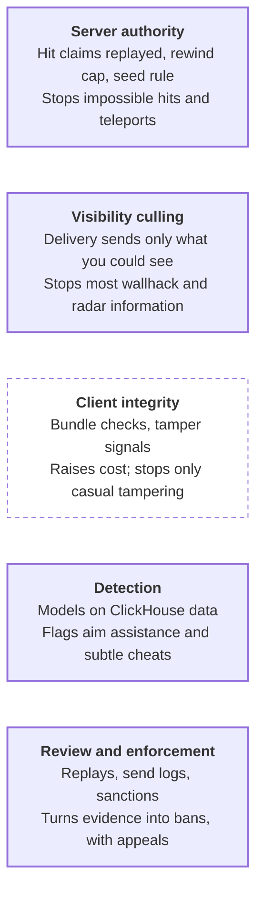

# Phase 5 Spec — Launch Readiness

Oct 2, 2026 · @Nicholas Bonilla

Phase 5 takes Phase 3's hosted alpha to a public beta. It turns the launch-readiness gaps listed in the Phase 4 spec into seven new sub-specs, 18 to 24: anti-cheat and client integrity, the content pipeline, live operations, moderation and player safety, the economy, world selection and faction balance, and legal and privacy work.

Nothing here depends on Phase 4. Phase 5 builds on Phase 3, so it can run before the scaling stages, which only start on a trigger; the Phase 4 spec's first open question recommends exactly that order. The console client stays deferred, as v2 decided.

## Exit criteria

The public beta gate passes when all of these hold:

- [ ] Cheat detection runs on live data, flagged players reach a review queue with replays, and a reviewed ban takes effect within 24 hours (proposed).
- [ ] Enemies a client can't see aren't sent to it, measured as a culling rate in test fights, while Phase 1's smoothness rules still pass.
- [ ] A new map goes from editor to staging with no manual steps, passing the portal validator, the simulator check and the collision agreement test.
- [ ] A release ships while fights continue: running continents finish on the old version while new ones open on the new.
- [ ] A rollback restores the previous version within 30 minutes (proposed), and database backups restore to a fresh cluster.
- [ ] Players can report, block and mute, moderators act from one console, and every action is audited.
- [ ] Purchases, refunds and chargebacks reconcile to the ledger with zero unexplained differences over a simulated month.
- [ ] Faction populations stay within ±10% of each other (proposed) on a test world.
- [ ] Terms, privacy policy, data export and deletion, and age rules are in place for every launch region, signed off by counsel.
- [ ] On-call, runbooks and alerts are live, and a game day recovers from a continent crash, a database failover and an edge outage.

## At a glance

Each new sub-spec builds on something an earlier phase already shipped, which is why Phase 5 needs Phase 3 but not Phase 4.

| Sub-spec | Adds | Builds on |
| --- | --- | --- |
| 18 · Anti-cheat and client integrity | Visibility culling, client checks, detection, review and bans | Server-validated hits, claim logs in ClickHouse, deterministic replays |
| 19 · Content pipeline | Repeatable export and validation of maps and assets | The portal validator, the simulator, collision formats, baked animations |
| 20 · Live operations | Releases, rollbacks, on-call and backups | Protocol versions, the Agones lifecycle, CloudNativePG |
| 21 · Moderation and player safety | Reports, chat moderation, sanctions and audit | Chat channels, claim logs, gateway rate limits |
| 22 · Economy | Currency sources and sinks, purchases, refunds, reconciliation | The currency ledger and idempotency keys |
| 23 · World selection and faction balance | Worlds, faction caps, queues and incentives | The World owner, the global region's faction balance, the admission queue |
| 24 · Legal, privacy and compliance | Terms, privacy, data rights and age rules | Pseudonymous event IDs |

## Sub-spec 18: Anti-cheat and client integrity

A browser client can't be locked down, so anti-cheat leans on what the server controls: what it validates, what it sends and what the data shows. Client-side checks add friction, not security.

### Visibility culling

In VALORANT, Riot's server [withholds enemy positions until a client needs to display them](https://technology.riotgames.com/node/108). It uses precomputed potentially visible sets (PVS), and expands each target's bounds by its velocity times a look-ahead longer than ping, so enemies don't pop in. Riot reports the system costs under 2% of server frame time and cuts network messages.

- Ours runs in Delivery as a gate before priority scoring: an enemy outside the viewer's potentially visible set isn't sent. The look-ahead covers ping plus the interpolation delay.
- A full PVS table doesn't scale to a continent. At 16 m cells, an 8 km map has 250,000 cells per layer, and a cell-to-cell bit table is about 7.8 GB per layer.
- So PVS covers bases and indoor areas, where walls matter. Open ground uses heightfield horizon tests and batched raycasts, with CPU ray tracing tried before any GPU, as v2 says.
- An enemy the viewer can hear, such as one firing or driving, becomes sendable, as Riot also ties audio in.
- A client gets no events while an entity is hidden, so everything a hidden entity does must be recoverable from its current state. Riot hit exactly this bug class, such as a defuse pose missing after an enemy left the fog.
- Every culling decision is logged, with dashboards and alerts per map and entity class, plus automated bots that step in and out of cover.

### Client integrity

The bundles are minified and integrity-checked at load. The client reports tampering signals, such as modified code, debugger hooks or automated input patterns, as telemetry, never as ban evidence on its own. A browser offers no kernel-level protection, so these checks raise a cheater's cost rather than stop them.

### Detection

Models run on ClickHouse data: accuracy and headshot ratio per weapon, rejected-claim rate, snap angles and tracking smoothness from inputs. Culling adds a strong signal: the time from an enemy becoming sendable to the player's aim landing on it. Players far outside the distribution for their skill band are flagged, and rejections alone never ban, as v2 requires.

### Review and enforcement

Reviewers watch deterministic replays rebuilt from recorded inputs, beside a log of what Delivery sent that client, kept for flagged players. That shows whether a player acted on information they shouldn't have had. Sanctions run from suspension to ban. Browser accounts are cheap to recreate, so new accounts start with less trust until they build history.

### Layers

<!-- Diagram converted from Claude Docs widget "anti-cheat layers · what each one stops" -->
**Server-side layers do the stopping; the client only adds friction**
*Anti-cheat layers; shaded ones run on the server, the dashed one in the client*

Each layer catches what slipped past the one above it. Only the client layer can be bypassed outright, which is why it never produces ban evidence on its own.

## Sub-spec 19: Content pipeline

Every map goes through one export and validation path before any server or client loads it, so a missing portal or an unbaked visibility table never reaches players.

1. **Author.** Terrain, static meshes, bases, capture points, designed areas, portals and spawns are built in the chosen editor.
2. **Export.** One command produces the runtime set: heightfield tiles, collision meshes, section and layer tags, the portal graph with crossing policies, navigable adjacency, PVS tables for bases and indoor areas, and render assets with compressed textures and baked animations.
3. **Validate in CI.** The Pre-Phase 1 portal validator and simulator check the map's portals, base spacing and fusion risk. The Phase 1 agreement suite checks collision across builds, bots test culling by stepping in and out of cover, and budgets cap triangles, texture memory and download size.
4. **Publish.** The output is an immutable, versioned content bundle, and the content version joins the protocol handshake.
5. **Stage.** Maps run on staging with bots and testers before production.

Two rules hold throughout. Server and client load collision data from the same export, never two exports. A continent runs one content version for its whole lifetime, which is what lets live operations swap content without dropping fights.

## Sub-spec 20: Live operations

Releases never drop a running fight. Running continents finish on the version they started with, and new continents open on the new one.

### Releases

Agones' rolling updates [never delete Allocated game servers](https://1-31-0.agones.dev/site/docs/guides/fleet-updates/) until they shut down through the SDK. Its two-fleet strategy runs old and new fleets side by side, prefers allocating from the new one, and rolls back by scaling the old one up again.

1. A new continent-server fleet starts at zero, and the World owner allocates new continents from it.
2. Running continents keep their version until their natural lock, or a scheduled maintenance lock that warns players in game.
3. Once no continent runs the old version, its fleet scales to zero.

- Each continent advertises its protocol and content versions, and the gateway only sends players to continents their client supports.
- The browser client updates on reload. The gateway checks the client version at sign-in and on each deploy, and asks outdated clients to reload.
- Edges, the gateway, the progression service and the API roll as ordinary Deployments, with protocols changed expand-and-contract so mixed versions work mid-rollout.
- Balance tunables, such as weapon stats, ship as versioned data applied when a continent opens, so most balance changes need no build.

### Rollback, backups and incidents

- A rollback scales the previous fleet back up and points allocation at it. Database migrations are expand-and-contract, so the previous version still runs against the current schema.
- CloudNativePG archives PostgreSQL continuously for point-in-time recovery, and restores to a fresh cluster are rehearsed on a schedule.
- ClickHouse keeps scheduled backups; losing some telemetry is tolerable, losing the ledger is not.
- On-call pages from Prometheus alerts, with runbooks for a continent crash, an edge outage, a database failover, a login storm and DDoS, plus a public status page and post-incident reviews.

## Sub-spec 21: Moderation and player safety

Players get tools to protect themselves first, and moderators get one console where every action is recorded.

### Player tools

- **Report** a player for cheating, abuse or a name. A report automatically attaches the reported messages from the channel's short buffer, and, for cheating, a replay window.
- **Block** stops chat and invites from a player; **mute** silences them in chat.
- A chat filter is on by default, and players can adjust it.
- Outfit and squad leaders can remove members, and names are filtered at creation.

### Moderator console

- One queue holds player reports and anti-cheat flags, ordered by severity and by how many distinct players reported.
- Evidence sits beside each case: the chat buffer, replays with Delivery's send log for cheating cases, and account history.
- Actions are a warning, a chat mute, a suspension, a ban or a forced rename, each with a reason code.
- Every action goes to an append-only audit log recording who did what, when and why.
- Each sanction can be appealed once, and a different moderator reviews the appeal.

Reports raise a case's priority but never sanction anyone on their own, so groups can't brigade a player into a ban. Chat is still never persisted, except the messages attached to a report, which are kept for a set retention period. Rules for younger players depend on the launch regions and live in sub-spec 24.

## Sub-spec 22: Economy

Every unit of currency enters and leaves through Phase 3's ledger, so the economy can always be audited and reconciled. The amounts and prices are game design's call; this sub-spec covers the plumbing.

- **Currencies.** One earned through play and one bought with money (proposed), and earned currency never converts into the bought one.
- **Sources and sinks.** Play, captures and events are sources; unlocks, cosmetics and consumables are sinks. The ledger gives a daily money supply per currency, with alerts on unexpected growth.
- **Purchases.** A payment processor handles cards and wallets, and we store only its transaction ID, never card data. Checkout redirects to the processor's page rather than opening a popup, because of Phase 1's COOP header.
- **Granting.** The processor's signed webhook reaches the web store's purchase service, which asks the progression tier to grant the currency under the processor's transaction ID as the idempotency key. The progression tier writes the single ledger row, and the webhook is marked processed only after it confirms, so a repeated webhook gets the original result and can't grant twice.
- **Refunds and chargebacks** arrive the same way and write reversing rows, each keyed by the processor's own ID for that event rather than the original payment's: a refund by its refund ID, a chargeback by its dispute ID, and any later change to either, such as a won dispute's reinstatement or a failed refund, by that change's own ID, so its compensating row never repeats an earlier key. If the currency was already spent, the balance goes negative and purchases lock until it is settled (proposed).
- **Reconciliation.** A daily job compares the processor's settlement reports with the ledger, and any difference opens a ticket.
- **Trading.** Bought currency isn't tradable between players (proposed), which limits fraud and real-money trading, and velocity limits on purchases and trades flag abuse.

## Sub-spec 23: World selection and faction balance

Three-faction fights only work when the factions are close in size, so balance is enforced where players enter rather than hoped for. Everything here uses pieces that already exist: the World owner's directory and capacity, the global region's population caps and faction balance, and Phase 3's admission queue.

- **Worlds.** A world is a set of continents with its own population, about 20,000 players at four continents of 5,000 (proposed). Characters belong to one world (proposed), and transfers are a later decision.
- **Capacity.** The World owner publishes each world's population. Full worlds queue, and new players are steered toward quieter ones.
- **Faction caps.** Each continent's population caps include a share per faction. A faction above its share queues for that continent while the others deploy freely.
- **Incentives.** An outnumbered faction earns bonus XP, shown at deploy (proposed).
- **Instant Action** prefers fights where the player's faction is outnumbered.
- **Off-peak.** The World owner opens fewer continents when population drops, so fights stay dense instead of spreading thin.

## Sub-spec 24: Legal, privacy and compliance

This sub-spec lists what launch needs. Counsel decides the specifics for each launch region, and nothing here is legal advice.

- **Terms and code of conduct** define cheating and abuse, and the sanctions sub-specs 18 and 21 apply.
- **Privacy policy and retention.** The policy covers account data, gameplay events, chat attached to reports and telemetry, with a retention period for each.
- **Data rights.** Export pulls a player's PostgreSQL data, plus their events through the pseudonymous mapping. Deletion removes their rows and that mapping, leaving their events anonymous. Financial records may have to outlive a deletion request for tax law, which counsel settles.
- **Age rules.** The US COPPA covers children under 13, and the EU's GDPR lets each country set the age of digital consent between 13 and 16. Each launch region gets a minimum age, an age gate at sign-up and, if minors are allowed, stricter chat defaults.
- **Payments.** Refund rights, consumer protection and sales taxes vary by region; a merchant-of-record payment service can carry much of that.
- **Breaches.** The incident runbook includes regulator notification, such as GDPR's 72-hour deadline.
- **Licenses.** A CI check keeps every dependency on v2's permissive list, and the client ships an attribution notice.

## Public beta gate

The gate runs on staging, and the cheat drills use real cheats written by our own testers.

| Test | Setup | Pass rule |
| --- | --- | --- |
| Cheat drills | Testers run a wallhack overlay, an aim-assist script and a modified bundle | Culling hides unseen enemies, detection flags the aim assist, and reviewed bans apply within 24 hours |
| Culling cost | Gate 12's continent scenario with culling on | Delivery CPU and smoothness stay within Phase 1 baselines, with pop-in under a set rate |
| Map pipeline | A new map, editor to staging | No manual steps, every validation passes |
| Live release | A release during a staged fight | No fight dropped; old continents finish on the old version |
| Rollback | A release rolled back | Done within 30 minutes |
| Restore | PostgreSQL restored to a fresh cluster at a point in time | Data matches, and the time is recorded |
| Moderation | Seeded reports and anti-cheat flags | Cases reach the queue with evidence, actions are audited, appeals go to another moderator |
| Economy | A simulated month of purchases, refunds and chargebacks in the processor's test mode | Zero unexplained ledger differences |
| Faction balance | A bot-filled test world with skewed faction arrivals | Factions stay within ±10% of each other |
| Game day | A continent crash, a database failover and an edge outage | Runbooks followed, recovery times recorded |
| Compliance | Export and deletion requests, and the age gate | Completed within targets, with counsel's sign-off |

## Risks

The sharpest Phase 5 risk is cheating, because a browser client can't be locked down and players judge a shooter by it fast.

| Risk | Impact | Mitigation |
| --- | --- | --- |
| Cheats outpace detection | Players lose trust | Culling removes the biggest information cheats, backed by detection, review and fast bans |
| Culling causes pop-in or hidden enemies | Unfair deaths | A generous look-ahead, per-map and per-class telemetry, and bot tests, as Riot found necessary |
| PVS tables grow too large or go stale | Memory blowup or wrong visibility | PVS only for bases and indoor areas, rebaked by the pipeline on every map change |
| A release breaks mixed-version compatibility | Players can't join, or clients crash | Expand-and-contract protocols, advertised versions and the two-fleet rollout |
| Payment fraud and chargebacks | Revenue loss and processor penalties | The processor's fraud tools, velocity limits and negative-balance locks |
| Moderation can't keep up | Toxicity drives players away | A prioritized queue and automation for spam and names |
| Mass reports target an innocent player | Wrongful sanctions | Reports raise priority only, never sanction on their own |
| A launch region's law differs from assumptions | Launch blocked in that region | Counsel engaged early per region, and regions chosen with that cost in mind |
| Faction imbalance persists | Lopsided fights and churn | Caps, queues, incentives and Instant Action steering, tuned from data |

## Proposed changes to the breakdown and v2

Seven changes, each with the case for and against and a recommendation. Agents decide each change under the constitution's Governance, Roadmap decisions, before the first feature of any sub-spec it affects is specified; the Decision column records it.

| Change | For | Against | Recommendation | Affects | Decision |
| --- | --- | --- | --- | --- | --- |
| Sub-specs 18–24 join the breakdown as Phase 5 | Launch work gets the same structure and gates as the rest | Seven more sub-specs to own | Adopt | Breakdown | Yes (constitution 1.0.0: sub-specs 18–24 are Phase 5's, defined in this spec; the breakdown keeps 1–17; Principle XII) |
| Phase 5 runs before Phase 4 | Players need anti-cheat, operations and moderation long before 100,000-player fights, and Phase 4 waits on a trigger anyway | Scaling starts later if its trigger fires early | Adopt, and renumber the phases if you'd rather the numbers match the order | 17, 18–24 | Yes (constitution 1.0.0: Phase 5 MAY run before Phase 4, and the phases keep their numbers; Principle XII) |
| Visibility culling runs in Delivery | Removes wallhack information at its source, and saves bandwidth | Adds work to every view build, with pop-in risk | Adopt, with PVS only where walls matter | 7, 18 | Partly (constitution 1.0.0: line-of-sight culling of what Delivery sends is sub-spec 18 work) |
| A hidden entity's behavior is recoverable from its state, never only from events | No stale poses or missing effects when an entity leaves the fog | Some systems need state where events would have done | Adopt as a rule for gameplay systems | 5, 7, 18 | Pending |
| Releases use Agones' two-fleet strategy, and continents finish on their starting version | No fight dropped by a release | Two versions run at once, so protocols must stay compatible | Adopt | 15, 20 | Partly (constitution 1.0.0: allocated continent servers keep their build until they shut down, under the version-skew rule) |
| Balance tunables ship as versioned data applied when a continent opens | Most balance changes skip a build | A change reaches a continent only when it next opens | Adopt | 20, 23 | Pending |
| Bought currency isn't tradable between players | Limits fraud and real-money trading | Less freedom for players | Adopt, pending game design | 13, 22 | Pending |

## Open questions

Ten questions are open and one is decided by the constitution, each with its trade-off and a recommendation. Agents answer each remaining question under the constitution's Governance, Roadmap decisions, before the first feature of any sub-spec it affects is specified, and record the answer in its Status cell; escalation items wait for the director.

| Question | Status | Trade-off | Recommendation |
| --- | --- | --- | --- |
| Phase order | Decided (constitution 1.0.0): Phase 5 may run before Phase 4, and the phases keep their numbers (Principle XII) | Launching first ships sooner at capped scale; scaling first risks building for players you don't have | Launch first, renumbering the phases if you prefer |
| Crowd summaries under culling | Open | Summaries of hidden infantry leak coarse positions; dropping them loses the feel of distant battles | Exclude entities in sealed and indoor areas unless potentially visible; keep open-ground summaries |
| Level editor | Open | A general 3D tool with export plug-ins starts fast but needs custom portal and area tooling; a custom editor fits best but costs most | Decide in a short spike, judged first on portal and area authoring |
| Per-map download budget | Open | Larger maps look better but load slower in a browser | Set from the reference laptop and a typical connection, streaming detail after the first frame |
| Limits on new accounts | Open | Stricter limits slow cheaters on fresh accounts but frustrate genuine newcomers | Light limits, such as leaderboard eligibility and outfit leadership, until an account has history |
| Currency model | Open | Two currencies keep paid and earned progress apart; one is simpler but invites pay-to-win | Two, with no conversion from earned to bought |
| Payment model | Open (escalation item: the director decides) | A merchant of record handles taxes and refunds for a fee; direct processing is cheaper but leaves taxes to us | A merchant of record at launch |
| Characters per world | Open | Per-world characters keep worlds and balance stable; account-wide characters free players but complicate balance | Per world, with transfers decided later |
| Launch regions | Open (escalation item: the director decides) | More regions bring more players and more legal work on age, tax and privacy | One region first, chosen with counsel |
| Minimum age | Open (escalation item: the director decides) | Allowing minors widens the audience but adds consent, chat and data duties | At or above each launch region's age of digital consent at first, revisited later |
| Moderation staffing | Open (escalation item: the director decides) | In-house moderators know the game; outsourced teams scale faster | A small in-house team for policy and appeals, with outsourced first-line review if volume demands it |

## Sources

- PS2-Style MMOFPS Server Architecture Spec v2 (Oct 2, 2026)
- Earlier specs: the breakdown PS2-Style MMOFPS — Sub-spec Breakdown, Phase 3 Phase 3 Spec — Platform: Persistence, Login, Hosting and Public API and Phase 4 Phase 4 Spec — Scaling Past One Host
- [Demolishing Wallhacks with VALORANT's Fog of War](https://technology.riotgames.com/node/108), Riot Games Technology
- [Fleet Updates](https://1-31-0.agones.dev/site/docs/guides/fleet-updates/), Agones docs
