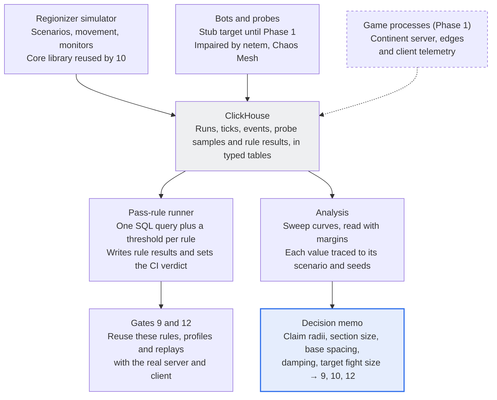

# Pre-Phase 1 Spec — Regionizer Simulator and Test Harness

Oct 2, 2026 · @Nicholas Bonilla

Pre-Phase 1 builds two things before any game code: an offline regionizer simulator, and the test harness every later gate measures through. It ends with a decision memo that sets claim radius per class, section size, minimum base spacing, split damping and the target fight size. The regionizer core written here is the same library that sub-spec 10 later runs inside the continent server.

## Exit criteria

Pre-Phase 1 is done when all of these hold:

- [ ] The regionizer core library implements the four invariants, merge, split, damping and timer handling, with unit tests, and needs no changes for reuse in sub-spec 10.
- [ ] Every scenario is deterministic: the same seed gives the same per-tick state hash on the fixed runner class.
- [ ] Invariant monitors report zero violations across a 24-hour simulated soak in interleaved scheduling mode.
- [ ] The portal validator finds every leak seeded into the test maps.
- [ ] Sweep results sit in ClickHouse, and the decision memo recommends a value for each row in Values it sets.
- [ ] Regionizer bookkeeping cost at 5,000 entities is measured against its budget.
- [ ] The harness comes up locally on kind or k3d and in CI with one command.
- [ ] Each network profile is calibrated: measured round trip, jitter and loss match the profile within tolerance.
- [ ] A pass rule written as SQL plus a threshold can fail CI, and a failing run keeps its seed, inputs and manifest.

## At a glance

<!-- Diagram converted from Claude Docs widget "measurement path · 3 sources, 1 store, 2 readers, 2 hand-offs" -->
**Every run lands in one store; rules and the decision memo both read from it**\
Pre-Phase 1 data flow; the dashed source joins in Phase 1



Operational logs and traces take a separate path through the OpenTelemetry Collector, with metrics in Prometheus; the picture shows only the measurement path.

## Sub-spec 1: Regionizer simulator

The simulator answers one question: how large may claims be, and how far apart must fights sit, before separate fights fuse into one region. It drives the real regionizer core with synthetic movement and records what the regions do.

### Values it sets

| Value | How the simulator sets it | Used by |
| --- | --- | --- |
| Claim radius per class | Game design sets the floor (interaction range plus movement margin); the sweep shows what each extra metre costs | 10 |
| Section size | Smallest power of two whose bookkeeping cost fits the budget, traded against merge slack | 10 |
| Claim anchoring | Section-anchored or position-anchored claims, chosen by cost and slack | 10 |
| Merge gap | 0 or 1 section; 0 only if rule 2 holds at every tick boundary under the fastest movement in interleaved mode | 10 |
| Minimum base spacing | Smallest spacing at which neighbouring fights stay separate at the chosen radii | Level design |
| Lane bridging limit | Lane traffic at which travellers chain two fights into one region | Level and spawn design |
| Split damping | Thresholds with the least churn that still split finished fights promptly | 10 |
| Air layer | Whether aircraft above a set altitude use their own section layer | 10 |
| Target fight size | p99 of the largest region's player count in the baseline scenario | 9, 11, 12 |

Out of scope: physics, networking, real level geometry, gameplay tick cost and multithreading. The simulator models where entities are and what they claim, not what they do.

The regionizer is written from Folia's published docs, never its source, and the code's design notes record every source.

### Regionizer model

The model follows [Folia's region logic](https://docs.papermc.io/folia/reference/region-logic/), with entity claims in place of chunk holders and per-class radii in place of one merge radius. It keeps the four v2 invariants and Folia's four region states: transient, ready, ticking and dead.

- **Sections.** Square tiles of side *s* metres, *s* a power of two, keyed by layer and grid position. Layer 0 is the open world; each sealed designed area gets its own layer, so a fight underground and one above it can sit in separate regions. An entity changes layer only by passing through a portal, so no per-move geometry test is needed. Each section keeps a claim count, and a section its region owns at zero claims is dead.
- **Claims.** Each entity claims the sections within its class radius, reached from its own section without crossing a closed portal. Active capture points claim their zone while occupied; heavy projectiles claim nothing.
- **Claim anchoring.** Both modes are built and compared. Section-anchored claims are computed from the entity's section, so they change only when it crosses a section edge. Position-anchored claims follow the exact position, which is tighter but updates more often.
- **Merge.** A claim landing on another region's section forces a merge. A swept merge gap of zero or one section plays the role of Folia's merge radius. Gap 0 stays the default only if rule 2 holds at every tick boundary under the fastest movement in interleaved mode; otherwise the default becomes 1.
- **Ticking regions.** A ticking region never grows, so sections it newly needs go into a transient region. As in Folia's merge-later logic, the transient side is recorded on the ticking region and absorbed when its tick ends.
- **Tick end.** In Folia's order: process pending merges; if the region still owes a merge elsewhere, mark it transient; otherwise drop dead sections and try a split.
- **Split damping.** A region may split only once it owns at least *N*min sections, at least *p*dead of them are dead, and it is older than *T*min. The first two mirror Folia's recalculation count and max dead section percent.
- **Islands.** Groups of entities linked by claims that touch under the merge gap: claims sharing a section, or at gap 1 also claims in sections that share an edge or a corner (constitution, Glossary). Each island becomes a child region, which keeps the split rule consistent with the merge rule.
- **Callbacks.** Merge concatenates entity lists and timers; split hands each entity to the child that owns its section.
- **Timers.** Gameplay timers use absolute deadlines on the continent time base (recommended), so merges need no offsets and a region that drops to 20 Hz doesn't stretch them. The simulator also implements v2's per-region tick counters, with merge offsets and split copies, for comparison.
- **Scheduling modes.** Lockstep mode ticks every region together, for fast sweeps. Interleaved mode starts and ends region ticks in a seeded random order, with random drops to 20 Hz, so merges against ticking regions and diverging counters actually happen. Interleaved mode is the seeded single-threaded scheduling mode v2 asks for.

Proposed budget: regionizer bookkeeping under 1 ms p99 per tick at 5,000 entities, single-threaded, revised after the first measurement. Serialized regionizer work is measured separately, because it limits parallel scaling more than total cost does.

### Movement and scenarios

Movement is synthetic and deliberately simple, because the simulator needs positions, not gameplay. The default map is 8 × 8 km, PlanetSide 2's continent area, with three lanes, until level design supplies real maps. At 5,000 players that is about 78 players per km², against about 31 at PlanetSide 2's 2,000-player cap, so map size is swept too.

| Class | Movement model | Speed ceiling (placeholder) |
| --- | --- | --- |
| Infantry | Clustered around a fight's objectives with a random walk; some redeploy by teleport | 7 m/s |
| Ground vehicle | Along lanes between fights, loitering at fight edges | 30 m/s |
| Aircraft | Point to point between fights, with strafing passes over them | 120 m/s |
| Traveller | Infantry or vehicles moving along a lane between bases | Class ceiling |
| Capture point | Static; claims its zone while occupied | 0 |

Game design replaces the speed ceilings, which also set the claim-radius floor. Results rescale through the floor formula, so placeholder speeds don't block the sweep. The simulator can also replay recorded position traces, so Phase 1 bot runs and later live telemetry can re-check the chosen values.

| Scenario | Setup | Measures |
| --- | --- | --- |
| Baseline | Fights of 1,200, 800, 800, 500, 400, 300 and 300 players, plus 700 travellers and aircraft | Region count, largest region, target fight size |
| Spacing | Two fights at neighbouring bases, spacing stepped | Minimum base spacing |
| Lane traffic | Two fights joined by one lane, traffic stepped | Lane bridging limit |
| Air traffic | Baseline with aircraft count stepped, with and without an air layer | Bridging and churn from aircraft |
| Vehicle columns | Armour columns driving between fights | Bridging by vehicles |
| Stacked areas | An underground fight beneath a surface fight, doors opening and closing | Portal correctness; merges and splits on door events |
| Migration | Fights move base to base along lanes, with Instant Action teleports | Split latency, churn, timers |
| One base | All 5,000 players at one base | Bookkeeping cost with one giant region |
| Soak | Migration, stacked areas and air traffic for 24 simulated hours, interleaved mode | Invariants and timers under long churn |

### Sweeps

| Parameter | Starting range |
| --- | --- |
| Section size | 8, 16, 32 and 64 m |
| Claim anchoring | Section or position |
| Infantry claim radius | 8–40 m in 4 m steps |
| Ground vehicle claim radius | 8–48 m in 8 m steps |
| Aircraft claim radius | 8–32 m in 8 m steps |
| Merge gap | 0 or 1 section |
| Split damping (*N*min, *p*dead, *T*min) | 8–256 sections; 10–50%; 0–10 s |
| Base spacing (Spacing scenario) | 100–1,000 m in 50 m steps |
| Lane traffic (Lane traffic scenario) | 10–200 travellers per lane |
| Seeds | 10 per cell |
| Map size (secondary) | 6, 8 and 10 km per side |

A full grid is too large, so each parameter is swept alone around a default point, then a full grid runs near the chosen values. Runs are independent and spread across cores and machines. Each run covers 10 simulated minutes at 30 Hz (18,000 ticks) unless its scenario says otherwise.

### Metrics

Every run writes these per tick, and the run summary keeps p50, p95, p99 and max.

| Metric | Definition |
| --- | --- |
| Region count | Regions holding at least one player |
| Largest region size and share | Players in the largest region, and that count over all players |
| Fusion events | Merges joining two fights the scenario tags as separate, with the class of the entity whose claim caused it |
| Merge and split rate | Per second, each merge attributed to the class that caused it |
| Split latency | Ticks from a region first holding two islands to the split that separates them |
| Section churn | Sections changing owner per tick |
| Region lifetime | Age of each region when it dies |
| Cross-region pairs | Entity pairs within deferred or read-only range but in different regions; a proxy for message volume |
| Bookkeeping cost | Wall-clock time of regionizer work per tick |
| Oversized fusions | Ticks in which a fused region exceeds the target fight size |

### Invariant monitors

Monitors run every tick in test builds, and any violation fails the run at that tick.

- Rule 1: every live section belongs to exactly one region.
- Rule 2: at each region's tick boundary, every section in an entity's claim belongs to its region, or to a region pending a merge with it.
- Rule 3: a ticking region's section set does not change during its tick.
- Rule 4: every region is transient, ready, ticking or dead. Legal moves are transient to ready, ready to ticking or transient, ticking to ready or transient, and any non-ticking region to dead.
- Every entity has at most one owner, and has none only while a two-step teleport is in flight; an owned entity's section belongs to its owner (constitution, reconciliation 6).
- No claim crosses an area boundary except through an open portal.
- Every synthetic timer fires once and never early: with continent-time deadlines, at the first tick at or past its deadline, an overdue timer firing at the merged region's next tick (constitution, Scheduling and time); with the comparison mode's per-region tick counters, after exactly its relative delay in ticks.

### Portal validation

The validator is a standalone tool, so level designers can run it on any map. A map gives each layer a section grid with area tags, portals as edges between sections, and the navigable adjacency between sections. Navigable adjacency is hand-authored for test maps now, and later comes from the level editor's navmesh export.

1. Leaks: every navigable adjacency across an area or layer boundary must be a declared portal. Openings that allow instant interactions without walking through, such as windows, are tagged and checked the same way.
2. Dead portals: every portal must join two navigable sections.
3. Policies: every portal declares what may cross while it is closed: entity transfers, door and objective events, deferred projectiles.
4. Sealing: with all portals closed, no claim can reach from a sealed area into any other area.

Test maps carry seeded leaks, and the validator must find every one.

### Reading the results

Each value is read off one scenario's curve with a margin, and three analytic checks catch a simulator that disagrees with arithmetic. The decision memo records each value with its curve, margin and seeds, so anyone can re-run it.

- **Claim radius per class.** Start at the floor below, then read Baseline's region count against radius. Past the radius where region count collapses, fights fuse, so the chosen radius stays below it with margin.
- **Minimum base spacing.** The smallest spacing at which a fused region exceeds the target fight size in under 1% of ticks (proposed) in the Spacing scenario, plus room for fights to sprawl. Fusing two small fights is harmless; fusing two large ones is what costs tick time.
- **Section size and anchoring.** The smallest section size whose bookkeeping fits the budget in Baseline and One base, after checking its merge slack against the spacing it forces. Anchoring modes are compared at equal bookkeeping cost, for example position-anchored claims at 16 m against section-anchored claims at 8 m.
- **Split damping.** The thresholds with the lowest merge-plus-split rate that keep split latency under 5 s (proposed).
- **Air layer.** Adopted only if overflight churn proves costly and the layer cuts it without adding fusion events. An air layer breaks the portal-only rule for layer changes, so it needs an altitude threshold with hysteresis.
- **Target fight size.** The p99 of the largest region in Baseline at the chosen values; the Phase 1 sweep (9) measures this size first.

The claim-radius floor, where Δt is the longest tick a region may run (50 ms at 20 Hz; constitution, reconciliation 17):

```latex
r_{\min} = d_{\text{interact}} + v_{\text{rel,max}} \, \Delta t
```

Two aircraft closing at 240 m/s cover 12 m in one 20 Hz tick, so their floor sits 12 m above their interaction range.

Merge distance: two entities always share a region within the sum of their radii, and may share one up to the distance below. Here k is 3 for section-anchored claims and 1 for position-anchored claims.

```latex
d_{\max} = r_A + r_B + k\sqrt{2}\,s
```

At s = 16 m, the slack is about 68 m for section-anchored claims and 23 m for position-anchored ones. A one-section merge gap adds up to another √2 × s.

Lane bridging: with travellers spread at random at λ per metre along a lane of length ℓ, the lane chains two fights when every gap is under the merge distance d.

```latex
P_{\text{bridge}} \approx \left(1 - e^{-\lambda d}\right)^{\lambda \ell + 1}
```

On a 600 m lane with d = 30 m, that is 0.04% at 30 travellers, 4% at 60 and 74% at 120. Real traffic is clumpier than random, so the Lane traffic scenario's measured curve replaces this estimate. The steep jump is why lane traffic needs a design limit rather than a tuning knob.

## Sub-spec 2: Telemetry and test harness

The harness turns every run into rows in ClickHouse and every test into a SQL query with a threshold. It comes up the same way on a laptop and in CI.

### Components

| Component | Role | License |
| --- | --- | --- |
| ClickHouse | Store of record for run manifests, test events, simulator results and rule results | Apache 2.0 |
| OpenTelemetry Collector (contrib) | Receives OTLP from every process; logs and traces go to ClickHouse, metrics to Prometheus | Apache 2.0 |
| Prometheus | Live metrics and alerts during long runs | Apache 2.0 |
| Grafana | Dashboards; runs unmodified as a separate service | AGPLv3 |
| Chaos Mesh | Network impairment inside Kubernetes | Apache 2.0 |
| tc netem | Network impairment on a single machine | Linux kernel |
| Bot host | Runs headless bots; a stub target stands in for the game until Phase 1 | Ours |
| Pass-rule runner | Runs SQL rules after each run and sets the CI verdict | Ours |
| Replay viewer | Draws sections by region, claims, portals and entities for any tick of a recorded run | Ours |

Data takes two paths. Operational telemetry (logs, traces, low-rate metrics) goes through the Collector. The [ClickHouse exporter](https://pkg.go.dev/github.com/open-telemetry/opentelemetry-collector-contrib/exporter/clickhouseexporter) is beta for logs and traces but alpha for metrics, so metrics go to Prometheus.

Test data (rows per tick, per frame or per hit claim) skips OTLP and goes straight into typed ClickHouse tables in batches, through the HTTP client in ClickHouse's official C# package, ClickHouse.Driver. Its native TCP client is experimental, so it is considered only if insert throughput limits. The exporter's docs relay ClickHouse's advice to insert at least 5,000 rows per batch, or at most one insert per second. In CI, processes may write local files that load at run end, so a slow database never perturbs a measurement.

### Local environment

One command brings up a kind or k3d cluster with ClickHouse, the Collector, Prometheus, Grafana and Chaos Mesh, and CI applies the same manifests. This moves the local cluster from sub-spec 15 into Pre-Phase 1, as the breakdown flagged. The simulator runs as a plain process or a Kubernetes Job, and sweeps fan out as Jobs.

- Schemas live in the repo as DDL; the exporter runs with `create_schema: false`, as its docs recommend for production.
- CI has one fixed runner class, a single CPU model, for replay and benchmark jobs; other jobs run anywhere.
- Grafana reads Prometheus for live runs and ClickHouse for history, with dashboards kept in the repo. Prometheus and Grafana are optional profiles, so the laptop stack stays light.

### Data model

| Table | One row per | Main columns |
| --- | --- | --- |
| runs | Run | run\_id, kind, git SHA, config hash, scenario, seed, profile, runner class, start, end, verdict |
| sim\_ticks | Simulator tick | run\_id, tick, region count, largest region size, section churn, bookkeeping µs |
| sim\_events | Merge, split, fusion or violation | run\_id, tick, type, region IDs, causing class |
| net\_samples | Probe packet | run\_id, probe\_id, direction, sequence number, send and receive timestamps |
| bot\_frames | Bot frame (filled from Phase 1) | run\_id, bot\_id, frame, correction distance, snap, underrun, remote position error |
| rule\_results | Rule per run | run\_id, rule\_id, value, threshold, sample count, passed |
| baselines | Rule per profile | rule\_id, profile, value, source run\_id, set at |

All tables use MergeTree, ordered by run\_id then tick or frame. Raw rows expire after 14 days (proposed); at run end, rows from failing and golden runs are copied to retained tables. Per-run aggregates, the percentiles each rule reads, are kept indefinitely for trend lines.

### Pass rules

A rule is a file in the repo: an ID, the run kinds it applies to, a SQL query, and either a fixed threshold or a baseline. The runner executes every matching rule after a run, writes each result to rule\_results and sets the CI verdict.

```yaml
id: bot.correction_p99
applies_to: [bot]
min_samples: 100000
query: |
  SELECT quantile(0.99)(correction_m), count()
  FROM bot_frames WHERE run_id = {run_id:String}
mode: baseline
max_regression: 10%
```

- **Fixed mode** compares against a threshold in the file, such as zero invariant violations.
- **Baseline mode** only reports until gate 9 records a baseline, then fails when a run is worse than the baseline by more than the allowed regression. This is how v2's “from baseline” rules work.
- **Baselines** change only through a reviewed commit that names the source run, never automatically.
- **Sample floors.** A statistical rule states its minimum sample count. A run below it is inconclusive and fails as a broken test, instead of passing quietly.

### Network profiles and calibration

Profiles are named, versioned settings, and each is calibrated by measurement before any run trusts it. The values are v2's starting points.

| Profile | Round trip | Jitter | Loss |
| --- | --- | --- | --- |
| LAN | 1 ms | 0 ms | 0% |
| Typical | 80 ms | 10 ms | 0.5% |
| Cross-region | 160 ms | 25 ms | 1% |
| Poor | 250 ms | 50 ms | 3% |

This spec fixes the definitions v2 leaves open. Round trip is the median; jitter is the standard deviation of round-trip time; loss is per packet in each direction. Reordering is off by default, and a separate variant of each profile adds it for robustness runs, which run nightly rather than on every commit. Calibration also records RFC 3550 interarrival jitter, so profiles can be compared with real-player telemetry later.

Implementation follows the [tc-netem manual](https://man7.org/linux/man-pages/man8/tc-netem.8.html):

- netem delays packets as they leave an interface, so round trip and jitter split across both directions. Per-direction settings come from calibration, not arithmetic.
- netem reorders packets when jitter is large, because its internal queue orders packets by send time. Profiles without reordering add a plain FIFO child queue, as the manual shows.
- netem's seed option makes random loss reproducible, so impaired runs can be replayed.
- For TCP runs, such as the WebSocket fallback, netem sits on the receiver's ingress, which the manual requires for realistic TCP results.

Inside Kubernetes, [Chaos Mesh's NetworkChaos](https://chaos-mesh.org/docs/simulate-network-chaos-on-kubernetes/) applies the same delay, loss and reordering per pod, with direction set to to, from or both. Its nodes need the kernel's netem module.

Calibration runs a probe pair that exchanges sequenced UDP packets at 30 Hz for 5 minutes per profile, writing every packet to net\_samples. A profile passes when median round trip and jitter land within 10% of target (LAN within 0.5 ms), loss within 0.25 percentage points per direction, and reordering at zero unless allowed. These tolerances are proposed; the calibrated settings are stored with the profile and re-run whenever the runner class or kernel changes.

### Bot scaffolding

Bots exist before the game does, so the measurement path is proven before Phase 1 depends on it.

- **Bot host.** A .NET process running many headless bots, each on a fixed 60 Hz frame loop, writing one row per frame in batches.
- **Stub target.** A small C# server that sends fake 30 Hz snapshots and echoes inputs, so bots, impairment and pass rules run end to end.
- **Host health.** Each host records its own frame-deadline misses. Rows from a host that misses deadlines are invalid, and the run fails as inconclusive.
- **Phase 1 swap.** The real continent server replaces the stub, and the real client netcode replaces the bots' stub logic. A few real browser clients, driven by Playwright, join each load run to catch browser-only behavior.

v2 requires bots to run the real client netcode. That is cheapest if decoding, delta application, interpolation and prediction live in the shared C# core, so bots run it natively; see Proposed changes.

### Replay and determinism

Every run can be reproduced from its manifest, and CI proves it by replaying golden runs and comparing state hashes tick by tick.

- **Manifest.** Each run records git SHA, build flags, config, scenario, seed, network profile, runner class and the runtime's hardware-intrinsic settings in the runs table.
- **Inputs.** The simulator's only inputs are its seed and scenario file. From Phase 1, the server also records each tick's inputs, so the same mechanism replays game runs.
- **Randomness.** One PRNG implemented in our own code, seeded per run and split into named streams for movement, scheduling and timers. A .NET upgrade can't change the sequences, and a new random draw in one system can't shift another.
- **Ordering.** Entities and regions iterate in ID order, and no regionizer or gameplay code iterates an unordered collection, as v2's determinism rules require.
- **State hash.** Each tick hashes a canonical serialization of section owners, region membership and timers with a stable 64-bit hash, such as XxHash64 from System.IO.Hashing.
- **Golden runs.** A fixed set of recorded runs stores per-tick hashes. CI replays them and reports the first divergent tick with a state diff, not just a final mismatch.
- **Vector width.** Replays run on the fixed runner class, with hardware-intrinsic settings pinned by environment variables before the process starts, as the [.NET vectorization guidelines](https://github.com/dotnet/runtime/blob/8323e58d7b587deceb7ef39e61725bce7bfe86f8/docs/coding-guidelines/vectorization-guidelines.md) describe for DOTNET\_EnableAVX2. The simulator is mostly integer section math, so this matters more once physics arrives in Phase 1.
- **Impaired runs** are statistical, not replayable tick for tick. Recording netem's seed makes their loss pattern repeatable, but delay jitter is not seeded.

A failing run keeps its manifest, seed and inputs in the retained tables and as CI artifacts.

## Build order

The simulator's core comes first because everything else measures it; steps 7 and 8 don't depend on it and can run alongside steps 3–6.

1. Repo, CI with the fixed runner class, and the one-command local cluster.
2. Regionizer core library, with unit tests for the four invariants, merge, merge-later, split, damping and timer handling.
3. Simulator loop, movement models and the Baseline scenario in lockstep mode, writing local files.
4. ClickHouse schemas, run manifests and the pass-rule runner; simulator results load into ClickHouse.
5. Invariant monitors and interleaved scheduling, then the 24-hour soak.
6. Remaining scenarios, sweeps and the replay viewer.
7. Portal map format and validator, with seeded-leak test maps.
8. Probe pair, network profiles and calibration; bot host with the stub target.
9. Golden runs and determinism checks in CI.
10. Analysis and the decision memo.

## Proposed changes to the v2 spec

Six changes, each with the case for and against and a recommendation. The spec's body follows every recommendation. Agents decide each change under the constitution's Governance, Roadmap decisions, before the first feature of any sub-spec it affects is specified; the Decision column records it.

| Change | For | Against | Recommendation | Affects | Decision |
| --- | --- | --- | --- | --- | --- |
| Sections are keyed by layer and grid position | A sealed fight beneath a surface fight can be its own region; portals become explicit edges between layers | Every section key and lookup carries a layer; level design must author sealed areas as layers; open multi-story spaces still share one layer | Adopt, with layers only for sealed areas and layer changes only through portals, so no per-move geometry test | 10, level design | Pending |
| “Claims touch” means sharing a section, with an optional one-section gap; split islands use the same rule | A precise, testable rule, and splits can't create regions that must immediately re-merge | Gap 0 relies on the claim radius's movement margin being right; gap 1 is safer but merges more, costing parallelism | Adopt with the gap swept; keep gap 0 only if rule 2 holds under the fastest movement in interleaved mode | 10 | Partly (constitution 1.0.0: the merge gap, 0 or 1 section, set by the decision memo) |
| Claims cross area boundaries only through open portals | Walls separate areas without a portal per wall, and claims can't leak through solid geometry | Correctness depends on area tagging; an untagged opening that allows instant interactions would wrongly separate regions | Adopt, and extend the leak check to interaction openings such as windows | 10, level design | Pending |
| Client netcode lives in the shared C# core | Bots run the real client netcode natively | Bigger browser download and a younger .NET-in-Worker path, weighed in the Phase 1 spec | Adopted in the Phase 1 spec, with a generated TypeScript decoder as the fallback | 3, 8 | Pending |
| The local Kubernetes cluster moves from 15 into 2 | Chaos Mesh needs Kubernetes, and laptop and CI run the same manifests | Kubernetes overhead early and a heavy laptop stack, though the simulator itself doesn't need it | Adopt; the simulator stays runnable as a plain process, and Prometheus and Grafana become optional profiles | 2, 15 | Partly (constitution 1.0.0: from sub-spec 8, playable Dev builds run on the local kind or k3d stack until Dev is hosted) |
| Network profiles get definitions and reordering variants | Calibration has an exact target, and results compare across runs | Our definitions may not match real-player telemetry, and variants double run time | Adopt; also record RFC 3550 jitter, and run reordering variants nightly | 2, 9 | Pending |

## Open questions

Seven questions are open, one is partly decided and two are decided by the constitution, each with its trade-off and a recommendation. The spec's body follows the recommendations. Agents answer each remaining question under the constitution's Governance, Roadmap decisions, before the first feature of any sub-spec it affects is specified, and record the answer in its Status cell.

| Question | Status | Trade-off | Recommendation |
| --- | --- | --- | --- |
| Default map size and lane layout | Open | Larger maps separate fights but add travel, lane traffic and content; at 5,000 players, 8 × 8 km is about 2.5 times PlanetSide 2's density | Keep 8 × 8 km with three lanes as the default, and sweep 6 and 10 km to measure sensitivity |
| Interaction ranges and speed ceilings per class | Open | Placeholders unblock the sweep but risk tuning radii to wrong numbers; waiting stalls the simulator | Use explicit placeholders now, since results rescale through the floor formula; lock real values before sub-spec 10 |
| Claim anchoring: section or position | Open | Section-anchored is cheapest but has up to 3√2 × s of slack; position-anchored is tighter but updates more often | Compare at equal bookkeeping cost, such as position at 16 m against section at 8 m, and pick the lower fusion rate |
| Air layer for aircraft | Open | Cuts overflight churn, but breaks the portal-only rule for layer changes and needs altitude hysteresis | Measure overflight churn first; adopt only if it proves costly |
| Timers in ticks or continent time when a region drops to 20 Hz | Decided (constitution 1.0.0): timer deadlines are kept in game time on the continent time base, so a drop to 20 Hz stretches no timer (Scheduling and time; reconciliation 5) | Tick timers match Folia but stretch in degraded regions and need merge offsets; continent-time deadlines stay fair and need no offsets, firing at the first tick at or past the deadline | Absolute deadlines on the continent time base; the simulator keeps tick offsets only for comparison |
| Regionizer bookkeeping budget | Decided (constitution 1.0.0): 1 ms p99 per tick at 5,000 entities as the starting value, revised by measurement, with tick-end time reported as serialized regionizer time (Sections and regions) | A tight budget leaves headroom but costs design effort; serialized work limits parallel scaling more than total cost | Keep 1 ms p99 per tick at 5,000 entities, and measure the serialized part separately |
| Fusion threshold for base spacing | Open | A flat rate treats two small fights fusing like two large ones; a size-aware rule spaces bases only where it matters | Count only fusions whose region exceeds the target fight size, kept under 1% of ticks |
| .NET ClickHouse client | Open | ClickHouse's official ClickHouse.Driver is maintained, but its faster native TCP client is experimental; raw HTTP avoids a dependency but means writing our own encoding | The official HTTP client with batched inserts, after confirming its license; the TCP client only if throughput limits |
| Bot runtime | Partly decided (constitution 1.0.0: headless bots run the real client netcode; Validation program) | Native .NET bots are cheapest and run the shared core directly, but skip browser-only paths; Node with WebAssembly is closer to a browser but heavier per bot | Native .NET bots for load, plus a few Playwright browser clients in each run |
| Raw data retention | Open | Longer keeps history for late investigations at a large storage cost; shorter is cheap but loses context | 14 days for raw rows, failing and golden runs kept, and per-run aggregates kept indefinitely |

## Sources

- PS2-Style MMOFPS Server Architecture Spec v2 (Oct 2, 2026), and the sub-spec breakdown: PS2-Style MMOFPS — Sub-spec Breakdown
- [Folia: Region logic](https://docs.papermc.io/folia/reference/region-logic/), PaperMC Docs
- [OpenTelemetry Collector ClickHouse exporter](https://pkg.go.dev/github.com/open-telemetry/opentelemetry-collector-contrib/exporter/clickhouseexporter), v0.161.0 (Sep 15, 2026)
- [tc-netem(8)](https://man7.org/linux/man-pages/man8/tc-netem.8.html), Linux manual page
- [Chaos Mesh: Simulate Network Faults](https://chaos-mesh.org/docs/simulate-network-chaos-on-kubernetes/), version 2.8.4
- [.NET runtime vectorization guidelines](https://github.com/dotnet/runtime/blob/8323e58d7b587deceb7ef39e61725bce7bfe86f8/docs/coding-guidelines/vectorization-guidelines.md)
- [ClickHouse C# clients](https://clickhouse.com/docs/integrations/language-clients/csharp/overview), ClickHouse docs
