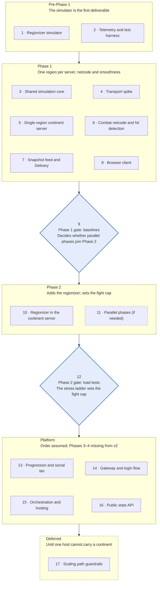

# PS2-Style MMOFPS — Sub-spec Breakdown

Oct 2, 2026 · @Nicholas Bonilla

The Server Architecture Spec v2 breaks into 17 sub-specs in five stages, numbered in build order. The order follows the roadmap's gates where the spec defines them, and dependencies after that. Each entry gives scope only; detail comes when each one is specified.

The spec says to copy Phases 3–4 from the Sep 30 version, but v2 doesn't include them, so the Platform order (13–16) is assumed.

## Sequence at a glance

<!-- Diagram converted from Claude Docs widget "build order · 5 stages, 17 sub-specs, 2 gates" -->
**Simulator first; Phases 1 and 2 each end in a measurement gate**\
17 sub-specs by roadmap stage, numbered in build order

Accent diamonds are the two measurement gates; dashed outlines mark work that is conditional (11) or deferred (17).

## Pre-Phase 1

The simulator sets the map's numbers, and the harness gives every later gate a way to measure.

### 1. Regionizer simulator

An offline tool that lays bases along lanes and places fights, aircraft and stragglers between them. It runs the regionizer every tick across a range of claim radii, and validates each map's portal graph.

Depends on nothing. Outputs the claim radius per class, section size, minimum base spacing and target fight size.

### 2. Telemetry and test harness

ClickHouse for events and test metrics, OpenTelemetry and Prometheus for live metrics, and headless bot scaffolding. It defines the named network profiles (tc netem locally, Chaos Mesh in Kubernetes). It also sets up the pass-rule framework, where each test is a SQL query with a threshold.

Depends on nothing. Failing runs keep their seed and inputs for replay.

## Phase 1

Phase 1 proves netcode and smoothness on one region per server, and ends at a baseline gate.

### 3. Shared simulation core

The C# library holding the movement step, character collision against terrain and static meshes, weapon timing, and the input, command and collision-data formats. It carries the determinism rules and builds for .NET and WebAssembly. It also picks vehicle physics: BepuPhysics2 by default, deterministic Jolt as the fallback.

Depends on nothing. Answers the open question on WebAssembly speed and download size.

### 4. Transport spike

Picks Rust or Go for the edge's transport component by testing WebTransport datagrams on Chrome, Firefox and Safari 26.4+. It also covers reliable streams, the WebSocket fallback with runtime detection, and pinned certificates for local development.

Depends on nothing. Settles the transport-language question.

### 5. Single-region continent server

The 30 Hz tick loop, with struct-of-arrays storage and no per-tick allocation in gameplay code. Each tick keeps pose history, publishes an immutable snapshot and emits a state hash for deterministic replay.

Depends on 2 and 3.

### 6. Combat netcode and hit detection

Client prediction and reconciliation, plus the hit-claim flow: claim, forward, replay against pose history, apply, confirm. Its rules are the rewind cap, staleness-scaled tolerance, the sent-entity check and the spread-seed rule. Heavy projectiles stay server-simulated, and every claim is logged to ClickHouse.

Depends on 3 and 5; the sent-entity check also needs 7. Owns the rewind cap, set from measured pings.

### 7. Snapshot feed and Delivery

The feed format: snapshot deltas plus each tick's damage, fire, squad and portal events, over a direct link. On the edge, Delivery builds each view from the cell grid, distance tiers, attention set and priority scoring. Staleness limits, crowd summaries, fire events, delta encoding and the per-client byte budget complete it.

Depends on 4 and 5. Runs as a separate process on the continent host in Phase 1; its tuning values are set in 12.

### 8. Browser client

Babylon.js on WebGPU with a WebGL2 fallback, soldiers as baked-animation instances, and LODs then impostors with distance. It budgets particles, decals and audio voices, and warms shaders during loading. Network decoding and interpolation run in a Worker behind COOP and COEP headers.

Depends on 3, 4 and 7.

### 9. Phase 1 gate: baselines

The tick-time sweep, measuring per-player movement cost first, plus smoothness baselines for each network profile. It also brings up invariant monitors, golden replays, server-versus-WebAssembly agreement and the frame-time test with 1,000 bots.

Depends on 2 through 8. Sets the “from baseline” thresholds and decides whether parallel phases (11) join Phase 2.

## Phase 2

Phase 2 adds the regionizer and ends with load tests that set the fight cap.

### 10. Regionizer in the continent server

Sections and regions under the four invariants, with merge, split, damping and data callbacks. It adds portals, the earliest-first tick scheduler, per-region timers, the global region and area actors. Cross-region work runs through the entity, location and global queues, including the two-step teleport and heavy-projectile handoff.

Depends on 1, 5 and 9. Works with level design on which bases get designed boundaries and which portals players can open.

### 11. Parallel phases (if needed)

Spreads a busy region's tick across the pool in five phases: movement, shots, effects, apply and gameplay. Each phase has one writer per entity, and phases switch on above a threshold on region size or single-thread tick time, and off with hysteresis (constitution, reconciliation 24).

Depends on 9's verdict and on 10.

### 12. Phase 2 gate: load tests and fight cap

The tick-time curve, then the stress ladder: 1,000, 2,000, 3,000 and 5,000 bots on one base. Door tests and a soak test check merges, splits and timers. The same runs tune attention-set size, hold time and the staleness limit.

Depends on 10, and on 11 if built. Sets the largest fight size: the highest step that holds 30 Hz or degrades cleanly to 20 Hz.

## Platform

These four follow Phase 2 in an assumed order, since the spec's Phases 3–4 aren't in v2.

### 13. Progression and social tier

One ASP.NET Core service over PostgreSQL, with one owner class per player and per outfit, shaped for a later move to Orleans grains. It covers the write policy, concurrency tokens, trades as one SQL transaction, and the per-continent stats batcher.

Depends on 5 for its event source. Settles Nakama versus custom grains for friends, groups and chat, through a MINOR amendment.

### 14. Gateway and login flow

TLS, routing, token validation, per-player rate limits and chat WebSockets, on ASP.NET Core middleware first and YARP once several services exist. It owns login and first deploy, from sign-in to a one-time join token checked at the edge, plus chat and presence.

Depends on 7 and 13.

### 15. Orchestration and hosting

The Agones fleet with one continent per dedicated node, exclusive cores, NUMA placement and quiet tick cores. It covers continent open, lock and failure through the World owner, edge-node networking, and local clusters on kind or k3d.

Depends on 10, 13 and 14.

### 16. Public stats API

Its own ASP.NET Core service with self-serve hashed API keys, per-key rate limits and CDN caching. Reads hit ClickHouse aggregates or a read replica with hard timeouts, and a separate service streams live kills and captures.

Depends on 2, 13 and 14.

## Deferred

### 17. Scaling path guardrails

Keeps the five multi-server invariants intact from Phase 1 on: at most one authority per entity, stable IDs, worker-independent sessions, message-only cross-region writes and one time base. The design work runs as the Phase 4 spec's stages, each only after the previous gate passes and its own trigger fires: identical shards and a partition coordinator (Stage A) once profiling shows one host can't carry a continent, then soft seams (Stage B) once the design needs fights bigger than the fight cap. Stages A and B also need the MINOR amendment that lifts the matching Non-goal (constitution, Principle XII).

Stage A starts from the Simulation Domains sub-spec.

## Ordering calls to revisit

Four places where the order is a judgment call rather than something the spec fixes:

- The harness (2) comes before any game code, because every later gate measures through it.
- Delivery (7) stays in Phase 1 as its own process, as “Requirements now” asks, though the roadmap describes Phase 1 as one region per server.
- 6 and 7 could swap: hit claims reach regions through the edge, and the sent-entity check needs Delivery's send records.
- The local cluster from 15 may need to move into 2, since the harness runs Chaos Mesh in Kubernetes.
